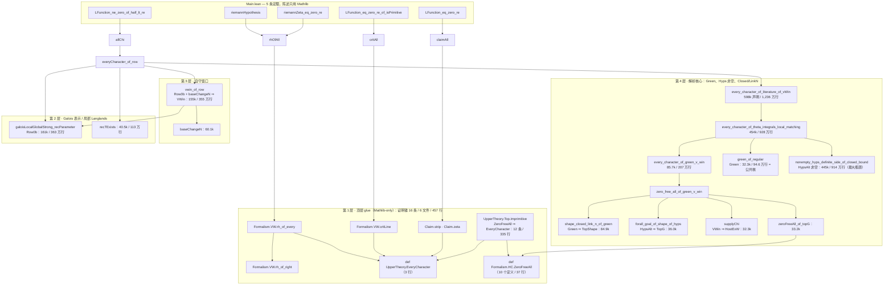

# SKELETON-graph — 主线骨架的静态依赖图（TASK.md 第 6 步 · "静态依赖图"部分）

> **汇总会话注（2026-11-23 02:30）**：本文件作为附录 C 原样保留，它的"陈述锥 / 证明锥"是 `SKELETON.md` 各表采用的口径，但有两处结论要按 `SKELETON.md` §3.3 修正后阅读：(1) **"公共核 = 32,207 条 = `green_of_regular` 的锥"是误配的产物**——`Formalism.BasicNotions.D7` 的定义体里的字段名（`Om`、`K`、`q`、`loc` …）被当成对别处同名声明的引用，给 `Green`、`HostExW`、`TopG`、`FamP` 等挂上了一棵约 3.2 万条的假子树；编译器实测 `Green` 的陈述锥是 16 条（本文给 3,127），去掉 `D7` 的出边后 `green_of_regular` 的锥是 64 条。受影响的还有 §3 的 `Green`/`VWin`/`ZeroFreeAll` 陈述锥和 §7 的"约 3,120 条基本词汇"。(2) 整条主线的证明锥 662,997 条是**上界**：另一种解析（汇总会话旧稿 `analysis/mainline_cone.py`，strict）给 223,420 条，是系统性漏算的**下界**；两版差在哪见 `SKELETON.md` §3.3 与 `analysis/conecheck.txt`。两法一致的结论（glue ≈ 0、最大瓶颈是 `nonempty_hyps_definite_side_of_closed_bound`、其次 Galois 表示/窗口/文献包）不受影响。正文与生成表（`analysis/mainline_graph.txt`/`.md`）差 1–2 条的地方（32,207 ↔ 32,205、118,718 ↔ 118,717）`SKELETON.md` 取生成表。

> 本文件只做 TASK.md 第 6 步里的**静态依赖图**：不编译，从源码文本解析主线定理的证明引用了哪些声明，算出每一层结论的近似依赖锥。命题文件（`def LayerN : Prop`）和衔接定理由另外两个会话在 `skeleton/` 里做，这里不涉及。
>
> 功劳与署名：证明的全部数学与 Lean 代码属于 **Levent Alpöge（与 Claude 合作）**；本文件只是对 `source/` 的文本做统计，没有新的数学。脚本与原始结果：`analysis/mainline_graph.py`、`analysis/mainline_graph.txt`（全表）、`analysis/mainline_graph.md`（表）、`analysis/mainline_graph.json`、`analysis/mainline_graph.files.txt`（各层锥内的文件清单，只列 ≤ 12,500 个文件的锥；`analysis/mainline_graph.json` 被 .gitignore 的 `analysis/*.json` 规则排除，可用脚本重新生成）。

## 0. 一页结论

1. **Main 的实际路径和 REPORT §1.3 有一处出入。** `Main.riemannHypothesis → rhOfAll → Formalism.VW.rh_of_every allChi`，`allChi = everyCharacter_of_row galoisLocalGlobalStrong_recParameter`。从这里往下，Main 走的是 `ThetaCorrespondence/ThetaPairLifts/ThirdPlaceSeries/TopPlug.lean` 的 **`HypsAlt … DefiniteSideCondition`** 版本（`every_character_of_theta_integrals_local_matching → every_character_of_green_v_win → zero_free_all_of_green_v_win → zeroFreeAll_of_topG`），不是 `CharacterBoxes/EveryCharacter.lean` 里的 `plugAll`（它的假设是 `Hyps N DRS`，Main 不经过它）。两条路在 `zeroFreeAll_of_topG` 汇合，只是"Hyps 非空"的命题不同（§1）。

2. **按声明级依赖算，Main 的证明锥是整库的四分之三**：66.3 万条声明 / 132,338 文件 / 1,363 万行（占全库 1,057,803 条的 63%、175,187 文件的 76%、1,737 万行的 78%）。import 闭包是 99.8%，所以声明级图只砍掉了四分之一的文件——这和 REPORT §1.4 的"import 图 ≠ 依赖锥"一致，但也说明主线的证明确实用了几乎全部库。

3. **每一层的锥**（证明锥 = 证明它所需的全部内部声明；陈述锥 = 只为了*写出*这个命题所需的定义）：

| 层 | 关键结论 | 陈述锥（定义 / 文件 / 声明行） | 证明锥（声明 / 文件 / 文件行） |
|---|---|---|---:|
| 1 顶层 glue | `EveryCharacter ⇒ RiemannHypothesis`（`rh_of_right`、`rh_of_every`、`critLine`、`riemannHypothesis_of_everyCharacter`、`Claim.strip/zeta`） | EveryCharacter：1 / 1 / **3** | **16 / 6 / 457** |
| 1′ | `imprimitive`：`ZeroFreeAll ⇒ EveryCharacter` | ZeroFreeAll：10 / 2 / **37** | **12 / 3 / 335** |
| 4 解析核心 | `green_of_regular : Green` | Green：3,127 / 596 / 19,259 | 32,254 / 5,381 / 945,849 |
| 2 局部 Langlands | `recTExists : RecTExists` | RecTExists：3,285 / 627 / 20,044 | 40,507 / 6,973 / 1,134,533 |
| 3 自守窗口 | `vwin_of_row : Row0b IsRecT ⇒ VWin` | VWin：134 / 37 / 781 | 155,440 / 29,675 / 3,549,032 |
| 2 Galois 表示 | `galoisLocalGlobalStrong_recParameter : Row0b recT` | Row0b：730 / 130 / 4,259 | 161,315 / 32,390 / 3,629,195 |
| 4 ZeroFreeAll 路 | `zero_free_all_of_green_v_win`（Green + VWin + HypsAlt 非空 ⇒ ZeroFreeAll） | HypsAlt：7,034 / 1,187 / 43,770 | 85,737 / 12,317 / 2,072,638 |
| 4 Hyps 非空 | `nonempty_hyps_definite_side_of_closed_bound` | — | **444,958 / 79,760 / 9,141,428** |
| 4 文献包 | `every_char_lit_vWin`：`OpenLiteratureStatements` 里 177 条"已发表定理"的证明 + 上面所有 | OpenLiteratureStatements：3,529 / 661 / 21,390 | 598,129 / 117,754 / 12,363,640 |
| — 整体 | `Main.riemannHypothesis` | — | 662,997 / 132,338 / 13,629,204 |

4. **最小的层**是第 1 层：16 条声明、6 个文件、457 行，全部只依赖 Mathlib（§2 的校验）。把 `imprimitive`（12 条 / 335 行）接上以后，整条"**只要 ZeroFreeAll 成立就推出 RH**"的链一共 28 条声明 / 9 个文件 / 792 行，而且两端命题 `EveryCharacter`、`ZeroFreeAll` 的陈述都只用 Mathlib 概念（分别 3 行和 37 行）。

5. **最大的瓶颈**是"Hyps 非空"这一步：`nonempty_hyps_definite_side_of_closed_bound` 一个定理的锥就有 44.5 万条声明 / 7.98 万文件 / 914 万行，占 Main 证明锥的 67%；按"在前面各层之上新增多少"算（§4 瀑布），它一项新增 32.1 万条声明 / 6.0 万文件 / 703 万行，占整条主线的 51%。其次是 Galois 表示层（新增 12.1 万 / 291 万行）、文献包（12.8 万 / 331 万行）、窗口层（5.3 万 / 135 万行）。

6. **真正的地板**：所有非 glue 的层共用同一个 **32,207 条声明 / 5,378 文件 / 94.5 万行** 的核（`green_of_regular` 的锥 99.8% 就是它；`recTExists` 的锥 80% 是它，而且整个被 Galois、窗口、Hyps、EveryCharacter 四层包含）。换句话说，`imprimitive` 以下**没有任何一条**定理能在不带这 3.2 万条声明的情况下单独抽出来；被引用最多的是 `Formalism.BasicNotions.D7`（锥内 89,950 条声明引用它，占 14%）。

7. **推荐"真抽出来"的一层：第 1 层的完整版 = glue + `imprimitive`**（§6）。理由：依赖锥最小（28 条 / 792 行，比第二小的层小三个数量级）；命题两端只用 Mathlib；`Top` 会话已经在做 glue 部分，本图说明把链再往下延长一环到 `ZeroFreeAll` 的边际代价只有 12 条声明 / 335 行。有数学内容的层里最小的是 `recTExists`（4.05 万条 / 113 万行）——抽不动；能抽的只有它的**陈述**（3,285 个定义 / 2 万行 / 627 文件），而且陈述锥最小的有内容命题是 `VWin`（134 个定义 / 781 行 / 37 文件）。

## 1. 主线骨架：从 Main.lean 往下的实际调用链

```
Main.lean（5 条定理，陈述只用 Mathlib）
  riemannHypothesis            := rhOfAll
  riemannZeta_eq_zero_re       := rhOfAll
  LFunction_ne_zero_of_half_lt_re := allChi
  LFunction_eq_zero_re         := claimAll.2.1
  LFunction_eq_zero_re_of_isPrimitive := critAll
Supplements/Kernels/MainTheorems.lean
  rhOfAll  : RiemannHypothesis   := Formalism.VW.rh_of_every allChi            (Mathlib-only)
  critAll  := Formalism.VW.critLine allChi …                                   (Mathlib-only)
  claimAll := ⟨allChi, Claim.strip allChi, Claim.zeta allChi⟩                  (Mathlib-only)
  allChi   : UpperTheory.EveryCharacter := UpperTheory.FinalTheorems.everyCharacter
CharacterBoxes/MainConclusion.lean
  everyCharacter := everyCharacter_of_row Gal.Int.galoisLocalGlobalStrong_recParameter
  everyCharacter_of_row (h : Row0b IsRecT) :=
    every_character_of_literature_of_vWin ⟨h, LLC.recTExists, h⟩ (One.vwin_of_row h)
AutomorphicVarieties/…/VwinOfRow.lean
  vwin_of_row h := Join.automorphic_window_of_inputs (OpenImageCondition.mk h) (baseChangeN h)   -- Row0b + baseChangeN ⇒ VWin
Foundations/GaloisRepresentations/IntegralStructures/RowSrc.lean
  galoisLocalGlobalStrong_recParameter := galoisRepresentations_of_thetaLift TP.K.tLiftK           -- ⇒ Row0b
Foundations/LocalLanglands/LocalCentralUnits/RecTExists.lean
  LLC.recTExists := artEx ∘ cuspEx ∘ exists_isLExt ∘ …                                            -- ⇒ RecTExists
ThetaPairLifts/ThirdPlaceSeries/EveryCharacterOfLiteratureOfVWin.lean (810 行)
  every_character_of_literature_of_vWin (O : OpenLiteratureStatements) (hV : VWin) :=
    every_character_of_theta_integrals_local_matching (published_results_eigen O) (published_results_first O) … hV
  └ 同一文件里 177 条 `X_of_literature (O) / X_of_open (O) : GlobalTheory.Published.X := <Development 里的证明>`
ThetaPairLifts/ThirdPlaceSeries/SiegelEisensteinSecondTermHypotheses.lean
  every_character_of_theta_integrals_local_matching P F hA hM hX hL hV :=
    every_character_of_green_v_win (green_of_regular P.greenRegularCharacters) hV
      (nonempty_hyps_definite_side_of_closed_bound P F hA hM hX hL …)
ThetaPairLifts/ThirdPlaceSeries/TopPlug.lean                                   （REPORT §1.3 写的 plugAll 是 CharacterBoxes/EveryCharacter.lean 里的平行版本，假设为 Hyps N DRS）
  every_character_of_green_v_win hG hV h := imprimitive (zero_free_all_of_green_v_win hG hV h)
  zero_free_all_of_green_v_win hG hV h :=
    zeroFreeAll_of_topG (la := 3/2) _ (forall_goal_of_shape_of_hyps _ _ _ _ (shape_closed_link_n_of_green hG) trivial trivial h)
      fun ψ => supplyChi ψ (hV ψ)
CharacterBoxes/{ZeroFreeAllOfTopG,Imprimitive}.lean
  zeroFreeAll_of_topG : (∀ ψ, HostExW la (GChi ψ).req) → … → ZeroFreeAll
  imprimitive : ZeroFreeAll → EveryCharacter                       （LFunction_changeLevel：本原特征推到所有特征）
Formalism/GammaFactorNonvanishing/{RhOfRight,CritLine}.lean, CharacterBoxes/{ClaimStrip,RiemannHypothesisOfEveryCharacter}.lean
  rh_of_right / rh_of_every / critLine / Claim.strip / Claim.zeta / riemannHypothesis_of_everyCharacter   （Mathlib-only）
```



图中数字是证明锥（声明数 / 文件行数）。`everyCharacter_of_row` 以 `Row0b` 为假设、用 `recTExists` 和 `vwin_of_row` 的证明；`every_char_lit_vWin` 以 `VWin` 为假设、其证明里包含 `OpenLiteratureStatements` 各字段的证明（文献包）。

## 2. 方法与可信度

**做了什么。** `analysis/mainline_graph.py` 两遍扫描 `source/`（只读）：

- **pass A**（160 s）：和 `analysis/index_decls.py` 同一个正则找全部声明，得到 1,057,803 条（比 `decls.jsonl` 多 2,812 条：补上了名字里带 Unicode 下标/希腊字母的声明，并处理 `_root_` 前缀——Lean 4 的规则是带点的声明名也拼在当前 namespace 后面，只有 `_root_` 例外，见 `Lean/Elab/DeclModifiers.lean` 的 `mkDeclName`）。每条声明记下当时的 namespace 栈、`open` 的命名空间、以及作用域内 `variable` / `attribute` 行里的名字（这些类型会进入后面每条定理的陈述）。
- **pass B**（按需，只解析 BFS 走到的文件，全量 865 s）：把每条声明的文本按第一个顶层 `:=` / `where` 切成**陈述**和**证明**，去掉注释（嵌套块注释也处理）和字符串，抽出标识符（含带点的名字），再按 Lean 4 的作用域规则解析到声明：当前 namespace 由内到外 → `open` 的命名空间 → 根；`_root_.x` 是绝对名；`private` 只在本文件内可见；点记法 `x.foo` 只在接收者 `x` 是小写或约束变量时启用，候选还必须和引用者在同一文件、或者候选所在的命名空间名在本文里作为类型出现过（否则丢弃并计数）。约束变量名用启发式识别（`(x : T)`、`∀ x,`、`fun x =>`、`intro`/`obtain ⟨…⟩`、`have h`），不参与解析。
- 从根做 BFS 得到锥。**证明锥**沿全部边走；**陈述锥**只沿陈述边走，但被陈述引用到的定义/结构要把定义体也带上（否则写不出命题），被引用到的定理只带它的陈述。

**校验（都对上了 REPORT §3.1 的实测）。**

| 定理 | 图算出的内部依赖 | REPORT §3.1 的实测 |
|---|---|---|
| `Formalism.VW.rh_of_right` | 0 条 | 只 import Mathlib 原样编译通过 |
| `Formalism.VW.rh_of_every` | `rh_of_right` + `UpperTheory.EveryCharacter`（def） | 同 |
| `Formalism.VW.critLine` | 多一条同文件的 `gammaFactor_ne_zero` | 同 |
| `UpperTheory.riemannHypothesis_of_everyCharacter` | `EveryCharacter` + 同文件 `zeta_ne_zero_of_everyCharacter` | 去掉 50 个内部 import 后通过 |
| `Claim.strip` / `Claim.zeta` | `Claim.HalfPlane/Strip/Zeta` 三个 def + 同文件 4 条引理 | 同 |
| `everyCharacter_of_row` 的直接引用 | 陈述：EveryCharacter、IsRecT、Row0b；证明：vwin_of_row、recTExists、every_char_lit_vWin | 与 MainConclusion.lean:7–8 逐字一致 |
| `plugWin` 的直接引用 | 陈述：Green、Hyps、DRS、VWin、Closed、LinkN、ZeroFreeAll；证明：shape_of、zeroFreeAll_of_topG、shapeWin、supplyChi | 与 EveryCharacter.lean:8–11 逐字一致 |

全量解析了 134,899 个文件、约 4,300 万次（声明, 标识符）解析：1,049 万次是约束变量，1,442 万次的末段不是任何声明的名字（Mathlib 名、字段投影、局部变量），794 万次是可见范围内找不到的简单名（Mathlib 名、没识别出的局部变量），387 万次是接收者不是局部变量的带点名（`Real.pi_ne_zero` 这类 Mathlib 限定名、结构字段投影），**650 万次解析到内部声明**（namespace 238 万、open 296 万、根 63 万、`_root_` 10 万、点记法 41 万），点记法候选超过上限而丢弃的 2,498 次。

**近似的来源（都偏向"多算"或"漏算"个别边，不影响层与层之间数量级的比较）：**

1. 匿名 `instance : …`（源里有 3,362 个）不是节点，类型类参数看不到；`export`（38 行）没跟。
2. 点记法靠名字猜类型：接收者类型没在文中写出的引用会漏（如 `obtain ⟨h⟩ := …` 后的 `h.foo`）；本文出现过的类型名会多连一条同名声明。
3. 文件级 `variable`/`attribute` 的名字算给后面所有声明（没有按 `section` 切开再细分）。
4. "行数"有两个口径：**文件行**是锥内文件的总行数（实际要把文件搬过来时的量），**声明行**是锥内声明自身跨度之和（最小的量）。文件平均只有 99 行，两者相差约 1.4 倍（Main 锥：13,629,204 文件行 vs 9,408,415 声明行）。
5. 语句里引用了定理名但实际只用它的陈述的情况，证明锥会把它整条证明带上——这是"证明锥"的定义使然（Lean 需要 `.olean` 里有它），不是误差。

## 3. 各层的依赖锥

完整表在 `analysis/mainline_graph.md`（55 个根），这里按主线顺序列关键的。`thm`/`def` 是锥内定理数 / 定义数。

| 根（定理 / 命题） | 模式 | 声明 | thm | def | 文件 | 文件行 | 声明行 |
|---|---|---:|---:|---:|---:|---:|---:|
| `Main.riemannHypothesis` | 证明 | 662,997 | 531,591 | 131,406 | 132,338 | 13,629,204 | 9,408,415 |
| `UpperTheory.FinalTheorems.everyCharacter` | 证明 | 662,992 | 531,586 | 131,406 | 132,334 | 13,629,082 | 9,408,347 |
| `…everyCharacter_of_row` | 证明 | 636,472 | 510,176 | 126,296 | 125,669 | 13,149,252 | 9,050,816 |
| `…every_character_of_literature_of_vWin`（含文献包） | 证明 | 598,129 | 478,546 | 119,583 | 117,754 | 12,363,640 | 8,401,903 |
| `UpperTheory.Lit.every_character_of_theta_integrals_local_matching` | 证明 | 454,066 | 358,489 | 95,577 | 80,625 | 9,283,257 | 6,180,935 |
| `UpperTheory.Lit.nonempty_hyps_definite_side_of_closed_bound`（Hyps 非空） | 证明 | 444,958 | 351,828 | 93,130 | 79,760 | 9,141,428 | 6,051,491 |
| `UpperTheory.Top.every_character_of_green_v_win` | 证明 | 85,737 | 59,596 | 26,141 | 12,317 | 2,072,638 | 1,042,715 |
| `UpperTheory.Top.zero_free_all_of_green_v_win` | 证明 | 85,734 | 59,594 | 26,140 | 12,315 | 2,072,585 | 1,042,678 |
| `UpperTheory.Top.shape_closed_link_n_of_green`（Green ⇒ TopShape） | 证明 | 84,862 | 59,103 | 25,759 | 12,187 | 2,050,795 | 1,031,491 |
| `GlobalTheory.Fc.forall_goal_of_shape_of_hyps` | 证明 | 36,024 | 22,100 | 13,924 | 5,905 | 1,059,400 | 385,661 |
| `UpperTheory.Top.zeroFreeAll_of_topG` | 证明 | 33,159 | 21,437 | 11,722 | 5,583 | 977,431 | 363,693 |
| `UpperTheory.Top.supplyChi`（VWin ⇒ HostExW） | 证明 | 32,295 | 20,854 | 11,441 | 5,389 | 946,569 | 350,586 |
| `GlobalTheory.GreenBridge.green_of_regular`（Green） | 证明 | 32,254 | 20,876 | 11,378 | 5,381 | 945,849 | 350,452 |
| `UpperTheory.Top.imprimitive`（ZeroFreeAll ⇒ EveryCharacter） | 证明 | **12** | 1 | 11 | **3** | **335** | 71 |
| `UpperTheory.Zero.LLC.recTExists` | 证明 | 40,507 | 27,591 | 12,916 | 6,973 | 1,134,533 | 461,738 |
| `UpperTheory.One.vwin_of_row`（⇒ VWin） | 证明 | 155,440 | 118,229 | 37,211 | 29,675 | 3,549,032 | 2,108,852 |
| `…BaseChangeIdentities.baseChangeN` | 证明 | 60,105 | 42,664 | 17,441 | 10,733 | 1,519,292 | 708,842 |
| `UpperTheory.Gal.Int.galoisLocalGlobalStrong_recParameter`（⇒ Row0b） | 证明 | 161,315 | 123,238 | 38,077 | 32,390 | 3,629,195 | 2,073,399 |
| glue 六条定理的并 | 证明 | **16** | 11 | 5 | **6** | **457** | 212 |

陈述锥（写出命题所需的定义；命题本身也在内）：

| 命题 | 声明 | def | thm | 文件 | 文件行 | 声明行 |
|---|---:|---:|---:|---:|---:|---:|
| `UpperTheory.EveryCharacter` | 1 | 1 | 0 | 1 | 18 | **3** |
| `Formalism.HC.ZeroFreeAll`（`PChar`、`KSet`、`Level`、`ZeroFreeOn` …） | 10 | 10 | 0 | 2 | 300 | **37** |
| `UpperTheory.Top.VWin`（`VVle`、`WinPair`、`PageN`、`VAt`、`VWinAt`、`PChar`、`shaLen/LData` …） | 134 | 115 | 19 | 37 | 10,619 | **781** |
| `UpperTheory.GalStar.Row0b`（`PropsB`、`AwayB`、`CuspSub`、`HChar`、`CG.mk`、`IsRegAlg`、`PolarizedPair`、`WD` …） | 730 | 625 | 105 | 130 | 58,155 | 4,259 |
| `UpperTheory.Zero.LLC.RecTExists` / `IsRecT` | 3,285 | 2,967 | 318 | 627 | 209,766 | 20,044 |
| `GlobalTheory.GLq.Green` | 3,127 | 2,850 | 277 | 596 | 197,396 | 19,259 |
| `Formalism.MainNotions.Closed` / `LinkN` | 3,211 | 2,933 | 278 | 607 | 199,179 | 20,085 |
| `UpperTheory.Top.TopG` | 3,412 | 3,130 | 282 | 653 | 209,169 | 21,267 |
| `UpperTheory.LiteratureTheorems.OpenLiteratureStatements` | 3,529 | 3,160 | 369 | 661 | 219,236 | 21,390 |
| `GlobalTheory.Fc.DefiniteSideCondition` | 6,314 | 5,754 | 560 | 1,063 | 308,609 | 40,034 |
| `GlobalTheory.Fc.TopShape` | 6,749 | 6,184 | 565 | 1,140 | 333,766 | 42,247 |
| `GlobalTheory.Fc.HypsAlt`（Main 用的版本）/ `Hyps`（plugAll 的版本） | 7,034 | 6,433 | 601 | 1,187 | 342,775 | 43,770 |

陈述锥的结构很整齐：`RecTExists`、`IsRecT`、`Green`、`Closed`、`LinkN`、`TopG`、`OpenLiteratureStatements`、`HypsAlt`、`TopShape` 九个命题两两共享约 **3,120 条声明**（3,119 条出现在至少 7 个命题的陈述锥里），这是解析核心的"基本词汇"（`Formalism.BasicNotions.D7`、`Ranks`、`SizeData₂`、`Host`、`Frame`、`FamP`、`FamClass` …）；`VWin` 的 134 个定义里 126 个属于这套词汇、只有 8 个是它自己的；`Row0b` 的 730 个定义里只有约 450 个属于这套词汇（它另带 `CuspRep.*`、`WeilDeligne.*`、`UnitaryHeckeCharacterIdele.*` 等 Galois 侧的定义）。

## 4. 层间共享：公共核与瀑布

**公共核。** 七个非 glue 层（Galois、LLC、窗口、Green、Hyps、ZeroFreeAll 路、EveryCharacter）的交集是 **32,207 条声明（20,840 条定理 + 11,367 个定义）/ 5,378 文件 / 945,118 行**。它就是 `green_of_regular` 的锥（99.8% 重合）：

| 层 | 层的声明数 | 其中属于公共核 | 占本层 | 被其它层完全包含的部分 |
|---|---:|---:|---:|---|
| Green（`green_of_regular`） | 32,254 | 32,207 | 100% | 独有 0 |
| LLC（`recTExists`） | 40,507 | 32,207 | 80% | 独有 0；被 Galois / 窗口 / Hyps / EveryCharacter 四层完全包含（ZeroFreeAll 路含它的 84%） |
| 窗口（`vwin_of_row`） | 155,440 | 32,207 | 21% | 与 Galois 层共享 102,892 条 |
| Galois（`gal_row0b`） | 161,315 | 32,207 | 20% | 与窗口层共享 102,892 条 |
| Hyps 非空 | 444,958 | 32,207 | 7% | 与 Galois 层共享 117,190、与窗口层共享 101,240 |
| ZeroFreeAll 路（`plugWin`） | 85,140 | 32,205 | 38% | 独有 117 条 / 46 文件 / 4,170 行 |
| EveryCharacter（`every_char_lit_vWin`） | 598,129 | 32,207 | 5% | 包含 Hyps、ZeroFreeAll 路、Green、LLC 的全部 |

按"在前面各层之上新增多少"排成瀑布（每行 = 这一层的锥减去上面所有行的并）：

| 步骤 | 新增声明 | 新增文件 | 新增行数 | 占 Main 证明锥 |
|---|---:|---:|---:|---:|
| 公共核（= `green_of_regular` 的锥） | 32,254 | 5,381 | 945,849 | 6.9% |
| + LLC（`recTExists`） | 8,300 | 1,735 | 235,809 | 1.7% |
| + Galois 表示（`gal_row0b`） | 120,807 | 26,646 | 2,911,812 | 21.4% |
| + 自守窗口（`vwin_of_row`） | 52,548 | 10,952 | 1,351,332 | 9.9% |
| + **Hyps 非空**（`nonempty_hyps_definite_side_of_closed_bound`） | **321,474** | **59,873** | **7,028,023** | **51.6%** |
| + 文献包（`every_char_lit_vWin` 的其余部分） | 127,607 | 34,672 | 3,309,780 | 24.3% |
| 累计 | 662,990 | 132,333 | 13,629,068 | 100% |
| + ZeroFreeAll 路自己的部分（`plugWin` 独有） | 117 | 46 | 4,170 | — |
| + Main / Supplements 主干 | 7 | 5 | 136 | — |

## 5. 瓶颈在哪里

1. **Hyps 非空一步占一半。** `nonempty_hyps_definite_side_of_closed_bound` 的直接输入里，`hypotheses_nonempty_of_unramified_exponents_alt` 一条就是 41.0 万条声明 / 841 万行；它又靠 `open0_of_unitary_group_hypotheses`（19.7 万 / 428 万行）、`ontoX_and_lamLow_of_unitaryGroupHypotheses'`（16.9 万 / 394 万行）、`fourier_coefficient_fit_of_join_alt`（13.2 万 / 309 万行）、`test_vector_assembly_holds`（11.8 万 / 278 万行）、`linked_bundles_l3_of_open_alt`（10.9 万 / 267 万行）。按目录看，`Development.AbelianVarietyTheory.Proofs` 一个目录在 Main 锥里有 26.9 万条声明 / 73,215 文件 / 598 万行（44%）。
2. **文献包另占四分之一。** `every_character_of_literature_of_vWin.lean` 里 `topCovolSlim2_use_alt_alt`（18.3 万 / 443 万行，用到 resolution of singularities、Moriwaki bigness、Poincaré–Lelong 等）、`published_results_arithmetic`（13.2 万 / 325 万行）、`published_results_eigen`（11.7 万 / 266 万行）、`siegel_toroidal_integral_of_literature`（9.8 万 / 249 万行）、`toroidal_for_fan_ks_of_literature`（9.8 万 / 250 万行）。
3. **Galois 表示层和窗口层各带一块自己的东西**（独有部分分别 26,519 条 / 7,093 文件 / 59 万行 和 36,804 条 / 7,878 文件 / 86 万行），其余都是公共核加对方的：两层的交集 102,892 条。窗口层独有的部分主要在 `Development.AutomorphicArithmetic.AutomorphicVarieties`（21,482 条）。
4. **各库在 Main 锥里的比例**：CompanionTheory 89%、AutomorphicSpectrum 80%、WeilBound 79%、ReciprocityTheory 79%、AbelianVarietyTheory 77%、AutomorphicArithmetic 75%、GroundTheory 72%、Formalism 71%、Lemmata 72%；**不在**主线里的主要是 `Development.EtaleCohomology`（只有 11% 在锥内）、`DiscreteGroups`（51%）。按文件数，最大的三块是 AbelianVarietyTheory（75,947 文件 / 655 万行）、AutomorphicArithmetic（13,722 / 130 万行）、Formalism（12,869 / 250 万行）。
5. **被引用最多的声明（锥内入度）**，也就是"搬什么都不能漏"的定义：`Formalism.BasicNotions.D7`（structure，262 行，89,950 条声明引用）、`ReciprocityTheory.ChartRestriction.G.Geo.Tor.Sp`（abbrev，36,675）、`Formalism.BasicNotions.TH.HSp`（25,178）、`Formalism.MainNotions.GlobalTheoryTheory.GenusMassVolumes.AF`（22,066）、`ReciprocityTheory.ChartRestriction.G.Geo.Tor.Host`（structure，19,745）、`…Tor.spMap`（18,263）、`…Tor.Datum`（16,120）、`Formalism.L2.Theta.GA`（14,531）、`…Semi.LB`（14,501）、`Formalism.L2.Theta.AE`（13,091）。前 30 名里 29 个是定义/结构，唯一的定理是 `UpperTheory.Grass.R.comp`（6,194）。

## 6. 推荐"真抽出来"的一层：第 1 层完整版（glue + `imprimitive`）

**对象。** 把下面这条链整个放进 `skeleton/`，只 import Mathlib：

```
Formalism.HC.ZeroFreeAll（10 个定义 / 37 行，PChar、KSet、Level、ZeroFreeOn …）
  ⇒ UpperTheory.Top.imprimitive（31 行）⇒ UpperTheory.EveryCharacter（3 行）
  ⇒ Formalism.VW.rh_of_every（62 + 4 行）⇒ RiemannHypothesis
  ⇒ Formalism.VW.critLine（18 行）⇒ Statements.PrimitiveDirichletLZerosOnLine
  ⇒ Claim.strip / Claim.zeta（104 行）⇒ Statements.DirichletLZerosOnLine / RiemannZetaZerosOnLine
```

合计 **28 条声明 / 9 个文件 / 792 行**（glue 16 条 / 6 文件 / 457 行，`imprimitive` 一侧 12 条 / 3 文件 / 335 行，两边不重叠）。这就是 Main.lean 五条定理里 `riemannHypothesis`、`riemannZeta_eq_zero_re`、`LFunction_eq_zero_re`、`LFunction_eq_zero_re_of_isPrimitive` 的全部证明，加上 `LFunction_ne_zero_of_half_lt_re` 在"ZeroFreeAll 成立"这个唯一假设下的证明。

**理由。**

1. **锥最小，而且小三个数量级。** 第二小的完整层是 LLC（4.05 万条 / 113 万行），再往上 Green（3.2 万 / 95 万行，但它就是公共核，单独抽出来没有"层"的意义）。28 条 vs 4 万条，没有别的选择。
2. **两端命题都只用 Mathlib 概念**：`ZeroFreeAll` 是 `∀ ψ : PChar, ∀ s, 1/2 < Re s → LFunction ψ.χ s ≠ 0`（`PChar` 只是带本原性证明的 `DirichletCharacter`），`EveryCharacter`、`RiemannHypothesis`、`Statements.*` 全是 Mathlib 的 `riemannZeta` / `DirichletCharacter.LFunction`。所以抽出来的是一条别人真的能引用的定理：`zeroFreeAll_of_all_dirichlet_characters ⇒ RiemannHypothesis`。
3. **和另外两个会话的工作正好衔接。** `Top` 会话已经在编译 `rh_of_right`、`RiemannHypothesisOfEveryCharacter`、`CritLine`；本图说明把它们接到 `ZeroFreeAll` 只需再加三个文件：`CharacterBoxes/Imprimitive.lean`（35 行，定理本身）、`PrimePairSizeCondition.lean` 里的 6 个定义（`PChar`、`PChar.one`、`PChar.inv`、`PChar.of`、`PChar.IsReal`、`KSet`）和 `ExplicitFormulaErrorOfHostConditions.lean` 里的 5 个定义（`Level`、`PChar.ZeroFreeAbove`、`ZeroFreeOn`、`ZeroFreeAll`、`Level.ZeroFreeAbove`）——`imprimitive` 的 12 条依赖全在这三个文件里，不需要 `PChar.of_self`、`of_inv` 这些引理。文件清单见 `analysis/mainline_graph.files.txt`（`T.imprimitive`、`T.rh_of_every` 两段；`Claim.strip/zeta` 的依赖见 `mainline_graph.txt` §2）。
4. **它让"LayerN"的编号有了自然的起点。** 第 1 层命题文件就是 `def Layer1 : Prop := ZeroFreeAll`（37 行），衔接定理 `Layer1 → RiemannHypothesis` 当天就能编译并 `#print axioms`。

**有数学内容的层里"最小"的是 `recTExists`，但抽不动，卡在这里：**

- 它的证明锥 40,507 条声明 / 6,973 文件 / 113 万行，其中 32,207 条 / 5,378 文件 / 94.5 万行是公共核（`extDual`、`extInj`、`extTw`、`Pr.multi`、`extDepth`、`Pr.exh`、`cuspEx`、`artEx`、`typeIff`、`exists_isLExt` 每一条的锥都是 3.2–3.8 万条，因为都站在公共核上）；真正属于 LLC 自己的只有 8,300 条 / 1,735 文件 / 23.6 万行。
- 所以"抽 LLC"等价于"先抽公共核"。公共核 5,378 个文件按单进程 6 GB、一次一个文件算是可以做的，但它没有单独的数学命题作为目标（它是 `green_of_regular` 这条定理的锥，内容是 `Development.AbelianVarietyTheory.Proofs` 的 148k 声明行 + `AutomorphicArithmetic.Foundations` 28.6k + `AbelianVarietyTheory.Definitions` 22k + `ReductiveGroups.ArithmeticGeometry` 11k …），要抽它就得先决定哪些定义进 Mathlib、哪些留在 skeleton，这不是本轮静态图能回答的。
- 退一步能做的是**只抽陈述**：`RecTExists` 的陈述锥 3,285 个定义 / 20,044 声明行 / 627 文件，其中 3,119 条声明是解析核心共用的基本词汇——这个"基本词汇"文件（约 600 个定义文件）是所有陈述锥为 3k+ 的命题的共同前提，值得作为命题文件工作的第一个目标。

## 7. 对命题文件（`def LayerN : Prop`）的含义

按陈述锥从小到大，只 import Mathlib 就能写出来的命题依次是：

| 命题 | 需搬定义 | 需搬文件 | 声明行 | 评价 |
|---|---:|---:|---:|---|
| `EveryCharacter` | 1 | 1 | 3 | 已是 Mathlib-only |
| `ZeroFreeAll` | 10 | 2 | 37 | 直接搬 `PChar`、`KSet`、`Level` 即可 |
| `VWin` | 134 | 37 | 781 | 可做；126 个定义属于公共词汇，8 个是自己的（`VVle`、`IsChiField`、`WinPair`、`PageN`、`VAt`、`VWinAt`） |
| `Row0b` | 730 | 130 | 4,259 | 可做但重；一半是公共词汇，一半是 Galois 侧（`CuspRep`、`WeilDeligne`、`HChar`、`CG.mk`、`IsRegAlg`、`PolarizedPair`、`LocBridge`、`IsCrysAt` …） |
| `RecTExists` / `Green` / `Closed` / `LinkN` / `TopG` / `OpenLiteratureStatements` | 3.1k–3.5k | ~600 | ~20k | 都压在同一套 3,119 条声明的公共词汇上，应先做一个共享的 "BasicNotions" 文件 |
| `DefiniteSideCondition` / `TopShape` / `HypsAlt` | 6.3k–7.0k | 1,063–1,187 | 40k–44k | 公共词汇再加一层 |

两个由此得到的建议：

1. **命题文件的顺序应当按陈述锥而不是按证明锥排。** 证明锥从上到下是 16 → 12 → 3.2 万 → 4 万 → 15 万 → 44 万 → 66 万，但陈述锥是 3 → 37 → 781 → 4,259 → 2 万 → 4.4 万行。`ZeroFreeAll`、`VWin` 两个命题文件现在就能写；`Row0b` 是下一个；`RecTExists`、`Green`、`Closed`、`LinkN`、`TopG` 这五个必须共用一个基本词汇文件，否则会把同一套 3,119 条声明抄五遍。
2. **衔接定理里唯一能立刻证的是 `ZeroFreeAll → EveryCharacter`（`imprimitive`）和 glue**；`Row0b + RecTExists → VWin`（`vwin_of_row`）、`Green + VWin + HypsAlt → ZeroFreeAll`（`zero_free_all_of_green_v_win`）这两条衔接的证明锥分别是 15.5 万和 8.6 万条声明，在 skeleton 里只能作为假设（`Layer2 → Layer3` 的陈述可以写，证明要等公共核）。

## 8. 局限与待人工确认

1. **本图是文本近似，不是 Lean 的依赖。** 它看不见实例参数、`export`、宏展开后的引用；点记法靠名字猜类型。对 glue 层（逐条核对过）是精确的；对大层，个别边的多少不改变数量级和瀑布的排序，但"公共核 = 32,207 条"这种数应当理解为 ±几个百分点。
2. **"公共核 = `green_of_regular` 的锥"是本次最值得人工看一眼的结构性结论。** 它意味着 Green 函数的解析输入（`GreenRegularCharacters`）本身就带着自守表示/θ 提升/迹公式的基本机器；如果数学上 Green 的证明可以不经过这套机器，那就是一个很大的拆分机会，但这需要懂证明的人判断，本图只能说"现在的证明文本是这样连的"。
3. **`HypsAlt … DefiniteSideCondition` 与 `Hyps N DRS` 两个版本的关系**（哪个是 Main 真正用的、REPORT §1.3 的描述是否需要改）请汇总会话在合并 SKELETON 文档时定：按调用链，Main 用的是前者（`TopPlug.lean`），`EveryCharacter.lean` 的 `plugAll` 只被 `FockModels/EveryCharacterE.lean` 的平行路线 `everyE₂` 使用。
4. `Development.AbelianVarietyTheory.Proofs`（Main 锥内 26.9 万条声明 / 598 万行）的目录名和内容是否相符，仍待人工确认（REPORT §5.1）。
