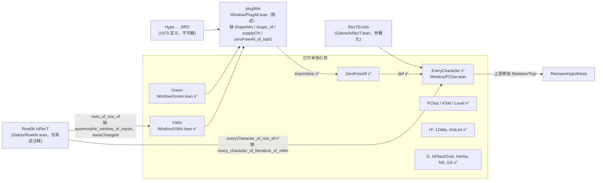

# SKELETON-lower — 主线下层骨架：Galois 层与 Window 层

> **汇总会话注（2026-11-23 02:30，合并后）**：本文件作为附录 B 原样保留。合并时 `Window/PChar.lean` 移到 **`skeleton/src/Skeleton/PChar.lean`**（内容不变，另并入 `zeroFreeAll_iff`，`import Mathlib` 收窄为 4 个子模块），`Top/` 里重复的 `Skeleton.PChar`/`ZeroFreeAll`/`EveryCharacter`/`imprimitive` 已删除，所以本目录的定义现在是整个 `skeleton/` 唯一的一份；本文 §2.1、§5、§7、§8.6 里提到的 `Window/PChar.lean` 和"与 `Skeleton/Top/` 二选一"均按此理解（对照见 `SKELETON.md` 附录 D）。§1 的"陈述级闭包 / 含函数体"数字是本文的口径（偏小），与其它口径的差异见 `SKELETON.md` §3.1、§3.5。另：`Main.lean` 实际走 `TopPlug.lean` 的 `zero_free_all_of_green_v_win`（`HypsAlt … DefiniteSideCondition`），`plugWin`/`plugAll` 是平行版本，见 `SKELETON.md` §1.1；`Window/PlugAll.lean` 里的 `plugWinStatement` 两条路通用。

三个并行会话中的「下层骨架」这一份。目录：`skeleton/src/Skeleton/Galois/`、`skeleton/src/Skeleton/Window/`。
上层（EveryCharacter → RiemannHypothesis）和静态依赖图在另外两份（`Skeleton/Top/`、`SKELETON.md`）。

主线（REPORT.md §1.3）：

```
Row0b IsRecT  ──vwin_of_row──▶  VWin  ─┐
RecTExists（局部 Langlands 存在性）     ├─plugWin──▶ ZeroFreeAll ──imprimitive──▶ EveryCharacter ──▶ RH
Green（Green 特征标存在性）      ──────┤
Hyps（解析核心假设可满足）        ──────┘
```

## 0. 结论一览

| 命题（源名字） | 源位置 `source/src/` | 本次状态 | 骨架文件 | 陈述级闭包（def + thm / 最长链 / 行数） |
|---|---|---|---|---|
| `UpperTheory.Top.VWin` | Development/AutomorphicArithmetic/CharacterBoxes/ExistsPageN.lean:49 | **完整搬出，编译通过** | `Window/VWin.lean`（+ `Galois/Places.lean`、`Galois/GaloisCohomology.lean`） | 31 + 1 / 13 / 84 |
| `GlobalTheory.GLq.Green` | Development/AbelianVarietyTheory/Definitions/NonGaloisDescent/LabelDatum.lean:108 | **完整搬出，编译通过** | `Window/Green.lean` | 15 + 0 / 5 / 35 |
| `Formalism.HC.ZeroFreeAll`、`UpperTheory.EveryCharacter` | Formalism/…/ExplicitFormulaErrorOfHostConditions.lean:18；CharacterBoxes/EveryCharacter.lean:13 | **完整搬出** | `Window/PChar.lean` | 7 + 0 / 4 / 15；0 |
| `UpperTheory.GalStar.Row0b` | Development/AutomorphicArithmetic/Foundations/GaloisRepresentations/TypeConditions/WeightsConjBis.lean:69 | **搬不动**：只搬出 `IsQp`/`IsQpBig`，陈述原文以注释保存 | `Galois/Row0b.lean` | 150 + 18 / 15 / 462（含函数体：180 + 45 / 17 / 573） |
| `UpperTheory.Zero.LLC.IsRecT`、`RecTExists` | Foundations/LocalLanglands/IsRecTOfIsRec.lean:76,78 | **搬不动**：陈述原文以注释保存，另给参数化版本 `RecTExistsSchematic` | `Galois/IsRecT.lean` | 143 + 7 / 14 / 360（含函数体：148 + 20 / 16 / 389） |
| `GlobalTheory.Fc.Hyps … DRS` | Development/AbelianVarietyTheory/Definitions/GlobalTwisting/APerTw.lean:23；DRS.lean:21 | **搬不动**（1973 个定义，链深 32，8909 行） | 只有说明：`Window/PlugAll.lean` | 1434 def + 284 structure + 215 abbrev + 38 thm / 32 / 8909 |
| 衔接 `imprimitive`（ZeroFreeAll → EveryCharacter） | CharacterBoxes/Imprimitive.lean:5 | **已证**，Mathlib-only | `Window/PChar.lean` | — |
| 衔接 `plugAll` | CharacterBoxes/EveryCharacter.lean:16 | 拼接已证（`plugAll_of_plugWin`），`plugWin` 本身作假设 | `Window/PlugAll.lean` | plugWin 的陈述闭包 ≈ 2000 节点（`TopShape`/`Hyps`） |
| 衔接 `everyCharacter_of_row` | CharacterBoxes/MainConclusion.lean:7 | 拼接已证（`everyCharacter_of_row_of`），三条深定理作假设 | `Galois/Mainline.lean` | — |
| 衔接 `vwin_of_row` | AutomorphicVarieties/…/DenseThresholdCases/VwinOfRow.lean:4 | 拼接已证（`vwin_of_row_of`），`automorphic_window_of_inputs`、`baseChangeN` 作假设 | `Galois/Mainline.lean` | 后者陈述闭包 155 + 7 / 15 / 367 |

所有编译过的定理 `#print axioms` 都只含 `propext, Classical.choice, Quot.sound`（§6；42 条，0 sorryAx）。

## 1. 做法

1. **静态命题依赖闭包**（脚本 `/tmp/rh-lower/stmdep.py`，不编译）：从 `analysis/decls.jsonl` 出发，对每条声明只读它的文本——定理/引理只扫陈述（type），`def/abbrev/structure/class` 扫整个声明（字段、函数体，但不扫 `:= by` 的证明体）；标识符按该文件的 `open` 列表和声明所在行的 namespace 栈解析到项目声明（`open N` 只把 namespace 恰为 `N` 的名字带入；根名字只在定义文件位于引用文件的 2 级 import 邻域内、且不是 Mathlib 名字、长度 ≥ 3 时才算）；绑定变量和 section `variable` 排除。BFS 得到闭包，深度 = 从根到该节点的最长链。`-d` 模式把 `def` 函数体也算进去，函数体里引用的定理只计数不展开（「证明义务」）。
   局限：纯文本，无法处理 notation、instance、`open … in`、字段投影，数字是近似（偏小）；但足以排序和找瓶颈。
2. **编译**：只 import Mathlib 的文件用 `cd skeleton && lake env lean src/Skeleton/…`；依赖其它骨架文件的用 `lake build -K jobs=1 <module>`（先生成 olean，再 `lake env lean`）。同一时间只跑一个 lean 进程。`lake` 在 `~/.elan/bin`（需加 PATH）。
3. **公理检查**：`lake env lean /tmp/rh-lower/Axioms.lean`（对每个编译过的 def / theorem 做 `#print axioms`，§5）。
4. **搬法定义链的原则**：定义原样照抄（namespace、名字、陈述都不改），只补 docstring、加 `omit`、把 `haveI :` 改成 `have :`（linter）。源文件里的 `set_option`、重复副本（`Neutral.B1.*` 与 `Formalism.ConjugateSelfDual.*` 是同一组定义的两份）不搬。

## 2. 已能单独引用的命题（只 import Mathlib + 本骨架）

### 2.1 `Window/PChar.lean` — `Formalism.HC.{PChar, KSet, Level, ZeroFreeAbove, ZeroFreeOn, ZeroFreeEven, ZeroFreeAll}`，`UpperTheory.EveryCharacter`

来源：PrimePairSizeCondition.lean:7-45、ExplicitFormulaErrorOfHostConditions.lean:11-43、EveryCharacter.lean:13、Imprimitive.lean:5。
定义链：`ZeroFreeAll → ZeroFreeOn → PChar.ZeroFreeAbove → PChar → DirichletCharacter.IsPrimitive`（Mathlib）；深 4，共 7 个定义，0 个内部定理。
已证的引理（都是 Mathlib-only）：`PChar.inv_inv`、`PChar.of_self`、`PChar.of_one`、`PChar.of_inv`、`zeroFreeOn_of_levels`、`Level.mem_ofSub`、`Level.mem_cyc`、`zeroFreeOn_of_cyc`，以及**衔接定理 `UpperTheory.Top.imprimitive : ZeroFreeAll → EveryCharacter`**（35 行原证明，用 `LFunction_changeLevel` 把非本原特征归结为本原特征，再排除 `s = 1` 处平凡因子的零点）。
没搬：`Level.Gm`、`ChebyshevGrowthImpliesZeroFree`（需要 `Formalism.Gz`、`An.gChi`，不在主线上）。
注意：`Skeleton/Top/ZeroFreeAll.lean`、`Top/Imprimitive.lean`（上层会话）已有同一组定义的另一份（namespace `Skeleton`）。两份等价，汇总时留一份即可；本目录的文件都依赖本份（namespace 与源一致）。

### 2.2 `Galois/Places.lean` — 位、Galois 群、惯性群、`NS`/`GS`

来源：Formalism/ConjugateSelfDual/Statement.lean:6-32，ReciprocityTheory/GaloisValuations/Global.lean:15-66, 90-153。
`Formalism.ConjugateSelfDual.{G, Qbar, cyc, IsPlaceOver, normV, Inertia, IsFrob}`，`ReciprocityTheory.Gal.{Dec, mem_Dec, apply_mem_iff_of_mem_Dec, valuation_lt_one_iff', valuation_apply_lt_one_iff, mul_inv_apply, Ine, mem_Ine, Ine_le_Dec, cycZ, NS, normal_NS, isClosed_NS, GS, toGS, continuous_toGS, locHom, continuous_locHom}`。全部 Mathlib 概念：`Qbar l := PadicAlgCl l`（Mathlib 的 `AlgebraicClosure ℚ_[l]`）、`cyclotomicCharacter`、`ValuationSubring.decompositionSubgroup`（`open scoped Pointwise` 才有 `σ • A`）。
`Ine` 的证明（惯性群是子群）和 `valuation_lt_one_iff'` 等引理是 Mathlib-only 的实证明。

### 2.3 `Galois/GaloisCohomology.lean` — `H¹` 与 `LData`/`shaLen`

来源：SeparatedDvrSecondCohomologyMem.lean:36-66,138-154，ContinuousConstSMulQuotient.lean:168，Hypotheses/GalCoh.lean:132-138，Formalism/GaloisCohomology/Statement.lean:13-78。
`ReciprocityTheory.Gal.{Z1, d0, B1, mem_coboundaries1, H1, restrictCocycles1, resH1, Sha1, locFam, continuous_locFam}`，`Formalism.GaloisCohomology.{ZlSub, QZ, QZ.mk, scalRep, scalRep_apply, Above, LData, qzTw, zlTw, Sha, shaLen}`。这是 `VWin` 里 `VVle` 用的 Sha 长度。与源的两处差别（都不改变命题）：(a) `ContinuousConstSMul ℤ_[l] (QZ l)` 在源里由 `continuousConstSMul_quotient`（商模上的实例）提供，这里直接给 `continuousConstSMul_QZ`（`QZ l` 是离散模）；(b) Lean 4.33 只自动带上陈述里引用到的 section instance，所以这里的 `LData`/`Sha`/`shaLen` 带的实例参数比源少两个未用到的（`[NumberField F]`、`[IsAlgClosure F Ω]`），`VVle` 里那一处 `@shaLen` 的 `_` 个数随之不同（已在 VWin.lean 开头注明）。源文件 GaloisCohomology/Statement.lean 其余 100 行（`VLen`、`PTCoker`、`SelAll` 等）不在主线上，没搬。

### 2.4 `Window/VWin.lean` — `UpperTheory.Top.VWin`

来源：ExistsPageN.lean:12-77，原样。`VWin := ∀ ψ : PChar, VWinAt ψ 401`，`VWinAt → {PageN, WinPair, VAt} → {IsChiField, VVle} → {shaLen, PChar}`。定义链 31 个定义 + 1 个定理（`continuous_locFam`，定义 `Sha` 时要用），最长链 13，陈述共 84 行。
顺带搬了两条 Mathlib-only 引理：`VVle.mono`（`VVle` 对 `t`、`B` 单调）和 `exists_pageN`（页码函数存在）。

### 2.5 `Window/Green.lean` — `GlobalTheory.GLq.Green`

来源：LabelDatum.lean:11-112 原样，外加 `Formalism.CyclotomicNorms.{Fbar, rootsBar}`（StatementT.lean:14-17）和 `Formalism.MainNotions.ArithmeticCylinders.{entN, IsUniUp, eDat, eU}`（ArithmeticCylinders.lean:292-307）。15 个定义，链深 5，0 个内部定理。`FDRep ℂ G`、`FDRep.character`、`CategoryTheory.Simple` 都是 Mathlib 的。
没搬：`ESerTie`（LabelDatum.lean:114，依赖 `Formalism.BasicNotions.D7`，不在主线上）。

### 2.6 拼接定理

| 文件 | 定理 | 内容 | 缺什么 |
|---|---|---|---|
| `Window/PChar.lean` | `UpperTheory.Top.imprimitive` | `ZeroFreeAll → EveryCharacter` | 不缺（已完整证明） |
| `Window/PlugAll.lean` | `UpperTheory.Top.plugWinStatement (HypsSat : Prop)` | `Green → VWin → HypsSat → ZeroFreeAll`（`plugWin` 的陈述，`Hyps` 抽象成 `HypsSat`） | `plugWin` 的证明：`zeroFreeAll_of_topG`、`shape_of`、`shapeWin`、`supplyChi`（见 §4.4） |
| `Window/PlugAll.lean` | `UpperTheory.Top.plugAll_of_plugWin` | 从 `plugWinStatement` 拼出 `plugAll` | 不缺 |
| `Galois/Mainline.lean` | `UpperTheory.One.vwin_of_row_of` | `Row → OpenImageCondition Row`、`BaseChangeIsobaricN`、`automorphic_window_of_inputs` 三者 ⟹ `Row → VWin`（`vwin_of_row` 的拼接） | `automorphic_window_of_inputs`（TopMainZj.lean:71）、`baseChangeN`（DefiniteNHolds.lean:5） |
| `Galois/Mainline.lean` | `UpperTheory.FinalTheorems.everyCharacter_of_row_of` | `vwin_of_row` + `recTExists` + `every_character_of_literature_of_vWin` ⟹ `Row → EveryCharacter` | 后者（EveryCharacterOfLiteratureOfVWin.lean:810，810 行文件、import 约 230 个模块） |
| `Galois/Mainline.lean` | `UpperTheory.FinalTheorems.everyCharacter_of_row_and_inputs` | `Row` + 窗口定理 + 基变换 + `Green` + `HypsSat` + `plugWin` ⟹ `EveryCharacter`（整条下层主线） | 同上 |

`OpenImageCondition RowT`、`OpenLiteratureStatements Row RecTExists` 是源里两个 Prop 结构（TemperedProductOfSquareIntegrable.lean:207、EveryCharacterOfLiteratureOfVWin.lean:215），这里把 `RowT := Row0b fun h rc => IsRecT h rc`（`UpperTheory.V.Z.Win.RowT`、`UpperTheory.One.M.Row`）作为参数；参数化后定义等价于源陈述。

## 3. 搬不动的命题：卡在哪个定义、依赖多深

四个命题（Row0b、IsRecT/RecTExists、VWin、Green）的函数体级闭包取并集：**391 个声明**（264 def、43 abbrev、24 structure、1 inductive、2 instance、57 theorem/lemma/instance），分布在 **75 个文件**（共 26,828 行；其中 30 个文件 ≥ 300 行，合计 20,273 行），只有 12 个文件是纯 `import Mathlib` 的（63 个节点，即 §2 已搬的部分）。节点按深度：d1 5, d2 25, d3 39, d4 52, d5 53, d6 38, d7 33, d8 31, d9 23, d10 15, d11 11, d12 15, d13 17, d14 15, d15 11, d16 7, d17 1。

### 3.1 `Row0b`（WeightsConjBis.lean:69）

陈述级闭包 168 节点（150 def + 18 thm/inst），最长链 15，462 行；含函数体 225 节点（180 def + 45 thm/inst），链 17，573 行。按层：

| 深度 | 节点数 | 代表定义（源文件） |
|---|---:|---|
| 1 | 2 | `PropsB`（14 行陈述，20 个直接依赖）、`ContraPair.PolarizedPair`（GaloisGeometry/DualIsConjByOne.lean:53） |
| 2 | 7 | `AboveB`（13 行，23 个依赖）、`WeilDeligne.wdOf`、`CuspRep.CG.mk`、`ContraPair.DualIsConjBy`、`MainNotions.N.IsSSRep`（DataN.lean:1186）、`BasicNotions.LocTied`（LocTied.lean:11）、`GalOfCusp.compNorm` |
| 3 | 19 | `LocAinf`（29 行，DataNLoc.lean:786）、`LocBridge`（16 行，DataNLoc.lean:574）、`L2.Host.HChar`、`N.IsInv`、`Per.Ainf`、`Pst.{IsCrysAt, IsdRAt, IsJumpsAt, IsPstAt, IsInduced, wdAt}`、`WeilDeligne.IsWDOf`、`CuspRep.CG`、`GalOfCusp.algNorm` |
| 4 | 19 | `LocPrime`（31 行，DataNLoc.lean:527）、`CuspRep.CuspSub`（ExpoConjOfIsCsd.lean:209，通过 `SmIrr`、`cptRep`…）、`CuspRep.conjFin`、`LocGL.IrrGL.of`、`WeilDeligne.IsWDOfWith`、`Pst.wdPst`、`GalStar.{TmW, Sqf, Tor}` |
| 5 | 19 | `LocRings`、`WeaklyAdmissibleFiltrations.PeriodData`（37 行）、`IrrGL`（NonemptyEquivMultiProdOne.lean:179）、`Pst.{IsModel, IsPst, trivWD, wdRep}`、`WeilDeligne.{IsFrobSS, IsMonodromy, wdMat}`、`LocalGlobalAboveLAlt.Triv` |
| 6–8 | 41 | `CuspRep.{IsCuspForm, IsStable, IsAutForm, IsCuspidal, act, Op, cptRep, finRep, finGL, infGL, ratGL, ratN, Kinf, conjSrc, conjLoc, Zalg, cap, Eop, lieS, lie}`（自守表示的定义），`WeilDeligne.{WD, WDRep, WD.mk, isoSetoid, unrChar, inePart, tval}`，`SmGL.{IrrRep, IrrCl}`，`Pst.{wdN, wdRho, wdMap, Dpst, DpstUr, monD, monV, stRep, Letter, WDSpace, algC, urC}` |
| 9–13 | 57 | `CuspRep.{corner, cornerGL, matN, rt, toL, sFin, sInf, Af, Cinf, Ad, GA, atEmb, Lie, Sm}`（DifferentiableAtChart.lean / ContinuousConjFin.lean），`Pst.{Dpst, letterKer, onB, monSt, Bst}`，`Loc.{FinExt, MaximalUnramifiedExtension, Om, GK}`、`Formalism.REAL.{qdet, qminor, Tm}`、`WeilDeligne.{Weil, deg, degHom, ineIncl, weilSub}`、`ReciprocityTheory.Gal.Ine` |
| 14–17 | 3 | `IsPlaceOver`、`normV`、`G`（已搬，§2.2） |

**卡点（为什么搬不动）**：
1. **定义的函数体里要定理**（证明义务 45 条）。最重的：`exists_frobenius_semisimplification`（Proofs/IwasawaDecomposition/ExistsFrobeniusSemisimplification.lean:106，Weil 表示的 Frobenius 半单化存在，文件 184 行、自己还依赖 3 个 statement 文件）——`wdMat`/`wdRep` 用它来**定义** Weil–Deligne 表示的半单化；`conjSrc_injective`、`conjLoc_spec`、`conjPl_conjSrc`、`exists_finCompl_map`、`existsUnique_conjPl`（GL_n 在整数环/有限环上的共轭类，ContinuousConjFin.lean:419-434、Proofs/IwasawaDecomposition/*）——`conjFin`/`conjLoc`/`conjSrc` 的**定义**用到；`WDRep.Iso.{sum, symm, trans}`（`WD := Quotient (isoSetoid h)` 的 setoid 要这三条）；`isNilpotent_wdN`、`isSmooth_wdRho`、`wdRho_wdN`（FiniteDimensionalWdSpace.lean:66-114）。
2. **p-adic Hodge 理论的定义层**（深度 2–4 就出现）：`LocBridge`、`LocAinf`、`LocPrime`、`LocRings`、`LocTied`、`PeriodData`、`FinExt`、`GK`、`Om`、`MaximalUnramifiedExtension`、`Per.{Ainf, OC, Tilt}`、`AutPerF.{Ainf, Tilt}`——分布在 DataNLoc.lean（1260 行）、DataN.lean（1423 行）、WeaklyAdmissibleFiltrations/Statement.lean（575 行）、CoboundaryTransfers/Statement.lean、IntegralCasts/CrystallinePeriods/*（SpanNatCastLeComap.lean 331 行、InstIsAdicCompleteOC… 95 行）。
3. **自守表示的定义层**：`CuspSub`、`CG`、`IsRegAlg`、`infChar`、`IsLocComp`、`HChar`/`hcharSub`、`PolarizedPair`/`Paired`/`conjOp`/`barK`/`DualIsConjBy`、`GalOfCusp.{algNorm, compNorm}`、`ContinuousAdeleNorm`——ExpoConjOfIsCsd.lean（787 行）、DifferentiableAtChart.lean（405 行）、ContinuousConjFin.lean（463 行）、IsIrreducibleIff.lean（102 行）、SmoothPartStable.lean（188 行）、DualIsConjByOne.lean（59 行）、IsUnitaryNormOf.lean（208 行）。

真要搬：约 60 个文件、~2000–3000 行（150 个定义的原陈述 460 行 + 45 条证明义务 + 它们各自的依赖；函数体级闭包 573 行只是定义本身，不含证明义务的证明）。建议分三步，每步都能单独编译出更深一层的「原子」文件：
   (a) Weil 群与 Weil–Deligne 表示：ExistsNotCongPow.lean:76-200,240-293（`ActsAs`、`weilSub`、`Weil`、`deg`、`degHom`、`ineIncl`、`unrChar`、`qPow`）+ MonodromyZeroOfWeilDeligneRepClassIff.lean:13-130,36-60,370-400（`IsSmooth`、`WDRep`、`Iso`、`WD`）+ IsSemisimpleOfISupEigenspace.lean（262 行）。约 500 行，是 Row0b 和 IsRecT 共同的地基。
   (b) `IrrRep`/`IrrCl`/`IrrGL`/`Segment`/`IsL`/`segSum`/`parInd` 一族（NontrivialOfIrreducible.lean 289 行、NonemptyEquivMultiProdOne.lean 897 行、IsSubquotientDetRepParInd.lean 686 行、IsUnitarisableOfCharIff.lean 340 行、SmoothPartStable.lean 188 行）——`IsRecT` 的全部原子。
   (c) `CuspSub`/`CG`/`Pst.*`/`Loc*`（Row0b 独有的原子）。

### 3.2 `IsRecT` / `RecTExists`（IsRecTOfIsRec.lean:76,78）

陈述级闭包 150 节点（143 def + 7 thm），最长链 14，360 行；含函数体 168（148 + 20），链 16，389 行。与 Row0b 共享 Weil–Deligne 和 `IrrGL` 地基，自己的原子是**光滑表示论**：

| 深度 | 节点数 | 代表定义 |
|---|---:|---|
| 1 | 2 | `LawsT`（18 行陈述，23 个直接依赖）、`SmGL.IndSpLower` |
| 2 | 12 | `LocGL.IsL`、`LocLanglands.{IsIrrWD, IsTameWD, segSum}`、`SmGL.{HasCentralChar, contra, ofChar, prod}`、`WD.lpOfChar`、`Good`、`TypeLaw`（19 行，17 个依赖） |
| 3 | 18 | `BlochKatoReduction.IsWild`、`GLq.IsCusp`（已搬）、`LocGL.{HasSupport, LFactors, compEquiv, parIndEquiv, IsLSeg, IsOrderedForm}`、`LocLanglands.IsLocalArtin`（8 行，14 个依赖）、`Published.IsRegularChar`、`SerSys.TameGen.Inflates`、`SmGL.cls`、`GoodCusp` |
| 4 | 23 | `Formalism.G`、`GLp.{inc, red}`、`HeckeGal.IsGlobalArtin`（10 行，17 个依赖）、`PRep.fixed`、`SmGL.{Groth, IsCuspSupport, IsSmoothChar, ord, parIndMap}`、`SplitWeil.KOne`、`WD.{lpSp, mk, lpSum, lpZero}`、`Neutral.B1.toAb` |
| 5 | 30 | `ConjugateSelfDual.{IsFrob, cyc}`、`L2.Host.{IsUnifAt, IsUnitAt}`、`Formalism.{S, LamF, gammaF}`（表示的 Gamma 因子）、`HeckeGal.{infConn, toAb, Gab}`、`LocGL.{IsCosocle, prodIrr}`、`SmGL.{HasFiniteLength, IsSubquotient, Segment, compMap, jhMult, smIndMap, twistMap}`、`Neutral.B1.{Dec, IsPlaceOver, diagUnits, localIdele}` |
| 6–9 | 40 | `SmGL.{IsCuspidal, OccursTimes, multiProd, stdBlocks, parInd, piTensor, subQuot, unipRad, IrrCl, IndSp, IsSmooth, ind, IrrRep}`、`PRep.{Jacquet, TwJacquet, twKer}`、`WeilDeligne.{deg, degHom, IsSmooth, ineIncl}` |
| 10–16 | 21 | `SmGL.{leviTwo, parIndLower, two, Two, deltaHalf, leviProjLower, twist, absPow, detChar, leviProj, parabLower, Levi, diagBlock, opp, parab}`、`PRep.{smInd, ind, smoothRep, smoothPart_stable, indSpace, rightReg, sub, smoothPart}`、`Weil`、`Ine`、`G` |

卡点：`TypeLaw`（深度零处的型律）要把 `IsLocalArtin`、`IsRegularChar`、`TameGen.Inflates`、`IsWild`、`Formalism.{G, S, LamF, gammaF}`、`Neutral.B1.*`（局部互反律的 idele 群）都带上；`LawsT` 的 `langlands`/`dual`/`depth` 字段把 Bernstein–Zelevinsky 的段与抛物诱导（`SmGL.*`，5 个文件约 2400 行）带上。证明义务 20 条（`finite_constituents`、`smoothPart_stable`、`mem_smoothPart_of_nhds`、`WDRep.Iso.*`、`isSmooth_unrChar`、`Ine_le_Weil`、`deg_mul`、`qPow_add`…）。
本次给出的是参数化的 `RecTExistsSchematic R T`（IsRecT.lean），把「互反映射的类型 `R`」和「满足局部 Langlands 律的谓词 `T`」作为参数；取 `R := fun E Ω A w h => IrrGL (w.adicCompletion E) → WD h`、`T := fun … => IsRecT h rc` 即源定义。源里另有一份同名副本 Development/AbelianVarietyTheory/Definitions/NonGaloisDescent/RecTExists.lean（namespace `GlobalTheory.RecT`，内容相同）。

### 3.3 `Hyps … DRS`（APerTw.lean:23，DRS.lean:21）

`Nonempty (Hyps (fun 𝒞 => Closed 𝒞 fun Fm _ => LinkN Fm) DRS)` 是**第四层（解析核心）的输出**，不是一条可以「搬定义」的命题：`Hyps` 是 `Type 1` 的结构，47 个字段，每个字段都是一条全局解析假设（`RowsB`、`TieTwRec`、`RowsHoldLam3`、`ClassNumberFormula₂`、`CountAllPointsClass`、`GenusMassVolumes`、`Adm2InU.TwistedPointIntegral`、`TwistedPeriodAdmissible`、`WuDecayOfGap`、`ThmSOwn.TheoremSSelected`…）。陈述级闭包 **1973 个声明**（1434 def、284 structure、215 abbrev、38 theorem、2 class），最长链 32，8909 行，几乎全是 `Formalism.MainNotions / BasicNotions / L2` 的定义层；`DRS` 自己 1600 个、链 32、7377 行；`Closed`（ParamsHeightRankConstant.lean:159）195 个、链 20；`LinkN`（GlobalTheoremInputs.lean:45）222 个、链 19。
在源里这个假设是由 `GlobalTheory.Fc.*` 的全部工作（`shape_of`、`of_hyps`、`LinkTied`、`MainSup`…）**证明出来**的，所以正确的做法不是搬 `Hyps` 的定义，而是把「`Hyps` 可满足」本身当作第四层的命题（本骨架里抽象成 `HypsSat : Prop`，见 `Window/PlugAll.lean`），等第四层单独抽出来后再实例化。

## 4. 衔接定理：哪些能证、哪些只能写成命题

### 4.1 `imprimitive`：ZeroFreeAll → EveryCharacter — 已证（`Window/PChar.lean`），Mathlib-only。

### 4.2 `plugAll` 的拼接 — 已证（`plugAll_of_plugWin`）：`plugAll hG hV h = imprimitive (plugWin hG hV h)`。

### 4.3 `everyCharacter_of_row` 的拼接 — 已证（`everyCharacter_of_row_of`）：
`everyCharacter_of_row h = every_character_of_literature_of_vWin ⟨h, recTExists, h⟩ (vwin_of_row h)`，其中 `⟨h, recTExists, h⟩ : OpenLiteratureStatements`（三个字段：`caraianiLocalGlobalDual : Row`、`localLanglandsExists : RecTExists`、`galoisRepOfPolarizedPairLit : Row`）。同理 `vwin_of_row h = automorphic_window_of_inputs (OpenImageCondition.mk h) baseChangeN h` 拼成 `vwin_of_row_of`。两者合起来是 `everyCharacter_of_row_and_inputs`：整条下层主线只剩 5 个命名的深输入。

### 4.4 证不了的，缺什么

| 衔接 | 源 | 陈述闭包 | 缺的东西 |
|---|---|---|---|
| `plugWin` | CharacterBoxes/EveryCharacter.lean:8 | `shapeWin` 2085 节点（链 34，9475 行）、`shape_of` 2070（链 34，9490）、`zeroFreeAll_of_topG` 289（链 22，1787）、`supplyChi` 81（链 13，370） | `GlobalTheory.Fc.TopShape`、`TopG`、`HostExW`、`Hyps` 的全部定义（≈2000 个）；证明是第四层的全部内容。只能作假设（`plugWinStatement`）。 |
| `vwin_of_row` | VwinOfRow.lean:4 → TopMainZj.lean:71 | `automorphic_window_of_inputs` 陈述 33 节点（= `OpenImageCondition` + `BaseChangeIsobaricN` + `VWin`），`BaseChangeIsobaricN` 155 + 7 / 15 / 367 | 证明：`v_window_of_depth_zero_residual_bc_cm`（模性提升 + 窗口估计，TopMainZj.lean:55）；`baseChangeN : BaseChangeIsobaricN`（DefiniteNHolds.lean:5，基变换）。作假设。 |
| `every_character_of_literature_of_vWin` | EveryCharacterOfLiteratureOfVWin.lean:810 | 陈述只用 `OpenLiteratureStatements`、`VWin`、`EveryCharacter` | 证明 810 行，import 约 230 个模块（θ 积分、Siegel Eisenstein、topCovolSlim2…）。作假设。 |
| `recTExists` | LocalCentralUnits/RecTExists.lean:20 | 陈述 151 节点 | 证明 66 行，依赖 `artEx`、`cuspEx`、`exists_isLExt`、`extDim`、`extTw`、`extDual`、`extInj`、`extDepth`、`typeIff`（局部 Langlands 的存在性定理）。作假设（`RecTExists`）。 |

## 5. 文件清单

```
skeleton/src/Skeleton/
  Galois/Places.lean            ConjugateSelfDual.G/Qbar/cyc/IsPlaceOver/normV/Inertia/IsFrob；Gal.Dec/Ine/cycZ/NS/GS/toGS/locHom
  Galois/GaloisCohomology.lean  Gal.Z1/d0/B1/H1/restrictCocycles1/resH1/Sha1/locFam/continuous_locFam；GaloisCohomology.ZlSub/QZ(+实例)/scalRep/Above/LData/qzTw/zlTw/Sha/shaLen
  Galois/Row0b.lean             GalStar.IsQp/IsQpBig（已编译）；Row0b/AwayB/AboveB/PropsB 陈述原文（注释）
  Galois/IsRecT.lean            RecTExistsSchematic（已编译）；IsRecT/LawsT/TypeLaw/Good/GoodCusp/Toral/RecTExists 陈述原文（注释）
  Galois/Mainline.lean          OpenImageCondition、OpenLiteratureStatements（参数化）、vwin_of_row_of、everyCharacter_of_row_of、everyCharacter_of_row_and_inputs
  Window/PChar.lean             HC.PChar/KSet/Level/ZeroFree*、UpperTheory.EveryCharacter、imprimitive 及 8 条 PChar/Level 引理
  Window/VWin.lean              Top.VVle/IsChiField/WinPair/PageN/VAt/VWinAt/VWin、VVle.mono、exists_pageN
  Window/Green.lean             CyclotomicNorms.Fbar/rootsBar、ArithmeticCylinders.entN/IsUniUp/eDat/eU、GLq.Gn…Green
  Window/PlugAll.lean           plugWinStatement、plugAll_of_plugWin；Hyps/DRS 不可搬的说明
  Window/AxiomsLower.lean       对上面所有 def/structure/theorem 的 #print axioms（42 条）
```

## 6. 公理核对

脚本：`skeleton/src/Skeleton/Window/AxiomsLower.lean`（对 §2 的每个 def、structure 和 theorem 做 `#print axioms`），运行方式 `cd skeleton && lake env lean src/Skeleton/Window/AxiomsLower.lean`。编译方式：`cd skeleton && lake build -K jobs=1 Skeleton.Galois.Places Skeleton.Galois.GaloisCohomology Skeleton.Galois.Row0b Skeleton.Galois.IsRecT Skeleton.Window.PChar Skeleton.Window.VWin Skeleton.Window.Green Skeleton.Window.PlugAll Skeleton.Galois.Mainline`（2026-11-23 00:49 CST：9 个模块全部通过，0 warning，1 min 53 s）。

42 条声明（40 条只依赖标准公理，2 条不依赖任何公理）；非标准公理：0；sorryAx：False

| 声明 | 公理 |
|---|---|
| `Formalism.HC.PChar` | `propext, Classical.choice, Quot.sound` |
| `Formalism.HC.ZeroFreeAll` | `propext, Classical.choice, Quot.sound` |
| `UpperTheory.EveryCharacter` | `propext, Classical.choice, Quot.sound` |
| `UpperTheory.Top.VWin` | `propext, Classical.choice, Quot.sound` |
| `GlobalTheory.GLq.Green` | `propext, Classical.choice, Quot.sound` |
| `UpperTheory.Top.plugWinStatement` | `propext, Classical.choice, Quot.sound` |
| `UpperTheory.Zero.LLC.RecTExistsSchematic` | `propext, Classical.choice, Quot.sound` |
| `UpperTheory.GalStar.IsQpBig` | `propext, Classical.choice, Quot.sound` |
| `Formalism.HC.PChar.inv_inv` | `propext, Classical.choice, Quot.sound` |
| `Formalism.HC.PChar.of_self` | `propext, Classical.choice, Quot.sound` |
| `Formalism.HC.PChar.of_one` | `propext, Classical.choice, Quot.sound` |
| `Formalism.HC.PChar.of_inv` | `propext, Classical.choice, Quot.sound` |
| `Formalism.HC.zeroFreeOn_of_levels` | `propext, Classical.choice, Quot.sound` |
| `Formalism.HC.Level.mem_ofSub` | `propext, Classical.choice, Quot.sound` |
| `Formalism.HC.Level.mem_cyc` | `propext, Classical.choice, Quot.sound` |
| `Formalism.HC.zeroFreeOn_of_cyc` | `propext, Classical.choice, Quot.sound` |
| `UpperTheory.Top.imprimitive` | `propext, Classical.choice, Quot.sound` |
| `ReciprocityTheory.Gal.mem_Dec` | `propext, Classical.choice, Quot.sound` |
| `ReciprocityTheory.Gal.apply_mem_iff_of_mem_Dec` | `propext, Classical.choice, Quot.sound` |
| `ReciprocityTheory.Gal.valuation_lt_one_iff'` | `propext, Classical.choice, Quot.sound` |
| `ReciprocityTheory.Gal.valuation_apply_lt_one_iff` | `propext, Classical.choice, Quot.sound` |
| `ReciprocityTheory.Gal.mul_inv_apply` | `propext, Quot.sound` |
| `ReciprocityTheory.Gal.mem_Ine` | `propext, Classical.choice, Quot.sound` |
| `ReciprocityTheory.Gal.Ine_le_Dec` | `propext, Classical.choice, Quot.sound` |
| `ReciprocityTheory.Gal.normal_NS` | `propext, Classical.choice, Quot.sound` |
| `ReciprocityTheory.Gal.isClosed_NS` | `propext, Classical.choice, Quot.sound` |
| `ReciprocityTheory.Gal.continuous_toGS` | `propext, Classical.choice, Quot.sound` |
| `ReciprocityTheory.Gal.continuous_locHom` | `propext, Classical.choice, Quot.sound` |
| `ReciprocityTheory.Gal.mem_coboundaries1` | `propext, Classical.choice, Quot.sound` |
| `ReciprocityTheory.Gal.continuous_locFam` | `propext, Classical.choice, Quot.sound` |
| `Formalism.GaloisCohomology.scalRep_apply` | `propext, Quot.sound` |
| `GlobalTheory.GLq.hcL_cons` | `propext, Classical.choice, Quot.sound` |
| `GlobalTheory.GLq.hcL_nil` | `propext, Classical.choice, Quot.sound` |
| `UpperTheory.GalStar.IsQpBig.isQp` | `propext, Classical.choice, Quot.sound` |
| `UpperTheory.Top.VVle.mono` | `propext, Classical.choice, Quot.sound` |
| `UpperTheory.Top.exists_pageN` | `propext, Classical.choice, Quot.sound` |
| `UpperTheory.Top.plugAll_of_plugWin` | `propext, Classical.choice, Quot.sound` |
| `UpperTheory.One.vwin_of_row_of` | `propext, Classical.choice, Quot.sound` |
| `UpperTheory.FinalTheorems.everyCharacter_of_row_of` | `propext, Classical.choice, Quot.sound` |
| `UpperTheory.FinalTheorems.everyCharacter_of_row_and_inputs` | `propext, Classical.choice, Quot.sound` |
| `UpperTheory.LiteratureTheorems.OpenImageCondition` | （无） |
| `UpperTheory.LiteratureTheorems.OpenLiteratureStatements` | （无） |

## 7. 主线下层现状图



一条后人现在就能写的引用（只 import Mathlib + 骨架）：

```lean
import Skeleton.Window.VWin
import Skeleton.Window.Green
import Skeleton.Window.PlugAll
import Skeleton.Galois.Mainline

theorem myResult {Row BaseChangeIsobaricN HypsSat : Prop}
    (hmk : Row → UpperTheory.LiteratureTheorems.OpenImageCondition Row) (bc : BaseChangeIsobaricN)
    (haw : ∀ _ : UpperTheory.LiteratureTheorems.OpenImageCondition Row,
      BaseChangeIsobaricN → Row → UpperTheory.Top.VWin)
    (hW : UpperTheory.Top.plugWinStatement HypsSat)
    (hG : GlobalTheory.GLq.Green) (hH : HypsSat) (h : Row) : UpperTheory.EveryCharacter :=
  UpperTheory.FinalTheorems.everyCharacter_of_row_and_inputs hmk bc haw hW hG hH h
```

## 8. 下一步建议（按性价比）

1. **Weil 群 + Weil–Deligne 表示**（`Galois/WeilDeligne.lean`，约 500 行）：ExistsNotCongPow.lean:76-200,240-293（`ActsAs`、`weilSub`、`Weil`、`deg`、`degHom`、`ineIncl`、`unrChar`、`qPow`、`compactSpace_Ine`）+ MonodromyZeroOfWeilDeligneRepClassIff.lean:13-130,370-400（`IsSmooth`、`WDRep`、`Iso`、`WD`、`WD.mk`）+ IsSemisimpleOfISupEigenspace.lean。这是 Row0b 与 IsRecT 共同的深度 5–13 地基；搬完之后 `RecNotion`、`Tor`、`Sqf`、`Away`、`AwayB` 的陈述都能落地。
2. **`IrrRep`/`IrrCl`/`IrrGL` + 光滑表示论 API**（约 1500 行，5 个文件）：IsRecT 的全部原子（§3.2 深度 2–16）。其中 `parInd`/`Segment`/`IsL`/`segSum` 是 Bernstein–Zelevinsky 的标准内容，搬出来后本身也可以考虑往 Mathlib 贡献（Mathlib 目前没有 `GL_n` 的段理论）。
3. **`CuspSub`/`CG`/`Pst.*`/`Loc*`**（Row0b 独有，约 2000 行）：自守表示的定义层 + p-adic Hodge 理论的定义层（DataN.lean、DataNLoc.lean 各 1200–1400 行）。其中 `PeriodData`、`LocAinf`、`LocBridge` 依赖 `A_inf`/`Tilt`/`OC` 的构造（IntegralCasts/CrystallinePeriods/*），是最重的一块。
4. **`Hyps`**：不要搬定义；等第四层（Formalism.LocalToGlobal / SharpRestriction）被单独抽成库后，把 `HypsSat` 实例化为那一层的输出命题。
5. **衔接定理**：`plugWin` 的陈述闭包有 2000 节点（`TopShape`、`TopG`、`HostExW`），短期只能作假设；`vwin_of_row` 的两条输入（`automorphic_window_of_inputs`、`baseChangeN`）陈述闭包分别 33 和 162 节点，后者可随第 2 步一起搬。
6. **与上层会话合并**：`Skeleton/Top/` 已有 `Skeleton.{PChar, ZeroFreeAll, EveryCharacter, imprimitive, PlugWin}`（namespace `Skeleton`），与本目录 `Window/PChar.lean` 的 `Formalism.HC.*`/`UpperTheory.*`（源 namespace）重复；汇总时二选一，再把 `Window/*.lean` 的 import 指过去。

## 9. 待人工确认

- `RecTExistsSchematic` 的参数化方式（`RecMapType`/`RecLawPred`）是否合适，还是宁可只保留注释里的原陈述。
- `everyCharacter_of_row_and_inputs` 走 `plugWin` 路线而不是 `every_character_of_literature_of_vWin` 路线（两者在源里都通向 `EveryCharacter`）；若上层更愿意接文献定理路线，用 `everyCharacter_of_row_of` 即可。
- stmdep 的数字是文本近似（偏小）；Row0b/IsRecT 的「证明义务」只数到函数体直接引用的定理，不含这些定理自己的证明依赖。

## 附录 A. 命题依赖闭包脚本 `stmdep.py`（§1.1）

用法：`python3 stmdep.py [-l] [-d] NAME…`（`-l` 列出闭包里每个节点的深度/文件/行；`-d` 把 def 函数体也算进去）。依赖 `analysis/decls.jsonl`（先压成 `idx.json`：name/short/kind/mod/line）和 `analysis/imports.jsonl`、`analysis/leaf_files.json`。§0、§3 的数字由它产生（Row0b、IsRecT、RecTExists、VWin、Green、Hyps、DRS、Closed、LinkN、BaseChangeIsobaricN、shapeWin、shape_of、supplyChi、zeroFreeAll_of_topG、automorphic_window_of_inputs）。

<details>
<summary>脚本全文</summary>

```python
#!/usr/bin/env python3
"""Statement-level dependency closure of declarations in source/src (static, no compile).

stmdep.py [-l] ROOT [ROOT...]      ROOT = full name or unique short name; -l lists every node.

A theorem/lemma: only the statement is scanned.  def/abbrev/structure/class/inductive: the whole
declaration (fields / body), except `:= by` proof bodies.  Identifiers resolve to project
declarations only when reachable through the file's `open`s / namespace stack; bound variable
names are skipped.  Output: closure size, def/theorem split, longest chain depth, lines,
and the nodes at each depth.
"""
import json, os, re, sys, functools
from collections import Counter, defaultdict

HERE = '/tmp/rh-lower'
PROJ = '/Users/admin/Documents/Codex/projects/rh-mathlib-lemmas'
SRC = os.path.join(PROJ, 'source', 'src')

decls = json.load(open(os.path.join(HERE, 'idx.json')))
byfull = {d['name']: d for d in decls}
byshort = defaultdict(list)
byprefix = defaultdict(list)   # every namespace prefix -> names directly inside it
for d in decls:
    byshort[d['short']].append(d['name'])
    parts = d['name'].split('.')
    if len(parts) > 1:
        byprefix['.'.join(parts[:-1])].append(d['name'])
leaf = json.load(open(os.path.join(PROJ, 'analysis', 'leaf_files.json')))

tok_re = re.compile(r"[A-Za-z_][A-Za-z0-9_']*(?:\.[A-Za-z_][A-Za-z0-9_']*)*")
decl_start_re = re.compile(r'^(\s*)(?:@\[[^\]]*\]\s*)*(?:(?:private|protected|noncomputable|unsafe|partial)\s+)*'
                            r'(theorem|lemma|def|structure|class|abbrev|instance|inductive|opaque|axiom)\s+')
kw = set('theorem lemma def structure class abbrev instance inductive opaque axiom namespace end section variable '
         'open let have fun forall ∃ ∀ → ↔ ∧ ¬ in at by exact intro obtain refine apply rw simp only unfold show '
         'haveI match with where extends deriving as return do noncomputable scoped private protected'.split())

_filecache = {}
def _lines(mod):
    if mod not in _filecache:
        path = os.path.join(SRC, mod.replace('.', '/') + '.lean')
        try:
            _filecache[mod] = open(path, encoding='utf-8', errors='replace').read().split('\n')
        except FileNotFoundError:
            _filecache[mod] = []
    return _filecache[mod]

_stcache = {}
def statement_text(d):
    return _statement_text(d)

def _statement_text(d):
    if d['name'] in _stcache:
        return _stcache[d['name']]
    mod = d['mod']; lines = _lines(mod)
    if not lines:
        return ''
    i = d['line'] - 1
    first = lines[i]
    ind0 = len(first) - len(first.lstrip())
    out = []
    kind = d['kind']
    depth = 0
    j = i
    while j < len(lines):
        ln = lines[j]
        s = ln.strip()
        ind = len(ln) - len(ln.lstrip())
        if j > i:
            if s == '':
                if kind in ('structure', 'class', 'inductive'):
                    j += 1; continue
                break
            if ind <= ind0 and depth == 0:
                break
        out.append(ln)
        k = 0; in_str = False
        while k < len(ln):
            c = ln[k]
            if c == '"' and (k == 0 or ln[k-1] != '\\'):
                in_str = not in_str
            if not in_str:
                if c in '([{':
                    depth += 1
                elif c in ')]}':
                    depth = max(0, depth - 1)
                elif depth == 0 and c == ':' and k + 1 < len(ln) and ln[k+1] == '=':
                    rest = ln[k+2:].strip()
                    tactic_kw = re.compile(r'^\s*(obtain|rintro|have|haveI|refine|exact|intro|simp|rw|calc|apply|induction|cases|rcases|unfold|show|let|ext|funext|constructor|specialize|replace|omega|linarith|norm_num|positivity|gcongr|first|subset_goals|clear|rename_i|set|obtain)\b')
                    if kind in ('theorem', 'lemma', 'instance') or rest.startswith('by'):
                        _stcache[d['name']] = '\n'.join(out); return _stcache[d['name']]
                    j += 1
                    while j < len(lines) and kind in ('abbrev', 'def', 'opaque') and lines[j].strip() and \
                            (len(lines[j]) - len(lines[j].lstrip())) > ind0 and not decl_start_re.match(lines[j]) \
                            and not tactic_kw.match(lines[j]) and not lines[j].rstrip().endswith(' by') \
                            and not lines[j].rstrip().endswith(':= by') and not lines[j].rstrip().endswith('=> by'):
                        out.append(lines[j]); j += 1
                    _stcache[d['name']] = '\n'.join(out); return _stcache[d['name']]
                elif depth == 0 and ln[k:k+5] == 'where' and (k == 0 or not ln[k-1].isalnum()):
                    if kind not in ('structure', 'class', 'inductive'):
                        _stcache[d['name']] = '\n'.join(out); return _stcache[d['name']]
                    out[-1] = ln[:k] + ' ' + ln[k+5:]
                    k = len(ln)
            k += 1
        j += 1
        if j - i > 400:
            break
    _stcache[d['name']] = '\n'.join(out)
    return _stcache[d['name']]

ns_re = re.compile(r'^\s*(?:private\s+)?(?:namespace|section)\s+([A-Za-z0-9_.]+)')
end_re = re.compile(r'^\s*end\b\s*([A-Za-z0-9_.]*)')
_nscache = {}
def ns_at(mod, line):
    """namespace stack (namespaces only) in force at 1-based `line` of module `mod`."""
    key = mod
    if key not in _nscache:
        stack = []; table = []
        for ln in _lines(mod):
            m = ns_re.match(ln)
            if m and ln.lstrip().startswith('namespace'):
                stack.append(m.group(1))
            else:
                m = end_re.match(ln)
                if m and ln.lstrip().startswith('end'):
                    name = m.group(1)
                    if stack and (stack[-1] == name or stack[-1].split('.')[-1] == name.split('.')[-1]):
                        stack.pop()
                    elif not name and stack:
                        pass
            table.append(list(stack))
        _nscache[key] = table
    t = _nscache[key]
    return t[line - 1] if line - 1 < len(t) else []

def open_namespaces(mod, line=1):
    info = leaf.get(mod, {'ns': [], 'opens': []})
    opens = []
    for o in info['opens']:
        o = re.sub(r'^\s*scoped\s+', '', o.strip())
        o = re.sub(r'\s+in\s+.*$', '', o)
        # "A.B (TmW)" / "A (x) B" -> drop parenthesised groups
        o = re.sub(r'\([^)]*\)', ' ', o)
        for p in o.replace(',', ' ').split():
            if re.fullmatch(r"[A-Za-z_][A-Za-z0-9_']*(\.[A-Za-z_][A-Za-z0-9_']*)*", p):
                opens.append(p)
    return ns_at(mod, line), opens

NAMES = r"((?:[a-zA-Z_][a-zA-Z0-9_\']*\s+)*[a-zA-Z_][a-zA-Z0-9_\']*)"
binder_res = [re.compile(r'[(\[{]\s*([a-zA-Z_][a-zA-Z0-9_\']*)\s*(?=:|,|[)\]}])'),
              re.compile(r'[(\[{]\s*' + NAMES + r'\s*:'),
              re.compile(r'∀\s*' + NAMES + r'\s*(?=:|,|\s)'),
              re.compile(r'∃\s*' + NAMES + r'\s*(?=:|,|\s)'),
              re.compile(r'λ\s*' + NAMES + r'\s*=>'),
              re.compile(r'^\s*' + NAMES + r'\s*:(?!:)', re.M)]
_imports = None
def import_neighbourhood(mod):
    global _imports
    if _imports is None:
        _imports = {}
        with open(os.path.join(PROJ, 'analysis', 'imports.jsonl')) as fh:
            for line in fh:
                d = json.loads(line)
                _imports[d.get('mod') or d.get('module') or d.get('file')] = d.get('imports', [])
    near = {mod}
    for m in _imports.get(mod, []):
        near.add(m)
        near.update(_imports.get(m, []))
    return near

_ml = None
def mathlib_short():
    """short names of all declarations in the pinned Mathlib (for root-name tie breaks)."""
    global _ml
    if _ml is None:
        import glob
        _ml = set()
        rx = re.compile(r'^\s*(?:private\s+|protected\s+|noncomputable\s+|scoped\s+)*(?:theorem|lemma|def|abbrev|structure|class|inductive|instance|opaque)\s+([A-Za-z_][A-Za-z0-9_\']*)')
        root = os.path.join(PROJ, 'extracted', '.lake', 'packages', 'mathlib', 'Mathlib')
        for dp, dn, fn in os.walk(root):
            for f in fn:
                if f.endswith('.lean'):
                    try:
                        with open(os.path.join(dp, f), encoding='utf-8', errors='replace') as fh:
                            for ln in fh:
                                m = rx.match(ln)
                                if m: _ml.add(m.group(1))
                    except OSError:
                        pass
        json.dump(sorted(_ml), open(os.path.join(HERE, 'mathlib_short.json'), 'w'))
    return _ml

def resolve(tok, ns, opens, same_ns, bound=frozenset()):
    """Return the project declaration(s) the token can refer to, [] if none reachable."""
    if '.' in tok and tok in byfull:
        return [tok]
    if '.' in tok:
        head, rest = tok.split('.', 1)
        if head in bound:
            return []
        heads = resolve(head, ns, opens, same_ns, bound)
        out = []
        for hd in heads:
            full = hd + '.' + rest
            if full in byfull:
                out.append(full)
            else:
                # hd may be a namespace-ish root; find names hd.rest.*
                for n in byprefix.get(hd, []):
                    if n.endswith('.' + rest):
                        out.append(n)
        return sorted(set(out))
    cands = byshort.get(tok, [])
    if not cands:
        return []
    # `open N` brings only names whose namespace is exactly N; inside `namespace A.B`
    # names in A.B and in A are accessible.  `_root_.x`/plain `x` = top-level.
    scopes = set(opens)
    for n in ns:
        parts = n.split('.')
        for i in range(len(parts)):
            scopes.add('.'.join(parts[:i + 1]))
    scopes.add('')
    reach = [c for c in cands if c.rpartition('.')[0] in scopes]
    if not reach:
        return []
    # root-level (namespace-less) project names are in scope everywhere, so they are a big source of
    # false positives; accept one only if its defining module is within the referring file's
    # 2-level import neighbourhood (or is the referring file itself).
    if any(c.rpartition('.')[0] == '' for c in reach):
        namespaced = [c for c in reach if c.rpartition('.')[0] != '']
        near = import_neighbourhood(same_ns[0])
        rootok = [c for c in reach if c.rpartition('.')[0] == '' and byfull[c]['mod'] in near
                  and tok not in mathlib_short() and len(tok) >= 3]
        if namespaced:
            reach = namespaced
        else:
            reach = rootok
    if len(reach) > 1:
        # prefer same module / same namespace chain, then defs over theorems
        same = [c for c in reach if byfull[c]['mod'] == same_ns[0] or any(c.startswith(s + '.') for s in ns[-1:])]
        if same:
            reach = same
        if len(reach) > 1:
            nonthm = [c for c in reach if byfull[c]['kind'] not in ('theorem', 'lemma', 'instance')]
            if nonthm:
                reach = nonthm
    return reach

def body_text(d):
    """full declaration text (statement + body) for defs; for theorems just the statement."""
    if d['kind'] in ('theorem', 'lemma', 'instance', 'opaque'):
        return statement_text(d)
    key = 'body:' + d['name']
    if key in _stcache:
        return _stcache[key]
    lines = _lines(d['mod'])
    i = d['line'] - 1
    first = lines[i]; ind0 = len(first) - len(first.lstrip())
    j = i + 1
    while j < len(lines) and j - i < 600:
        s = lines[j].strip()
        if s and (len(lines[j]) - len(lines[j].lstrip())) <= ind0 and not decl_start_re.match(lines[j]) is None:
            break
        if s and (len(lines[j]) - len(lines[j].lstrip())) <= ind0 and not s.startswith(('|', ':=', '=', 'where', '-', '·', 'calc', 'have', 'exact', 'refine', 'intro', 'obtain', 'rintro', 'apply', 'rw', 'simp', 'show', 'funext', 'ext', 'let', 'induction', 'cases', 'rcases', 'constructor', 'unfold', 'first', 'omega', 'linarith', 'norm_num', 'positivity', 'gcongr', 'specialize', 'subset_goals', 'clear', 'rename_i', 'set', 'haveI')):
            if not re.match(r'^(theorem|lemma|def|abbrev|structure|class|instance|inductive|namespace|end|section|variable|open|attribute|noncomputable|@\[|omit|include|set_option|private|protected|scoped)', s):
                # a continuation line of a multi-line body at the same indent (e.g. `  fun x => ...` then `  exact`)... keep
                pass
            else:
                break
        j += 1
    _stcache[key] = '\n'.join(lines[i:j])
    return _stcache[key]

def deps(d, body=False):
    txt = body_text(d) if body else statement_text(d)
    txt = re.sub(r'--.*', '', txt)
    ns, opens = open_namespaces(d['mod'], d['line'])
    bound = set()
    for r in binder_res:
        for m in r.finditer(txt):
            for b in m.group(1).split():
                bound.add(b)
    # section `variable` binders in force before the declaration
    for ln in _lines(d['mod'])[:d['line'] - 1]:
        s = ln.strip()
        if s.startswith('variable') or s.startswith('variable ('):
            for r in binder_res:
                for m in r.finditer(s[len('variable'):]):
                    for b in m.group(1).split():
                        bound.add(b)
    res = {}
    for m in tok_re.finditer(txt):
        tok = m.group(0)
        if tok in kw or tok in bound or tok.startswith('_'):
            continue
        if tok in bound or tok.partition('.')[0] in bound:
            continue
        for n in resolve(tok, ns, opens, (d['mod'],), frozenset(bound)):
            if n != d['name'] and n not in res:
                res[n] = tok
    return txt, res

def closure(full, cap=200000, body=False):
    seen = {full}; order = [full]; parents = {full: set()}; qi = 0
    while qi < len(order) and len(order) < cap:
        n = order[qi]; qi += 1
        txt, ds = deps(byfull[n], body)
        if body and byfull[n]['kind'] in ('theorem', 'lemma', 'instance'):
            ds = {}   # proof obligations are not expanded
        for x in ds:
            if x not in seen:
                seen.add(x); order.append(x); parents[x] = set()
            parents[x].add(n)
    return order, parents

def analyse(full, list_nodes=False, body=False):
    order, parents = closure(full, body=body)
    memo = {}; visiting = set()
    def dep(n):
        if n in memo: return memo[n]
        if n in visiting: return 0
        visiting.add(n)
        memo[n] = 0 if n == full else 1 + max((dep(p) for p in parents[n]), default=0)
        visiting.discard(n)
        return memo[n]
    nodes = []
    for n in order:
        d = byfull[n]
        _, ds = deps(d)
        nodes.append({'depth': dep(n), 'kind': d['kind'], 'name': n, 'mod': d['mod'], 'line': d['line'],
                      'lines': len(statement_text(d).split('\n')), 'ndeps': len(ds)})
    return nodes

def report(full, nodes, list_nodes=False):
    d0 = byfull[full]
    defs = [t for t in nodes if t['kind'] not in ('theorem', 'lemma', 'instance')]
    thms = [t for t in nodes if t['kind'] in ('theorem', 'lemma', 'instance')]
    tot = sum(t['lines'] for t in nodes)
    maxd = max(t['depth'] for t in nodes)
    print(f'## {full}  ({d0["kind"]}, {d0["mod"].replace(".", "/")}.lean:{d0["line"]})')
    print(f'   closure (excluding root): {len(nodes)-1} nodes = {len(defs)-1} def/struct/abbrev + {len(thms)} thm/lemma/inst; '
          f'longest chain depth {maxd}; total {tot} lines')
    c = Counter(t['mod'].split('.')[0] for t in nodes)
    print('   by lib:', ', '.join(f'{k}={v}' for k, v in c.most_common()))
    per = Counter(t['depth'] for t in nodes)
    print('   nodes per depth:', ' '.join(f'd{k}:{v}' for k, v in sorted(per.items())))
    leaves = [t for t in nodes if t['ndeps'] == 0 and t['name'] != full]
    print(f'   leaves (no project deps in own statement): {len(leaves)}')
    if list_nodes:
        for t in sorted(nodes, key=lambda t: (t['depth'], t['name'])):
            print(f'   d={t["depth"]:<3} nd={t["ndeps"]:<3} {t["kind"]:9s} {t["name"]}  @ {t["mod"].replace(".", "/")}.lean:{t["line"]}  [{t["lines"]}L]')

if __name__ == '__main__':
    args = [a for a in sys.argv[1:] if not a.startswith('-')]
    lst = '-l' in sys.argv
    body = '-d' in sys.argv
    for r in args:
        full = r if r in byfull else None
        if full is None:
            c = byshort.get(r, [])
            full = c[0] if len(c) == 1 else None
        if full is None:
            print(f'## {r}: ambiguous/unknown'); continue
        report(full, analyse(full, body=body), lst)

```

</details>
