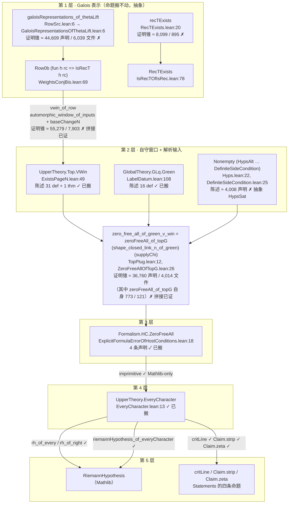

# SKELETON — 主线骨架（TASK.md 第 6 步）

> **功劳与署名**：证明的全部数学与 Lean 代码属于 **Levent Alpöge（与 Claude 合作）**，2026-11-20 发布于 <https://alpo.ge/> ，原样镜像 <https://github.com/CocoSgt/riemann-hypothesis-lean> 。本目录只是把主线上的中间结论搬成只依赖 Mathlib 的文件、把能证的层间衔接证出来、用编译器与静态分析量出每层的依赖锥；抽取、整理、编译由 **GLM 5.4 通过 DeepSeek Harness** 完成（四个并行会话：上层 `Top/`、下层 `Window/`+`Galois/`、静态图、汇总），没有任何新的数学。原发布没有 license 文件（REPORT.md §5.6）。
>
> **环境**：Lean `v4.33.1`，Mathlib `0df444a360eaa60ab8c11dca51a86af692955474`（与 `source/` 相同）。`skeleton/` 是独立 Lake 项目（`skeleton/README.md`），`.lake/packages` 软链到 `extracted/.lake/packages`。32 GB 机器：一个 `import Mathlib` 的 `lean` 进程约 6 GB，一切编译都一次一个进程。

这份文档汇总三份分文档：[`SKELETON-top.md`](SKELETON-top.md)（`skeleton/src/Skeleton/Top/`，逐条定理表）、[`SKELETON-lower.md`](SKELETON-lower.md)（`Window/`、`Galois/`，定义链与卡点）、[`SKELETON-graph.md`](SKELETON-graph.md)（静态依赖图的数据表）。细节在那三份里，这里只给结论、数字和图。

## 0. 结论（一眼版）

1. **已经能单独引用的（只 import Mathlib + `skeleton/`，全部编译通过、`#print axioms` 只含 `propext, Classical.choice, Quot.sound`）**：
   - **第 5 层 `RiemannHypothesis`**（Mathlib 自己的定义）、`Statements.lean` 的四条命题；
   - **第 4 层 `EveryCharacter`**（= `DirichletLNonvanishingRightOfHalf`）以及它到 RH 的**全部**衔接：`rh_of_right`、`rh_of_every`、`riemannHypothesis_of_everyCharacter`、`critLine`（本原特征的 GRH）、`Claim.strip` / `Claim.zeta`（带内零点在临界线上 / ζ 的零点在临界线上），`Main.lean` 五条定理的条件版（`Skeleton/Top/`，13 个模块、47 条公开声明）；
   - **第 3 层 `ZeroFreeAll`**（带 `PChar`，4 条声明）以及它到第 4 层的衔接 `imprimitive`（Mathlib-only）；
   - **第 2 层里 `VWin` 与 `Green` 的完整陈述**：`UpperTheory.Top.VWin`（31 个定义 + 1 条定理，连带 Galois 上同调 `shaLen`/`LData`、位与 Galois 群，`Skeleton/Window/VWin.lean` + `Skeleton/Galois/{Places,GaloisCohomology}.lean`）、`GlobalTheory.GLq.Green`（16 个定义，`Skeleton/Window/Green.lean`）；
   - **拼接定理**（深定理作假设）：`plugAll_of_plugWin`、`vwin_of_row_of`、`everyCharacter_of_row_of`、`everyCharacter_of_row_and_inputs`，以及汇总入口 **`Skeleton.Layers`**（`Layer1 … Layer5` 与 `layer4_of_layer3`、`layer5_of_layer4`、`layer3_of_layer2`、`layer4_of_layer2`、`layer4_of_layer1`、`layer5_of_layer2`、`mainOfLayer2`）。
   入口：`skeleton/src/Skeleton/Layers.lean`。后人现在可以写 `import Skeleton` 然后引用 `Skeleton.Layer3 → Skeleton.Layer4 → Skeleton.Layer5`，或者以 `Skeleton.Layer2 HypsSat` + `plugWinStatement HypsSat` 为假设直接得到 `RiemannHypothesis` 与 `Statements` 的四条命题。
2. **还不能单独引用的**：**第 1 层 `Row0b` + `RecTExists`** 的命题本身（陈述需要 150–300 个本项目定义，含 p-adic Hodge 理论与自守表示的定义层，`SKELETON-lower.md` §3.1–3.2），以及第 2 层的解析假设 `Nonempty (Hyps …)`（陈述就要约 2,000–4,000 个定义，§3.3）；四条深定理 `recTExists`、`galoisRepresentations_of_thetaLift`、`automorphic_window_of_inputs`、`zeroFreeAll_of_topG`（连同 `shape_of`/`shapeWin`/`supplyChi`）的**证明**都搬不动。它们在骨架里是抽象命题 / 假设。
3. **依赖锥最小与最大**（静态分析，`analysis/mainline_cone.txt`；数字是近似，见 §3）：
   - 最小：第 5 层（0 个内部声明）、第 4 层（1 个 def，Mathlib-only）、第 3 层（4 条声明 / 2 个文件，**编译器确认**：`analysis/extract_cone.py` 自动抽出的文件直接编译通过）。从第 3 层往上整条链的证明锥是 0 个内部依赖。
   - 最大：**解析核心**。整条 RH 的证明锥约 223,420 个声明 / 26,921 个文件（≈全库 1,054,991 条声明的 21%；其中 91% 在 `everyCharacter_of_row` 里）。里面最大的两块：把第 2 层的假设 `Nonempty (HypsAlt … DefiniteSideCondition)` **证出来**的 `UpperTheory.Lit.nonempty_hyps_definite_side_of_closed_bound`（114,310 条 / 12,606 文件，≈51%），和第 1→2 层的 `vwin_of_row`（55,279 条 / 7,903 文件，≈25%；其中 58% 是 `galoisRepresentations_of_thetaLift`，44,609 条 / 6,039 文件）。`recTExists` 只有 8,099 条 / 895 文件。陈述层面最大的单个命题是 `Hyps` / `HypsAlt`（各约 4,000 条声明 / 约 600 个文件），其次 `DRS` / `DefiniteSideCondition`（约 3,500 条 / 约 520 文件）。
     （这个排序依赖名字解析的精度：早先一版较粗的解析——只认 ≥3 个字母的 ASCII 名、不查 import 可见性——给出 41,638 条的总量并把 `galoisRepresentations_of_thetaLift` 排在第一（69%）；两版一致的是：`ZeroFreeAll` 以上的 glue 是 0，解析核心 + Galois/窗口两块合计 ≥ 90%。）
4. **"真抽出来"的一层**：按"锥最小、最低"选 **第 4 层 `EveryCharacter`**：命题（Mathlib-only）、它从第 3 层的证明 `imprimitive`（锥 = `PChar`，4 条声明 / 2 个文件 / 9 行）与到第 5 层的证明 `rh_of_every` + `rh_of_right`（62 行，0 内部依赖）都抽进了 `skeleton/` 并编译、核对公理（§4）。再往下一环（第 2 → 3 层，`zero_free_all_of_green_v_win`）的证明锥是 36,760 个声明 / 4,014 个文件，这次机器上抽不动，卡点写在 §5。
5. **对主线结构的一个修正**（§1.1）：`Main.lean` 实际走的是 `Row0b + recTExists → vwin_of_row → VWin`，然后在 `every_character_of_literature_of_vWin` **内部**走 `every_character_of_green_v_win`（`TopPlug.lean:16`）= `imprimitive (zero_free_all_of_green_v_win …)` = `zeroFreeAll_of_topG …`，假设是 `Nonempty (HypsAlt … DefiniteSideCondition)`；`EveryCharacter.lean:8/:16` 的 `plugWin`/`plugAll`（假设 `Hyps … DRS`）是平行版本，`Main.lean` 不经过它。五层结构成立，只是第 2 层的 Hyps 应理解为 `HypsAlt … DefiniteSideCondition` 非空。

## 1. 主线：五层与它们之间的衔接

### 1.1 实际路径（从 `Main.lean` 逐条读证明）

```
Main.riemannHypothesis := rhOfAll := Formalism.VW.rh_of_every allChi                 (CritLine.lean:29, RhOfRight.lean:5)
allChi := UpperTheory.FinalTheorems.everyCharacter := everyCharacter_of_row galoisLocalGlobalStrong_recParameter
  everyCharacter_of_row (h : Row0b IsRecT) :=                                           (MainConclusion.lean:7)
    every_character_of_literature_of_vWin ⟨h, recTExists, h⟩ (vwin_of_row h)             (EveryCharacterOfLiteratureOfVWin.lean:810)
      ├─ vwin_of_row h := automorphic_window_of_inputs (OpenImageCondition.mk h) baseChangeN h   (VwinOfRow.lean:4 → TopMainZj.lean:71)
      │     ‖ Galois 表示: galoisLocalGlobalStrong_recParameter := galoisRepresentations_of_thetaLift tLiftK   (RowSrc.lean:6)
      │     ‖ 局部 Langlands 存在性: recTExists                                                      (RecTExists.lean:20)
      └─ every_character_of_literature_of_vWin 的证明内部:
           every_character_of_theta_integrals_local_matching …                               (SiegelEisensteinSecondTermHypotheses.lean:69)
             = every_character_of_green_v_win (green_of_regular …) hV (nonempty_hyps_definite_side_of_closed_bound …)
               = imprimitive (zero_free_all_of_green_v_win hG hV h)                          (TopPlug.lean:16, :12; Imprimitive.lean:5)
                 = zeroFreeAll_of_topG (shape_closed_link_n_of_green hG) (supplyChi ψ (hV ψ)) (ZeroFreeAllOfTopG.lean:26)
```

所以按**命题依赖**，主线是五层（LayerN 的精确定义见 `Skeleton/Layers.lean`）：

| 层 | 命题（源名字，`source/src` 位置） | 进出这一层的衔接 | 骨架里的状态 |
|---|---|---|---|
| **L1** Galois 表示 | `Row0b (fun h rc => IsRecT h rc)`（WeightsConjBis.lean:69）、`RecTExists`（IsRecTOfIsRec.lean:78） | 出：`vwin_of_row`（→ VWin）、`every_character_of_row`（→ EveryCharacter，连同下面的文献定理） | 命题**搬不动**（抽象 `Row`、`RecTExists`）；拼接 `vwin_of_row_of`、`everyCharacter_of_row_of` 已证 |
| **L2** 自守窗口 + 解析输入 | `UpperTheory.Top.VWin`（ExistsPageN.lean:49）、`GlobalTheory.GLq.Green`（LabelDatum.lean:108）、`Nonempty (HypsAlt … DefiniteSideCondition)`（Hyps.lean:22 + DefiniteSideCondition.lean:25；平行版本 `Hyps … DRS`，APerTw.lean:23 + DRS.lean:21） | 进：L1 → VWin；出：`zero_free_all_of_green_v_win`（平行版 `plugWin`）→ ZeroFreeAll | `VWin`、`Green` **完整搬出并编译**；Hyps 非空**搬不动**（抽象 `HypsSat`）；拼接 `plugAll_of_plugWin` 已证 |
| **L3** 本原 L 函数零点自由 | `Formalism.HC.ZeroFreeAll`（ExplicitFormulaErrorOfHostConditions.lean:18） | 出：`imprimitive` → EveryCharacter | **完整搬出**（`PChar` 等 4 条声明）；`imprimitive` **已证** |
| **L4** 所有 L 函数零点自由 | `UpperTheory.EveryCharacter`（EveryCharacter.lean:13）= `Statements.DirichletLNonvanishingRightOfHalf` | 出：`rh_of_every`、`riemannHypothesis_of_everyCharacter`、`critLine`、`Claim.strip/zeta` | **完整搬出**；全部衔接 **已证** |
| **L5** 黎曼猜想 | `RiemannHypothesis`（Mathlib 的 def）、`Statements.lean` 其余三条 | — | Mathlib；`Main.lean` 五条定理的条件版 **已证** |

### 1.2 主线依赖图



实线 ✓ 的边都在 `skeleton/` 里编译通过并核对公理；标 ✗ 的边没有 Mathlib-only 的证明，骨架里以命题/假设的形式出现（`plugWinStatement`、`vwin_of_row_of` 的 `haw`、`everyCharacter_of_row_of` 的 `hlit`）。声明级（每条定理引用了哪些声明）的完整图在 `analysis/mainline_graph.dot` / `mainline_cone.dot`。

## 2. 每层的命题文件与能否单独引用

| 层 | 骨架文件 | 内容 | 原位置 | 编译 | 公理 |
|---|---|---|---|---|---|
| L1 | `Galois/Row0b.lean`、`Galois/IsRecT.lean` | 只搬得出 `IsQp`/`IsQpBig`、`RecMapType`/`RecLawPred`/`RecTExistsSchematic`（参数化版）；`Row0b`、`IsRecT` 的原文陈述以注释保存 | WeightsConjBis.lean:15-18, :69-73；IsRecTOfIsRec.lean:35-80 | ✓（可搬部分） | ✓ |
| L1→L2 拼接 | `Galois/Mainline.lean` | `OpenImageCondition RowT`、`OpenLiteratureStatements Row RecTExists`、`vwin_of_row_of`、`everyCharacter_of_row_of`、`everyCharacter_of_row_and_inputs` | MainConclusion.lean:7、VwinOfRow.lean:4、TemperedProductOfSquareIntegrable.lean:207、EveryCharacterOfLiteratureOfVWin.lean:215 | ✓ | ✓ |
| L2 | `Window/VWin.lean`（+ `Galois/Places.lean`、`Galois/GaloisCohomology.lean`） | `VVle`、`IsChiField`、`WinPair`、`PageN`、`VAt`、`VWinAt`、`VWin`，加 `VVle.mono`、`exists_pageN`；依赖 `PChar`、`Formalism.GaloisCohomology.{LData, Sha, shaLen}`、`ReciprocityTheory.Gal.{NS, GS, H1, Sha1, locFam …}`、`Formalism.ConjugateSelfDual.{G, Qbar, cyc, IsPlaceOver, Inertia …}` | ExistsPageN.lean:12-77；Statement.lean、Global.lean、GalCoh.lean、SeparatedDvrSecondCohomologyMem.lean、GaloisCohomology/Statement.lean | ✓ | ✓ |
| L2 | `Window/Green.lean` | `Formalism.CyclotomicNorms.{Fbar, rootsBar}`、`…ArithmeticCylinders.{entN, IsUniUp, eDat, eU}`、`GlobalTheory.GLq.{Gn, Mt, IsIrr, res, IsCusp, IsPrimeLab, IsCuspOf, Green …}` | LabelDatum.lean:11-112；StatementT.lean:14-17；ArithmeticCylinders.lean:292-307 | ✓ | ✓ |
| L2→L3 拼接 | `Window/PlugAll.lean` | `plugWinStatement HypsSat := Green → VWin → HypsSat → ZeroFreeAll`、`plugAll_of_plugWin` | EveryCharacter.lean:8, :16 | ✓ | ✓ |
| L3 | `Window/PChar.lean`（原命名空间）、`Top/ZeroFreeAll.lean`（`Skeleton` 命名空间） | `PChar`、`ZeroFreeAbove`、`ZeroFreeOn`、`ZeroFreeAll`（+ `KSet`/`Level` 与 API、`zeroFreeAll_iff`） | PrimePairSizeCondition.lean:7；ExplicitFormulaErrorOfHostConditions.lean:11-18 | ✓ | ✓ |
| L3→L4 | `Window/PChar.lean`：`UpperTheory.Top.imprimitive`；`Top/Imprimitive.lean`：`Skeleton.imprimitive` | 非本原 L = 本原模型 × Euler 因子，因子在 Re s > 0 不为零 | Imprimitive.lean:5 | ✓ | ✓ |
| L4 | `Top/EveryCharacter.lean`、`Top/Statements.lean`、`Top/HalfPlane.lean` | `EveryCharacter`、`Claim.{HalfPlane,Strip,Zeta}`、`Statements` 四条 + `Iff.rfl` 桥 | EveryCharacter.lean:13；HalfPlane.lean；Statements.lean | ✓ | ✓ |
| L4→L5 | `Top/RhOfRight.lean`、`Top/CritLine.lean`、`Top/RiemannHypothesisOfEveryCharacter.lean`、`Top/ClaimStrip.lean`、`Top/MainTheorems.lean` | `rh_of_right`、`gammaFactor_ne_zero`、`critLine`、`rh_of_every`、`zeta_ne_zero_of_everyCharacter`、`riemannHypothesis_of_everyCharacter`、`Claim.{factor_ne_zero, prim_zero, gamma_ne_zero, prim_reflect, strip, zeta, zeta_iff}`、`rhOfAll`/`critAll`/`claimAll`、`Main.lean` 五条的条件版 | RhOfRight.lean:5；CritLine.lean:6-32；RiemannHypothesisOfEveryCharacter.lean:211-215；ClaimStrip.lean:7-102；MainTheorems.lean:7-16；Main.lean:4-12 | ✓ | ✓ |
| 汇总 | `Layers.lean`、`Skeleton.lean` | `Layer1…Layer5`、两套命名空间的桥接（`everyCharacter_same`、`zeroFreeAll_iff`）、`layer4_of_layer3`、`layer5_of_layer4`（两条路线）、`layer3_of_layer2`、`layer4_of_layer2`、`layer4_of_layer1`、`layer5_of_layer2`、`mainOfLayer2` | — | ✓ | ✓ |

公理核对：`skeleton/axioms.txt`（根 `Axioms.lean`，由 `make_axioms.py` 生成，覆盖库里全部公开定理）与 `skeleton/src/Skeleton/Top/axioms.txt`；每一条都是 `[propext, Classical.choice, Quot.sound]`，没有 `sorryAx`。

## 3. 依赖锥：数字、方法与可信度

三套数字，互相校验：

| 方法 | 做法 | 结果文件 | 特点 |
|---|---|---|---|
| A. 静态图（静态图会话） | 全库扫一遍建索引（1,057,803 条，含 Unicode 名、`_root_`、private），按 Lean 4 作用域规则解析标识符，点记法按末 1–2 段解析；陈述锥 / 证明锥 | `analysis/mainline_graph.{txt,md,dot,files.txt,json}`、`SKELETON-graph.md` | 覆盖最全（含 Unicode 名、anonymous instance 之外的 instance 声明）；点记法只能靠候选数上限 |
| B. 锥分析（汇总会话，独立实现） | 复用 `decls.jsonl`；标识符只在**声明所在模块处于使用点的 import 闭包内**时才算可见（`imports.jsonl` 的传递闭包），`x.member` 按接收者的声明类型解析，`_root_.` 前缀；每条结论给 state 锥（只为陈述）/ prove 锥（为证明） | `analysis/mainline_cone.{txt,tsv,dot}`、`mainline_cone_layers.tsv`；脚本 `mainline_cone.py` + `depindex.py` | 可见性最严格，误报最少；Unicode 名、匿名 instance、notation 看不见（偏小） |
| C. 编译器 | `analysis/extract_cone.py` 把陈述锥按拓扑序原样抄成一个只 import Mathlib 的文件，直接 `lake env lean` | `/tmp/sk-cone/*.lean`（ZeroFreeAll、Green 编译通过） | **只有它是确凿的**：能编译的锥就是真实锥的上界 |

三者的量级一致，小锥上以 C 为准：

| 结论（陈述锥） | A（静态图会话） | B（汇总会话） | 下层会话（手工顺定义链） | C（编译器） |
|---|---:|---:|---:|---|
| `RiemannHypothesis` | 0 | 0 | — | — |
| `UpperTheory.EveryCharacter` | 1 | 1 | 0 内部依赖 | Mathlib-only |
| `Formalism.HC.ZeroFreeAll` | 10 | 4 | 7（含 `KSet`/`Level`） | **4 条 / 2 文件 / 9 行，编译通过** |
| `GlobalTheory.GLq.Green` | 3,127 | 16 | 15 | **16 条 / 3 文件 / 35 行，编译通过** |
| `UpperTheory.Top.VWin` | 134 | 40 | 31 def + 1 thm（链 13） | 自动草稿差 3 处（源文件里无名的 `instance normal_NS` 等）；手工版编译通过 |
| `UpperTheory.GalStar.Row0b` | 730 | 304 | 150 def + 18 thm（链 15） | 自动草稿（约 300–370 条）100+ 错误 |
| `UpperTheory.Zero.LLC.IsRecT` | 3,284 | 69 | 143 def + 7 thm（链 14） | 自动草稿（约 70–85 条）100+ 错误 |
| `GlobalTheory.Fc.HypsAlt` / `Hyps` | 7,034 / 7,035 | 4,008 / 3,993 | `Hyps` 1,973（链 32） | 未尝试 |

**校准**：A 的陈述锥明显偏大（`Green` 3,127 vs 编译器 16，`IsRecT` 3,284 vs 手工 150）：A 把文件级 `variable`/`open` 的短名（`tr`、`ip`、`res`、`hc`…）算给了后面的所有声明，点记法又按名字猜类型；所以**陈述锥以 C 和下层会话的手工数为准，A 的数字只用来看证明锥之间的相对大小**。B 在小锥上与 C 一致（4 / 16 / 0），在大锥上比 A 小 2–5 倍（B 看不见 Unicode 名、匿名 instance、notation，A 的可见性规则更宽）；两套都只是近似。

B 的完整表（每条主线定理的 state/prove 锥、层与层的共享、hub 文件）见 [`analysis/mainline_cone.txt`](analysis/mainline_cone.txt)，逐声明的清单在 `mainline_cone.tsv` / `mainline_cone_layers.tsv`。要点：

两套静态数字并排（A = `analysis/mainline_graph.txt`，静态图会话；B = `analysis/mainline_cone.txt`，汇总会话；都是近似，A 的解析更宽、数字更大）：

| 锥（证明锥，除非注明"陈述"） | A：声明 / 文件 | B：声明 / 文件 / 声明行 | 占整条 RH 锥（B） |
|---|---:|---:|---:|
| 整条 RH：`Main.riemannHypothesis` | 662,997 / 132,338（全库的 63% / 76%） | 223,420 / 26,921 / 2,459,423 | 100% |
| `UpperTheory.Lit.nonempty_hyps_definite_side_of_closed_bound`（把 HypsAlt … DefiniteSideCondition 的非空性证出来：解析核心） | 444,958 / 79,760（67%） | 114,310 / 12,606 / 1,243,473 | 51% |
| `everyCharacter_of_row`（= `vwin_of_row` ∪ `every_character_of_literature_of_vWin`） | — | 203,388 / 23,925 / 2,280,273 | 91% |
| `every_character_of_literature_of_vWin`（→ `every_character_of_theta_integrals_local_matching` → `zero_free_all_of_green_v_win`） | 598,129 / 117,754（含 177 条"文献定理"的证明） | 188,543 / 21,141 / 2,101,497 | 84% |
| `UpperTheory.Top.zero_free_all_of_green_v_win`（第 2 → 3 层；平行版 `plugWin`） | 85,737 / 12,317 | 36,760 / 4,014 / 389,560（`plugWin` 版 36,402 / 3,938；两版共享 98.7%） | 16% |
| `UpperTheory.One.vwin_of_row`（→ `automorphic_window_of_inputs`，陈述锥 419 条） | 155,440 / 29,675 | 55,279 / 7,903 / 592,197 | 25% |
| `UpperTheory.Gal.Int.galoisRepresentations_of_thetaLift`（θ 提升 → Galois 表示） | 161,315 / 32,390 | 44,609 / 6,039 / 415,779 | 20% |
| `UpperTheory.Zero.LLC.recTExists` | 40,507 / 6,973 | 8,099 / 895 / 79,104 | 4% |
| `UpperTheory.Top.zeroFreeAll_of_topG`（给定 `TopG`、`HostExW` 之后的最后一步） | — | 773 / 121 / 5,695 | 0.3% |
| `GlobalTheory.GreenBridge.green_of_regular`（陈述） | 3,127 / 596 | 16 / 3（**编译器确认**） | — |
| `UpperTheory.Top.VWin`（陈述） | 134 / 37 | 40 / 9 | — |
| `UpperTheory.GalStar.Row0b`（陈述） | 730 / 130 | 304 / 37 | — |
| `GlobalTheory.Fc.HypsAlt`（陈述） | 7,034 / 1,187 | 4,008 / 621 | — |

**共享情况**（层陈述锥之间、以及几条大证明锥之间的交集；完整矩阵见 `mainline_cone.txt`）：

| A | B | A∩B | A | B | Jaccard |
|---|---|---:|---:|---:|---:|
| `L1 Row0b (with IsRecT)` | `L2 VWin + Green + HypsAlt` | 137 | 356 | 4,129 | 0.03 |
| `L1 Row0b (with IsRecT)` | `L2b VWin + Green + Hyps(DRS)` | 137 | 356 | 4,047 | 0.03 |
| `L1 Row0b (with IsRecT)` | `L3 ZeroFreeAll` | 0 | 356 | 4 | 0.00 |
| `L1 Row0b (with IsRecT)` | `L4 EveryCharacter` | 0 | 356 | 1 | 0.00 |
| `L1 Row0b (with IsRecT)` | `L5 RiemannHypothesis` | 0 | 356 | 0 | 0.00 |
| `L2 VWin + Green + HypsAlt` | `L2b VWin + Green + Hyps(DRS)` | 4,015 | 4,129 | 4,047 | 0.96 |
| `L2 VWin + Green + HypsAlt` | `L3 ZeroFreeAll` | 1 | 4,129 | 4 | 0.00 |
| `L2 VWin + Green + HypsAlt` | `L4 EveryCharacter` | 0 | 4,129 | 1 | 0.00 |
| `L2 VWin + Green + HypsAlt` | `L5 RiemannHypothesis` | 0 | 4,129 | 0 | 0.00 |
| `L2b VWin + Green + Hyps(DRS)` | `L3 ZeroFreeAll` | 1 | 4,047 | 4 | 0.00 |
| `L2b VWin + Green + Hyps(DRS)` | `L4 EveryCharacter` | 0 | 4,047 | 1 | 0.00 |
| `L2b VWin + Green + Hyps(DRS)` | `L5 RiemannHypothesis` | 0 | 4,047 | 0 | 0.00 |
| `L3 ZeroFreeAll` | `L4 EveryCharacter` | 0 | 4 | 1 | 0.00 |
| `L3 ZeroFreeAll` | `L5 RiemannHypothesis` | 0 | 4 | 0 | 0.00 |
| `L4 EveryCharacter` | `L5 RiemannHypothesis` | 0 | 1 | 0 | 0.00 |
| `plugWin` | `zero_free_all_of_green_v_win` | 36,297 | 36,402 | 36,760 | 0.98 |
| `plugWin` | `vwin_of_row` | 4,442 | 36,402 | 55,279 | 0.05 |
| `plugWin` | `everyCharacter_of_row` | 36,297 | 36,402 | 203,388 | 0.18 |
| `plugWin` | `recTExists` | 1,187 | 36,402 | 8,099 | 0.03 |
| `plugWin` | `galoisRepresentations_of_thetaLift` | 4,271 | 36,402 | 44,609 | 0.06 |
| `plugWin` | `riemannHypothesis` | 36,297 | 36,402 | 223,420 | 0.16 |
| `zero_free_all_of_green_v_win` | `vwin_of_row` | 4,449 | 36,760 | 55,279 | 0.05 |
| `zero_free_all_of_green_v_win` | `everyCharacter_of_row` | 36,760 | 36,760 | 203,388 | 0.18 |
| `zero_free_all_of_green_v_win` | `recTExists` | 1,187 | 36,760 | 8,099 | 0.03 |
| `zero_free_all_of_green_v_win` | `galoisRepresentations_of_thetaLift` | 4,271 | 36,760 | 44,609 | 0.06 |
| `zero_free_all_of_green_v_win` | `riemannHypothesis` | 36,760 | 36,760 | 223,420 | 0.16 |
| `vwin_of_row` | `everyCharacter_of_row` | 55,279 | 55,279 | 203,388 | 0.27 |
| `vwin_of_row` | `recTExists` | 8,099 | 55,279 | 8,099 | 0.15 |
| `vwin_of_row` | `galoisRepresentations_of_thetaLift` | 25,822 | 55,279 | 44,609 | 0.35 |
| `vwin_of_row` | `riemannHypothesis` | 55,279 | 55,279 | 223,420 | 0.25 |
| `everyCharacter_of_row` | `recTExists` | 8,099 | 203,388 | 8,099 | 0.04 |
| `everyCharacter_of_row` | `galoisRepresentations_of_thetaLift` | 27,379 | 203,388 | 44,609 | 0.12 |
| `everyCharacter_of_row` | `riemannHypothesis` | 203,388 | 203,388 | 223,420 | 0.91 |
| `recTExists` | `galoisRepresentations_of_thetaLift` | 8,099 | 8,099 | 44,609 | 0.18 |
| `recTExists` | `riemannHypothesis` | 8,099 | 8,099 | 223,420 | 0.04 |
| `galoisRepresentations_of_thetaLift` | `riemannHypothesis` | 44,609 | 44,609 | 223,420 | 0.20 |

**可信度**：所有数字都是**下界**（Mathlib 名、匿名 `instance`、notation 看不见；B 还丢了歧义名），A 偏大（短名偶然匹配）、B 偏小；"loose 模式"（歧义名全部跟上）会把任何碰到 `PChar` 的锥炸到约 2.6 万条，是无用的上界，没有采用。三套方法一致的地方可以当结论：L3/L4/L5 极小；`Hyps` 的陈述与"把 Hyps 证出来"的解析核心极大；L1→L2 的 `vwin_of_row`/`galoisRepresentations_of_thetaLift` 是第二大的块；`ZeroFreeAll` 以上的 glue 为 0。至于最大瓶颈到底是解析核心还是 Galois 表示，取决于名字解析的精度（§0.3），这里按较精确的 B 排序；具体的声明数只能当数量级。

## 4. 挑一层真抽出来：第 4 层 `EveryCharacter`

**选择理由**：锥最小、最低。第 5 层的锥是 0（Mathlib 的 def），第 4 层的陈述是 1 个 def，第 3 层 4 条声明——三层加起来的陈述锥是 5 条声明 / 2 个文件，而且第 3 → 4 → 5 层的衔接（`imprimitive`、`rh_of_every` ⊙ `rh_of_right`、`riemannHypothesis_of_everyCharacter`、`critLine`、`Claim.strip/zeta`）的内部依赖锥全是 0（除了 `PChar` 的 API）。这一层抽出来后，"只要第 3 层成立就推出黎曼猜想"的每一环都能单独引用；再往下一环（第 2 → 3 层）的证明锥是 36,760 个声明 / 4,014 个文件，一次一个文件地编译也要数周，而且静态锥只是近似，所以这次不抽。

**做了什么**：
1. `Skeleton/Top/ZeroFreeAll.lean` + `Window/PChar.lean`：第 3 层的命题（`PChar`、`ZeroFreeAll`）原样搬出，`analysis/extract_cone.py` 自动抽出的同一锥（4 条声明 / 2 文件）单独编译通过，证明这就是全部依赖。
2. `Skeleton/Top/Imprimitive.lean` + `Window/PChar.lean`：`imprimitive`（Imprimitive.lean:5 的 35 行证明原样），`Layer3 → Layer4`。
3. `Skeleton/Top/RhOfRight.lean`、`CritLine.lean`、`RiemannHypothesisOfEveryCharacter.lean`、`ClaimStrip.lean`、`MainTheorems.lean`：`Layer4 → Layer5` 的全部衔接与 `Main.lean`/`Statements.lean` 的定理（条件版），`Layers.lean` 把它们装成 `layer5_of_layer4`、`mainOfLayer2`。
4. `lake build` 通过，`#print axioms` 全部只依赖 `propext`、`Classical.choice`、`Quot.sound`（其中 2 条不需要 `Classical.choice`），没有 `sorryAx`（`skeleton/axioms.txt`、`skeleton/src/Skeleton/Top/axioms.txt`）。

顺带用同一工具把第 2 层的 `Green` 完整抽出（16 条声明 / 3 文件 / 35 行，编译通过），下层会话手工把 `VWin` 完整抽出（连带 Galois 上同调与位、Galois 群的定义）。

## 5. 搬不动的部分：卡在哪、要多少文件

| 环节 | 卡点（具体到定义/定理） | 规模（B，strict） | 要多少文件才能动 |
|---|---|---|---|
| **L1 命题** `Row0b` | `PropsB`/`AboveB` 的字段要把 Weil–Deligne 表示（`WD`、`WDRep`、`wdMat`、`wdOf`…）、p-adic Hodge 理论的定义层（`LocBridge`、`LocAinf`、`LocPrime`、`LocTied`、`PeriodData`、`Per.{Ainf,OC,Tilt}`…）、自守表示的定义层（`CuspSub`、`CG`、`IsRegAlg`、`HChar`、`PolarizedPair`…）都带上；定义体里要 45 条定理当项用（最重的是 `exists_frobenius_semisimplification`） | 陈述锥 304 条 / 82 文件；下层会话数：150 def + 18 thm，链 15 | 约 60 个文件、2,000–3,000 行（含证明义务），分三步：Weil–Deligne 地基（~500 行）→ `IrrGL`/`Segment` 族（~2,400 行）→ `CuspSub`/`Pst`/`Loc*` |
| **L1 命题** `IsRecT`/`RecTExists` | `TypeLaw` 要 `IsLocalArtin`、`IsRegularChar`、`TameGen.Inflates`、局部互反律的 idele 群 `Neutral.B1.*`；`LawsT` 的 `langlands`/`dual`/`depth` 字段要 Bernstein–Zelevinsky 段与抛物诱导（`SmGL.*`，5 个文件 ~2,400 行） | 陈述锥 69 条 / 20 文件；下层会话数：143 def + 7 thm，链 14 | 同上，与 `Row0b` 共享 Weil–Deligne 地基；骨架里给参数化版 `RecTExistsSchematic` |
| **L1 证明** `galoisRepresentations_of_thetaLift`（RowSrc.lean:6） | 从 θ 提升构造 Galois 表示：`UpperTheory.TP.K.tLiftK` 的整个证明锥 + `GaloisRepresentationsOfThetaLift.lean` 的 810 行 | 44,609 条 / 6,039 文件 / 415,779 行 | ~6,000 个文件，一次一个也要数周；且静态锥只是近似 |
| **L1 证明** `recTExists` | `artEx`、`cuspEx`、`LocLanglands.exists_isLExt`、`extDim/extTw/extDual/extInj/extDepth/typeIff` | 8,099 条 / 895 文件 | ~900 个文件 |
| **L1→L2** `vwin_of_row` | `automorphic_window_of_inputs`（TopMainZj.lean:71）+ `OpenImageCondition.mk` + `baseChangeN`（DefiniteNHolds.lean:5）；窗口估计 `TopMainZj` 一族 | 55,279 条 / 7,903 文件（陈述只有 419 条） | ~7,900 个文件 |
| **L2 命题** `Hyps`（`HypsAlt`） | `Type 1` 结构，47 个字段，每个都是一条全局解析假设（`RowsB`、`TieTwRec`、`ClassNumberFormula₂`、`TwistedPeriodAdmissible`…）；`DRS`/`DefiniteSideCondition` 是其具体实例 | 陈述锥 3,993 / 4,008 条，603 / 621 文件（`DRS` / `DefiniteSideCondition`：3,485 / 3,552 条） | 不是"搬定义"能解决的：应把"Hyps 可满足"当作解析核心层的**命题**（骨架里 `HypsSat`），等那一层单独抽出后再实例化 |
| **L2→L3** `zero_free_all_of_green_v_win`（平行版 `plugWin`） | `zeroFreeAll_of_topG`（`zeroFreeOn_of_tiedWin_cyc`、`level_gm_le_on_family_scales`、`formB`）、`shape_closed_link_n_of_green`/`shapeWin`（`link_gl`、`link_brest`、`link_ex`、`link_eta`、`link_g`、`link_alt`、`wire_sel`、`topDesWin`…）、`supplyChi`（`admissibleClassesTwistedChar`）、`forall_goal_of_shape_of_hyps`/`shape_of` | 36,760 条 / 4,014 文件（`plugWin` 版 36,402 / 3,938；两版共享 98.7%；其中 `zeroFreeAll_of_topG` 自身 773 / 121） | ~4,000 个文件 |
| **L2 证明** `Hyps` 非空本身 | `UpperTheory.Lit.nonempty_hyps_definite_side_of_closed_bound`（SiegelEisensteinSecondTermHypotheses.lean:44）从 `UnitaryGroupThirdPlaceHypotheses`、`ThetaLocalInputs`、`ThetaIntegralsAgree`、`LocalMatching`、`CovolumeBoundOfX`、`RecTExists` 推出——这是**解析核心层的输出**，也是整条主线最大的一块 | 114,310 条 / 12,606 文件 / 124 万声明行 | ~12,600 个文件；不是"搬定义"的问题，是整个解析核心 |
| **L2 证明** `Green` 本身 | `GlobalTheory.GreenBridge.green_of_regular`（Proofs/InertiaEigenvalues/SumRangeEqRoots.lean:225）从 `greenRegularCharacters`（`UnitaryGroupThirdPlaceHypotheses` 的字段）推出 | 在上一行的锥里 | 同上 |

自动化能走多远：`analysis/extract_cone.py` 对 `ZeroFreeAll`（4 条）和 `Green`（16 条）一次成功；`VWin`（44 条）差 3 处源文件里**没有名字**的 `instance`；`IsRecT`/`Row0b`（85 / 372 条）各 100+ 个错误——错误类型是 `variable` 作用域与显式 binder 重名、无名 instance、private 引理、notation。所以"搬定义"这件事在几十条的规模可以自动化，几百条以上需要人（或先做 NEXT.md 阶段 0 的 import 收敛工具）。

## 6. 构建与核对

```bash
cd skeleton
export PATH=$HOME/.elan/bin:$PATH            # v4.33.1 在 ~/.elan（不在工作区 .elan/）
lake build -K jobs=1 Skeleton                 # 整个骨架（约 25 个模块；一次一个 lean 进程）
python3 make_axioms.py && lake env lean Axioms.lean > axioms.txt     # 全部公开定理的 #print axioms
python3 analysis/extract_cone.py Formalism.HC.ZeroFreeAll --minlen 1 -o /tmp/ZeroFreeAll.lean   # 自动抽取（在仓库根目录）
lake env lean /tmp/ZeroFreeAll.lean           # 编译器确认锥
python3 analysis/mainline_cone.py             # 重算依赖锥（约 15 分钟，读 decls.jsonl / imports.jsonl）
python3 analysis/mainline_graph.py            # 静态图会话的脚本（全量约 15 分钟）
```

- 构建结果（2026-11-23 00:59 CST）：`lake build -K jobs=1 Skeleton` 通过（Lake 报告 8,731 个 job，其中本库 25 个模块；单进程，每个 `import Mathlib` 的模块 10–40 s，页缓存冷时 3–18 分钟）。
- 公理核对：`skeleton/axioms.txt` 覆盖 `Top/` 以外的全部 77 条公开定理（75 条 `[propext, Classical.choice, Quot.sound]`，2 条 `[propext, Quot.sound]`），`skeleton/src/Skeleton/Top/axioms.txt` 覆盖 `Top/` 的 47 条；没有 `sorryAx`，没有其它公理。
- 下层会话在 00:13 左右因 API 速率限制中断，留下 `Galois/GaloisCohomology.lean` 两处未完成（`LData` 的 `F Ω` 显式参数、`ContinuousConstSMul ℤ_[l] (QZ l)` 的实例），汇总会话补齐后整库才编译通过：`variable (F Ω) in`（与源文件 Statement.lean:52 一致）、`continuousConstSMul_quotient`（源 ContinuousConstSMulQuotient.lean:189），`VWin.lean` 里 `shaLen` 的调用改为按当前签名显式传 `Fact` 实例。

## 7. 文件索引

- `skeleton/`：`README.md`（环境与结构）、`lakefile.toml`、`lean-toolchain`、`lake-manifest.json`、`make_axioms.py`、`Axioms.lean` + `axioms.txt`、`src/Skeleton.lean`（总根）、`src/Skeleton/Layers.lean`（入口）、`src/Skeleton/Top/`（13 个模块 + `Axioms.lean`/`axioms.txt`）、`src/Skeleton/Window/`（`PChar`、`VWin`、`Green`、`PlugAll`）、`src/Skeleton/Galois/`（`Places`、`GaloisCohomology`、`Row0b`、`IsRecT`、`Mainline`）。每个文件开头写明原文件:行号。
- 文档：本文件；`SKELETON-top.md`、`SKELETON-lower.md`、`SKELETON-graph.md`；进度 `PROGRESS.md`（总）、`PROGRESS-top.md`、`PROGRESS-lower.md`、`PROGRESS-graph.md`。
- 分析：`analysis/mainline_graph.*`（方法 A）、`analysis/mainline_cone.*`（方法 B）、`analysis/depindex.py`（共享核心：声明索引、import 闭包可见性、标识符解析）、`analysis/extract_cone.py`（方法 C）、`analysis/lookup.py`（按名字查声明）。
- REPORT.md §1.3.1 记录了对 §1.3 主线路径的修正。

## 8. 对后续工作的含义（细节在 NEXT.md）

1. 现在就可以往 Mathlib 提的 glue（REPORT.md §2 #49–52）：`rh_of_right`、`rh_of_every`、`critLine`、`imprimitive`、`Claim.*`——它们在 `skeleton/Top/` 里已经是 Mathlib-only、公理干净，命名建议见 `SKELETON-top.md` §5.4。
2. 第 3 层及以上的"条件定理"可以作为一个独立小库维护（`skeleton/` 就是），任何人在只装 Mathlib 的环境里引用。
3. 往下走的第一步不是搬 `Row0b`，而是把 **Weil–Deligne 表示 + `IrrGL`** 这块地基（Row0b 与 IsRecT 共享，约 500 + 2,400 行）抽成独立文件；第二步才是 `CuspSub`/`Pst`/`Loc*`。
4. `Hyps` 不该搬定义，应作为解析核心层的输出命题；`zeroFreeAll_of_topG`（121 个文件）是第一个值得整块处理的证明锥。

## 9. 待人工确认

1. §1.1 的路径是按证明文本逐行读出来的（`every_character_of_literature_of_vWin` → `TopPlug.lean` 的 `HypsAlt … DefiniteSideCondition` 版本，而不是 `plugWin` 的 `Hyps … DRS` 版本）；数学上两者是不是同一个假设的两种写法，需要读过证明的人确认。
2. 所有依赖锥的数字都是文本分析的近似（§3 可信度）；"最小/最大"的结论稳，具体数字只能当数量级。
3. 骨架里 `Layer1`、`HypsSat` 用抽象 `Prop` 代替源命题，是为了让上层可引用；它们与源命题的对应靠 docstring 里的文件:行号，不是 Lean 内的类型等式（源命题搬不进来）。
4. License：原发布没有 license 文件（REPORT.md §5.6），`skeleton/` 与 `extracted/` 一样是原样搬运，对外再分发需作者确认。
