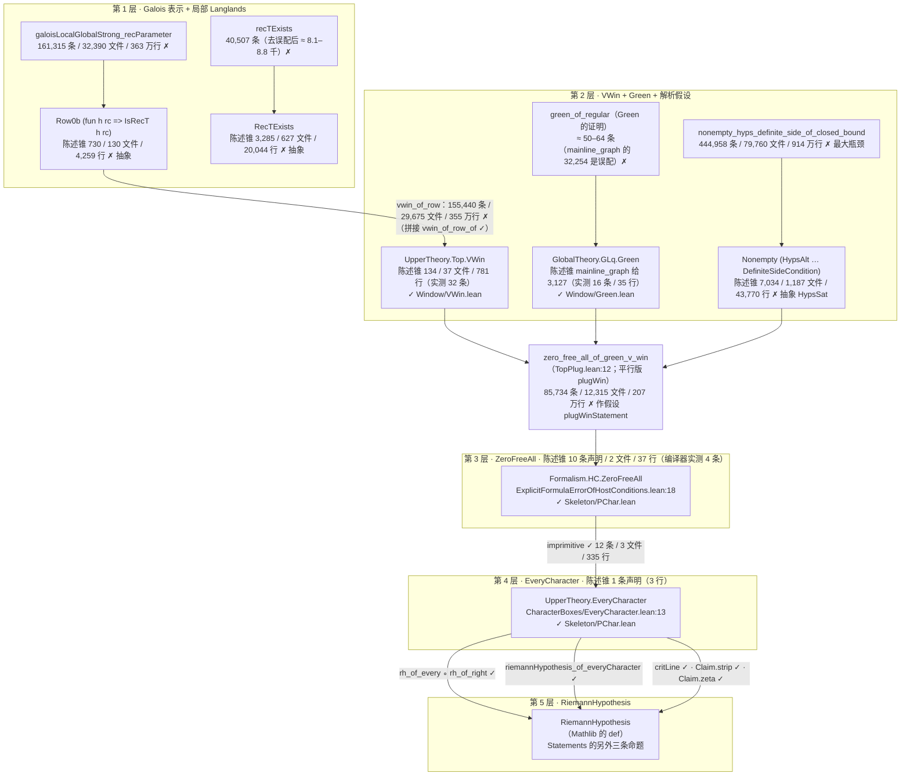

# SKELETON — 主线骨架（TASK.md 第 6 步）· 汇总

> **功劳与署名**：证明的全部数学与 Lean 代码属于 **Levent Alpöge（与 Claude 合作）**，2026-11-20 发布于 <https://alpo.ge/>，原样镜像 <https://github.com/CocoSgt/riemann-hypothesis-lean>。`skeleton/` 只是把主线上的中间结论搬成只依赖 Mathlib 的文件、把能证的层间衔接证出来、用编译器与静态分析量出每层的依赖锥；抽取、整理、编译由 **GLM 5.4 通过 DeepSeek Harness** 完成（三个并行会话：上层 `Top/`、下层 `Window/`+`Galois/`、静态依赖图；再由汇总会话合并），没有任何新的数学。原发布没有 license 文件（REPORT.md §5.6）。
>
> **环境**：Lean `v4.33.1`，Mathlib `0df444a360eaa60ab8c11dca51a86af692955474`（与 `source/` 相同）。`skeleton/` 是独立 Lake 项目（`skeleton/README.md`），`.lake/packages` 软链到 `extracted/.lake/packages`。32 GB 机器：一个 `import Mathlib` 的 `lean` 进程约 6 GB，一切编译一次只跑一个进程。

三份分文档作为附录保留：[A · `SKELETON-top.md`](SKELETON-top.md)（上层，逐条定理表）、[B · `SKELETON-lower.md`](SKELETON-lower.md)（下层，定义链与卡点）、[C · `SKELETON-graph.md`](SKELETON-graph.md)（静态依赖图的数据表）。它们写于合并之前，文件位置与数字口径跟本文不一致的地方以本文为准（附录 D 给出对照）。

## 0. 结论（一页）

1. **已经能单独引用的**（只 import Mathlib + `skeleton/`；`lake build -K jobs=1 Skeleton` 通过；`#print axioms` 只含 `propext`、`Classical.choice`、`Quot.sound`，无 `sorryAx`）：
   - **第 5 层**：`RiemannHypothesis`（Mathlib 自己的定义）和 `Statements.lean` 的四条命题（`Skeleton.RiemannZetaZerosOnLine` 等）；
   - **第 4 层**：`UpperTheory.EveryCharacter`，以及它到第 5 层的**全部**衔接：`Skeleton.rh_of_every`、`Skeleton.rh_of_right`、`Skeleton.riemannHypothesis_of_everyCharacter`、`Skeleton.critLine`、`Skeleton.Claim.strip`、`Skeleton.Claim.zeta`，和 `Main.lean` 五条定理的条件版（`Skeleton.riemannHypothesis (allChi : UpperTheory.EveryCharacter)` 等）；
   - **第 3 层**：`Formalism.HC.ZeroFreeAll` 和它到第 4 层的衔接 `UpperTheory.Top.imprimitive`；
   - **第 2 层里搬得动的两个命题**：`UpperTheory.Top.VWin`（`Window/VWin.lean`，连带 `Galois/Places.lean`、`Galois/GaloisCohomology.lean`）、`GlobalTheory.GLq.Green`（`Window/Green.lean`）；
   - **拼接定理**（深定理作假设）：`UpperTheory.Top.plugWinStatement`、`plugAll_of_plugWin`、`UpperTheory.One.vwin_of_row_of`、`UpperTheory.FinalTheorems.everyCharacter_of_row_of`、`everyCharacter_of_row_and_inputs`；入口 **`Skeleton.Layers`**（`Layer1 … Layer5`，`layer4_of_layer3`、`layer5_of_layer4`、`layer5_of_layer4'`、`layer5_of_layer3`、`mainOfLayer4`、`layer3_of_layer2`、`layer4_of_layer2`、`layer5_of_layer2`、`mainOfLayer2`、`layer4_of_layer1`、`layer5_of_layer1`）。

   一句话：**"每个本原 Dirichlet L 函数在 Re s > 1/2 无零点 ⇒ 黎曼猜想"（`Skeleton.layer5_of_layer3`）连同 `Main.lean`/`Statements.lean` 的全部结论，已经是只依赖 Mathlib 的定理**；再往下到 `Green + VWin + 解析假设` 只差一环（`zero_free_all_of_green_v_win`），骨架里以假设 `plugWinStatement HypsSat` 的形式出现。

2. **还不能单独引用的**：第 1 层 `Row0b` / `RecTExists` 的命题本身（陈述分别要 730 / 3,285 条本项目定义，含 Weil–Deligne 表示、p-adic Hodge 理论、自守表示的定义层），第 2 层的解析假设 `Nonempty (HypsAlt … DefiniteSideCondition)`（陈述要 7,034 条定义），以及所有深定理的**证明**。骨架里用抽象 `Prop` 代替（`Layer1 Row RecTExists`、`Layer2 HypsSat`），原因与代价见 §4。

3. **主线的实际路径**（§1，逐行核对过）：`Main` 走 `Row0b + recTExists → vwin_of_row → VWin`，然后在文献定理 `every_character_of_literature_of_vWin` **内部**走 `every_character_of_theta_integrals_local_matching → every_character_of_green_v_win`（`TopPlug.lean:16`）`= imprimitive (zero_free_all_of_green_v_win …)`（`TopPlug.lean:12`）`→ zeroFreeAll_of_topG`。假设是 `Nonempty (HypsAlt (fun 𝒞 => Closed 𝒞 fun Fm _ => LinkN Fm) DefiniteSideCondition)`。`CharacterBoxes/EveryCharacter.lean:8/:16` 的 `plugWin` / `plugAll`（假设 `Hyps … DRS`）是平行版本，`Main` 不经过它（唯一的使用者是 `FockModels/EveryCharacterE.lean:67–70`）；两条路在 `zeroFreeAll_of_topG`（`ZeroFreeAllOfTopG.lean:26`）汇合。骨架里的抽象衔接 `plugWinStatement HypsSat` 两条路通用。

4. **依赖锥**（§3；表中数字为 `analysis/mainline_graph.py` 的口径，与其它口径冲突处注明）：
   - 最小：第 3–5 层。陈述锥 10 / 1 / 0 条声明，衔接的证明锥 `imprimitive` 12 条、顶层 glue 16 条（6 个文件、457 行），全部只依赖 Mathlib。
   - 最大瓶颈：把解析假设证出来的 `UpperTheory.Lit.nonempty_hyps_definite_side_of_closed_bound`——662,997 条的主线锥里它一条定理占 444,958 条（67%），按瀑布算新增 32.1 万条 / 703 万行（51.6%）；其次是 Galois 表示层（161k）、自守窗口层（155k）、文献包（`every_char_lit_vWin` 598k，已包含前面所有）。
   - 整条主线的证明锥有**三版数字**：662,997（依赖图会话）、223,420（汇总会话旧稿）、41,638（旧稿的第一版）。§3.3 查清了差在哪：41,638 已作废；223,420 是系统性漏算的**下界**；662,997 是**上界性质的估计**，它对小层明显偏大（`Green` 的陈述锥算成 3,127 条，编译器实测 16 条；"公共核 32,207 条"是误配，真值 ≈ 50–64 条），对整条主线的总数没有发现同等量级的膨胀来源。两法一致的结论（glue ≈ 0、最大瓶颈是解析假设、Galois/窗口/文献包次之、`Green` 的证明极小）可以直接用。

5. **合并结果**：`Top/` 与 `Window/PChar.lean` 里重复的 `PChar`、`ZeroFreeAll`、`EveryCharacter`、`imprimitive` 合并成一份 **`skeleton/src/Skeleton/PChar.lean`**（保留源命名空间 `Formalism.HC` / `UpperTheory`，其它文件都 import 它），删除 `Top/{ZeroFreeAll,EveryCharacter,Imprimitive}.lean`，`Layers.lean` 去掉两套命名空间之间的桥接定理。22 个模块，`lake build -K jobs=1 Skeleton` 2 分 23 秒；`skeleton/axioms.txt` 覆盖 144 条公开声明（136 条依赖三条标准公理，3 条只依赖 `propext`、`Quot.sound`，5 条不依赖任何公理），0 个 `sorryAx`。

## 1. 主线：实际路径与五层

### 1.1 `Main.lean` 实际走的路（逐行核对，`source/src` 内的文件:行号）

```
Main.riemannHypothesis := rhOfAll := Formalism.VW.rh_of_every allChi                       Main.lean:4, Supplements/Kernels/MainTheorems.lean:9
allChi := UpperTheory.FinalTheorems.everyCharacter := everyCharacter_of_row galoisLocalGlobalStrong_recParameter
  everyCharacter_of_row (h : Row0b fun h rc => IsRecT h rc) : EveryCharacter :=             CharacterBoxes/MainConclusion.lean:7-11
    every_character_of_literature_of_vWin ⟨h, recTExists, h⟩ (vwin_of_row h)
      ├─ vwin_of_row h := automorphic_window_of_inputs (OpenImageCondition.mk h) baseChangeN h   VwinOfRow.lean:4 → TopMainZj.lean:71
      │     ‖ galoisLocalGlobalStrong_recParameter := galoisRepresentations_of_thetaLift TP.K.tLiftK   RowSrc.lean:6
      │     ‖ recTExists                                                                   Foundations/LocalLanglands/LocalCentralUnits/RecTExists.lean:20
      └─ every_character_of_literature_of_vWin (O) (hV) :=                                  ThetaPairLifts/ThirdPlaceSeries/EveryCharacterOfLiteratureOfVWin.lean:810
           every_character_of_theta_integrals_local_matching (published_results_eigen O) … hV
             := every_character_of_green_v_win (green_of_regular P.greenRegularCharacters) hV            …/SiegelEisensteinSecondTermHypotheses.lean:69-72
                  (nonempty_hyps_definite_side_of_closed_bound P F hA hM hX hL …)                       …:44
                = imprimitive (zero_free_all_of_green_v_win hG hV h)                                  …/TopPlug.lean:16-18
                    h : Nonempty (HypsAlt (fun 𝒞 => Closed 𝒞 fun Fm _ => LinkN Fm) DefiniteSideCondition)
                  = h.elim fun h => zeroFreeAll_of_topG (la := 3/2) (by norm_num)                     …/TopPlug.lean:12-15
                      (forall_goal_of_shape_of_hyps _ _ _ _ (shape_closed_link_n_of_green hG) trivial trivial h)
                      fun ψ => supplyChi ψ (hV ψ)                                                   CharacterBoxes/ZeroFreeAllOfTopG.lean:26
```

平行的另一版：`plugWin`（`CharacterBoxes/EveryCharacter.lean:8`）`:= zeroFreeAll_of_topG … (shape_of _ _ _ _ (shapeWin hG) trivial trivial h) fun ψ => supplyChi ψ (hV ψ)`，假设 `Nonempty (Hyps (fun 𝒞 => Closed 𝒞 fun Fm _ => LinkN Fm) DRS)`；`plugAll := imprimitive ∘ plugWin`（`:16`）。全库只有 `FockModels/EveryCharacterE.lean:67–70` 的 `everyE₂` 用它。两版的最后一步都是 `zeroFreeAll_of_topG`，只差"用哪一套 shape 定理把 Green 变成 `TopG`"和"假设包叫什么"。

### 1.2 五层的命题（`Skeleton/Layers.lean`）

| 层 | 命题（源名字与位置） | 进出这一层的衔接 | 骨架里 |
|---|---|---|---|
| **L1** Galois 表示 + 局部 Langlands | `UpperTheory.GalStar.Row0b (fun h rc => IsRecT h rc)`（`Foundations/GaloisRepresentations/TypeConditions/WeightsConjBis.lean:69`）、`UpperTheory.Zero.LLC.RecTExists`（`Foundations/LocalLanglands/IsRecTOfIsRec.lean:78`） | 出：`vwin_of_row`（⇒ VWin）；`everyCharacter_of_row`（⇒ EveryCharacter，经文献定理） | 命题**搬不动**（抽象 `Layer1 Row RecTExists`）；可搬部分 `IsQp`/`IsQpBig`、参数化的 `RecTExistsSchematic`；拼接 `vwin_of_row_of`、`everyCharacter_of_row_of` 已证 |
| **L2** 自守窗口 + 解析输入 | `UpperTheory.Top.VWin`（`CharacterBoxes/ExistsPageN.lean:49`）、`GlobalTheory.GLq.Green`（`NonGaloisDescent/LabelDatum.lean:108`）、`Nonempty (HypsAlt (fun 𝒞 => Closed 𝒞 fun Fm _ => LinkN Fm) DefiniteSideCondition)`（`ThirdPlaceSeries/Hyps.lean:22`、`DefiniteSideCondition.lean:25`） | 进：L1 → VWin；出：`zero_free_all_of_green_v_win` ⇒ ZeroFreeAll（平行版 `plugWin`） | `VWin`、`Green` **完整搬出并编译**；解析假设**搬不动**（抽象 `HypsSat`）；衔接作假设 `plugWinStatement` |
| **L3** 本原 L 函数零点自由 | `Formalism.HC.ZeroFreeAll`（`TotientGaloisClasses/ExplicitFormulaErrorOfHostConditions.lean:18`） | 出：`imprimitive` ⇒ EveryCharacter | **完整搬出**；衔接 **已证** |
| **L4** 所有 L 函数零点自由 | `UpperTheory.EveryCharacter`（`CharacterBoxes/EveryCharacter.lean:13`）= `Statements.DirichletLNonvanishingRightOfHalf` | 出：`rh_of_every`、`riemannHypothesis_of_everyCharacter`、`critLine`、`Claim.strip/zeta` | **完整搬出**；全部衔接 **已证** |
| **L5** 黎曼猜想 | `RiemannHypothesis`（Mathlib）、`Statements.lean` 其余三条 | — | Mathlib；`Main.lean` 五条定理的条件版 **已证** |

### 1.3 主线图



锥的数字是 `analysis/mainline_graph.py` 的口径（证明锥 = 证明该定理所需的全部内部声明；文件行 = 锥内文件总行数），§3.3 说明了它们哪里偏大、哪里可信。标 ✓ 的边在 `skeleton/` 里编译通过并核对过公理；标 ✗ 的没有 Mathlib-only 的证明，骨架里以抽象命题或假设的形式出现。文献定理 `every_character_of_literature_of_vWin`（598,129 条，含 `HypsAlt` 非空的证明与文献包）对应图上这样一框：它以 `VWin` 和文献包 `OpenLiteratureStatements` 为输入，在证明内部证出 `Green` 与解析假设非空，再经 `zero_free_all_of_green_v_win` 得到 `EveryCharacter`。

## 2. 已经能单独引用的（文件与定理名）

所有文件开头写明原文件:行号。命名规则：**从源里搬来的命题和衔接保留源命名空间与名字**（`Formalism.HC.*`、`UpperTheory.*`、`GlobalTheory.*`、`ReciprocityTheory.*`、`Formalism.GaloisCohomology.*` …），**只在骨架里才有的东西**（`Statements` 的副本、`Claim.*`、`PlugWin`、条件版 `Main` 定理、`LayerN`）放在 `Skeleton` 命名空间。

| 文件（`skeleton/src/`） | 可以引用的声明 | 原位置（`source/src`） |
|---|---|---|
| `Skeleton/PChar.lean`（合并后的共享底座，4 个 Mathlib 子模块的 import，单文件 10 s） | `Formalism.HC.PChar`（及 `val`、`one`、`inv`、`inv_inv`、`of`、`IsReal`）、`KSet`、`Level`（及 `ZeroFreeAbove`、`ZeroFreeLevel`、`IsEven`、`Nt`、`ofSub`、`mem_ofSub`、`cyc`、`mem_cyc`）、`PChar.ZeroFreeAbove`、`ZeroFreeOn`、`ZeroFreeEven`、**`ZeroFreeAll`**、`zeroFreeAll_iff`、`zeroFreeOn_of_levels`、`zeroFreeOn_of_cyc`、`PChar.of_self/of_one/of_inv`；**`UpperTheory.EveryCharacter`**；**`UpperTheory.Top.imprimitive : ZeroFreeAll → EveryCharacter`** | `PrimePairSizeCondition.lean:7-45`、`ExplicitFormulaErrorOfHostConditions.lean:11-127`、`CharacterBoxes/EveryCharacter.lean:13`、`CharacterBoxes/Imprimitive.lean:5` |
| `Top/Statements.lean` | `Skeleton.RiemannZetaZerosOnLine`、`DirichletLNonvanishingRightOfHalf`、`DirichletLZerosOnLine`、`PrimitiveDirichletLZerosOnLine` | `Statements.lean:3-16` |
| `Top/HalfPlane.lean` | `Skeleton.Claim.HalfPlane/Strip/Zeta`，`Claim.halfPlane_iff`、`strip_iff`、`zeta_iff_statements`、`everyCharacter_iff`（都是 `Iff.rfl`） | `CharacterBoxes/HalfPlane.lean:3-9` |
| `Top/RhOfRight.lean` | **`Skeleton.rh_of_right`**：ζ 在 Re s > 1/2 非零 ⇒ `RiemannHypothesis` | `Formalism/GammaFactorNonvanishing/RhOfRight.lean:5` |
| `Top/CritLine.lean` | `Skeleton.gammaFactor_ne_zero`、**`Skeleton.critLine`**（EveryCharacter ⇒ 本原 L 的带内零点在临界线上）、**`Skeleton.rh_of_every`** | `…/CritLine.lean:6-32` |
| `Top/RiemannHypothesisOfEveryCharacter.lean` | `Skeleton.zeta_ne_zero_of_everyCharacter`、**`Skeleton.riemannHypothesis_of_everyCharacter`**（第二条路线） | `CharacterBoxes/RiemannHypothesisOfEveryCharacter.lean:211-215` |
| `Top/ClaimStrip.lean` | `Skeleton.Claim.factor_ne_zero`、`prim_zero`、`gamma_ne_zero`、`prim_reflect`、**`strip`**、**`zeta`**、`zeta_iff` | `CharacterBoxes/ClaimStrip.lean:7-102` |
| `Top/PlugWin.lean` | `Skeleton.PlugWin (Green VWin Hyps : Prop) := Green → VWin → Hyps → ZeroFreeAll`（**未证**，不透明输入）；`Skeleton.everyCharacter_of_plugWin` | `TopPlug.lean:12-18` / `CharacterBoxes/EveryCharacter.lean:8-18`（陈述） |
| `Top/MainTheorems.lean` | `Skeleton.rhOfAll`、`critAll`、`claimAll`，`Main.lean` 五条的条件版 `riemannHypothesis`、`riemannZeta_eq_zero_re`、`LFunction_ne_zero_of_half_lt_re`、`LFunction_eq_zero_re`、`LFunction_eq_zero_re_of_isPrimitive`（都以 `allChi : EveryCharacter` 为假设），`riemannHypothesis_of_plugWin`、`mainOfPlugWin` | `Supplements/Kernels/MainTheorems.lean:7-16`、`Main.lean:4-12` |
| `Window/VWin.lean`（+ `Galois/Places.lean`、`Galois/GaloisCohomology.lean`） | **`UpperTheory.Top.VWin`**（`VVle`、`IsChiField`、`WinPair`、`PageN`、`VAt`、`VWinAt`，`VVle.mono`、`exists_pageN`）；位与 Galois 群 `Formalism.ConjugateSelfDual.{G, Qbar, cyc, IsPlaceOver, normV, Inertia, IsFrob}`、`ReciprocityTheory.Gal.{Dec, Ine, NS, GS, Z1, H1, Sha1, locFam …}`；`Formalism.GaloisCohomology.{LData, Sha, shaLen …}` | `CharacterBoxes/ExistsPageN.lean:12-77`；`ConjugateSelfDual/Statement.lean`、`GaloisValuations/Global.lean`、`GaloisCohomology/Statement.lean` 等 |
| `Window/Green.lean` | **`GlobalTheory.GLq.Green`**（`Gn`、`Mt`、`IsIrr`、`res`、`IsCusp`、`IsPrimeLab`、`IsCuspOf`、`LabelDatum` …）、`Formalism.CyclotomicNorms.{Fbar, rootsBar}`、`…ArithmeticCylinders.{entN, IsUniUp, eDat, eU}` | `NonGaloisDescent/LabelDatum.lean:11-112`、`StatementT.lean:14-17`、`ArithmeticCylinders.lean:292-307` |
| `Window/PlugAll.lean` | `UpperTheory.Top.plugWinStatement (HypsSat : Prop) := PlugWin Green VWin HypsSat`（未证的衔接的陈述）；`plugAll_of_plugWin` | `TopPlug.lean:12-18` / `EveryCharacter.lean:8-18` |
| `Galois/Row0b.lean`、`Galois/IsRecT.lean` | 只搬得出 `UpperTheory.GalStar.IsQp`、`IsQpBig`；参数化的 `UpperTheory.Zero.LLC.RecMapType`、`RecLawPred`、`RecTExistsSchematic`；`Row0b`、`IsRecT` 的原陈述以注释保存 | `WeightsConjBis.lean:15-18`、`IsRecTOfIsRec.lean:35-80` |
| `Galois/Mainline.lean` | `UpperTheory.LiteratureTheorems.OpenImageCondition`、`OpenLiteratureStatements`（参数化）；`UpperTheory.One.vwin_of_row_of`、`UpperTheory.FinalTheorems.everyCharacter_of_row_of`、`everyCharacter_of_row_and_inputs` | `MainConclusion.lean:7`、`VwinOfRow.lean:4`、`TemperedProductOfSquareIntegrable.lean:207`、`EveryCharacterOfLiteratureOfVWin.lean:215` |
| `Layers.lean`（入口）、`Skeleton.lean`（总根） | `Skeleton.Layer1 … Layer5` 与 §0 列出的全部衔接 | — |

后人现在就可以这样用（只装 Mathlib）：

```lean
import Skeleton

-- 只要第 3 层成立，就得到黎曼猜想与 Main.lean / Statements.lean 的全部结论
theorem myResult (h : Skeleton.Layer3) : RiemannHypothesis := Skeleton.layer5_of_layer3 h
theorem myResult' (h : Skeleton.Layer3) :=
  Skeleton.mainOfLayer4 (Skeleton.layer4_of_layer3 h)

-- 以第 2 层与未证的一环为假设
theorem myResult'' {HypsSat : Prop} (hW : UpperTheory.Top.plugWinStatement HypsSat)
    (hV : UpperTheory.Top.VWin) (hG : GlobalTheory.GLq.Green) (hH : HypsSat) : RiemannHypothesis :=
  Skeleton.layer5_of_layer2 hW ⟨hV, hG, hH⟩
```

## 3. 依赖锥

### 3.1 口径：每个数是哪种统计

三份附录用了三种不同的静态统计，另有编译器实测。它们都是**对源码文本的近似**，不是 Lean 的真实依赖。

| 口径 | 定义 | 谁在用 | 已知偏差 |
|---|---|---|---|
| **陈述锥** | 只为*写出*命题所需的内部声明：沿陈述里的引用走；被引用的定义/结构要带上定义体，被引用的定理只带陈述 | 依赖图会话（`analysis/mainline_graph.py`，全库索引 1,057,803 条，按 namespace + `open` 解析，点记法按名字猜）；上层会话（`top_closure2.py`，索引 `decls.jsonl` 的 1,054,991 条，允许"唯一点分后缀"匹配）；下层会话（`stmdep.py`，只在 `open`/namespace 可见时解析，根名字要落在 import 邻域内） | mainline_graph 与上层**偏大**（短名/字段名误配：把 `Om`、`K`、`loc` 这类字段名连到别处的同名声明）；下层**偏小**（notation、无名 instance、字段投影、Unicode 名看不见） |
| **含函数体** | 陈述锥 + `def` 的函数体；函数体里引用的定理只计数（"证明义务"）、不展开 | 下层会话（`stmdep.py -d`，只对 Row0b / IsRecT / VWin 做了） | 同下层的陈述锥 |
| **证明锥** | *证明*这条定理所需的全部内部声明（陈述 + 证明体里引用的一切，递归） | 依赖图会话（mainline_graph）；汇总会话旧稿（`analysis/mainline_cone.py`，strict：只在 import 闭包内可见时解析，歧义名丢弃） | mainline_graph 偏大（同上）；mainline_cone 偏小（见 §3.3） |
| **编译器实测** | 把陈述锥按拓扑序原样抄成一个只 import Mathlib 的文件（`analysis/extract_cone.py`），或手工搬进 `skeleton/`，`lake env lean` 编译通过 | 汇总会话、下层会话 | **只有它是确凿的**：能编译的那份文件就是真实陈述锥的上界 |

"行数"也有两种：mainline_graph 的**文件行**是锥内文件的总行数（实际要把文件搬过来时的量），**声明行**是锥内声明自身跨度之和（最小的量），两者平均差 1.4 倍；下层的"行数"≈声明行，上层的"行数"≈文件行。本文表中：陈述锥给"声明 / 文件 / 声明行"，证明锥给"声明 / 文件 / 文件行"。三个口径都**不含 Mathlib**（只数本项目声明），都按声明去重。

### 3.2 统一口径的表

数字取 `analysis/mainline_graph.py`（`analysis/mainline_graph.txt` / `.md`；`SKELETON-graph.md` 正文与生成表差 1–2 条的地方取生成表）。"更接近真值的读数"一列给出 §3.3 的两种校正值（去掉 ≤3 字符短名目标后的 mainline_graph、汇总会话旧稿的 strict 数），只在两者与主列相差一个量级时填。

**五层**

| 层 | 命题 | 陈述锥（声明 / 文件 / 声明行） | 进入这一层的衔接定理的证明锥（声明 / 文件 / 文件行） | 更接近真值的读数 | 骨架 |
|---|---|---|---|---|---|
| **L5** | `RiemannHypothesis` + `Statements` 四条 | 0（Mathlib） | glue `rh_of_right`、`rh_of_every`、`riemannHypothesis_of_everyCharacter`、`critLine`、`Claim.strip`、`Claim.zeta` 的并集：**16 / 6 / 457** | 一致 | ✓ 已证 |
| **L4** | `UpperTheory.EveryCharacter` | **1 / 1 / 3** | 从 L3：`imprimitive` **12 / 3 / 335** | 一致 | ✓ 陈述 + 衔接 |
| **L3** | `Formalism.HC.ZeroFreeAll` | **10 / 2 / 37** | 从 L2：`zero_free_all_of_green_v_win` 85,734 / 12,315 / 2,072,585 | 陈述：编译器 4 / 2 / 9；衔接：52,190 / 36,760 | ✓ 陈述；衔接 ✗（假设） |
| **L2** | `UpperTheory.Top.VWin` | 134 / 37 / 781 | 从 L1：`vwin_of_row` 155,440 / 29,675 / 3,549,032 | 陈述：编译器 32 条（+ Galois 两个文件）；衔接：121,362 / 55,279 | ✓ 陈述；衔接 ✗（拼接已证） |
| | `GlobalTheory.GLq.Green` | 3,127 / 596 / 19,259 | `Green` 的证明 `green_of_regular` 32,254 / 5,381 / 945,849 | 陈述：**编译器 16 / 3 / 35**；证明：**≈ 50–64** | ✓ 陈述；证明 ✗ |
| | `Nonempty (HypsAlt … DefiniteSideCondition)` | 7,034 / 1,187 / 43,770（`HypsAlt`）；`DefiniteSideCondition` 6,314 / 1,063 / 40,034 | 解析假设的证明 `nonempty_hyps_definite_side_of_closed_bound` 444,958 / 79,760 / 9,141,428 | 陈述：2,853 / 4,008；证明：391,529 / 114,310 | ✗ 抽象 `HypsSat` |
| **L1** | `UpperTheory.GalStar.Row0b` | 730 / 130 / 4,259 | ⇒ Row0b：`galoisLocalGlobalStrong_recParameter` 161,315 / 32,390 / 3,629,195 | 陈述：347 / 304；证明：103,321 / 44,609 | ✗ 命题搬不动；拼接 ✓ |
| | `UpperTheory.Zero.LLC.RecTExists` | 3,285 / 627 / 20,044 | `recTExists` 40,507 / 6,973 / 1,134,533 | 陈述：112 / 70；证明：**8,784 / 8,099** | ✗（参数化版 `RecTExistsSchematic`） |
| 整体 | `Main.riemannHypothesis` | — | **662,997 / 132,338 / 13,629,204**（全库 1,057,803 条的 63%、175,187 文件的 76%、1,737 万行的 78%） | 594,213 / 223,420（见 §3.3） | 条件版 ✓ |

**层间衔接与中间定理**

| 衔接 | 源定理（位置） | 证明锥（声明 / 文件 / 文件行） | 更接近真值的读数 | 骨架 |
|---|---|---|---|---|
| L4 → L5 | `rh_of_right`（`RhOfRight.lean:5`）、`rh_of_every`（`CritLine.lean:29`）、`riemannHypothesis_of_everyCharacter`（`:215`）、`critLine`、`Claim.strip`、`Claim.zeta` | 1 / 3 / 3 / 3 / 7 / 9 条（并集 16 / 6 / 457） | 一致（逐条与源文件核对） | ✓ |
| L3 → L4 | `imprimitive`（`Imprimitive.lean:5`） | 12 / 3 / 335 | 9 / 6 | ✓ |
| L2 → L3 | `zero_free_all_of_green_v_win`（`TopPlug.lean:12`，实际路线） | 85,734 / 12,315 / 2,072,585 | 52,190 / 36,760 | ✗ 假设 `plugWinStatement` |
| | ├ `shape_closed_link_n_of_green`（`ThirdPlaceSeries/TopShape.lean:33`） | 84,862 / 12,187 / 2,050,795 | — | ✗ |
| | ├ `forall_goal_of_shape_of_hyps`（解析核心） | 36,024 / 5,905 / 1,059,400 | — | ✗ |
| | ├ `zeroFreeAll_of_topG`（`ZeroFreeAllOfTopG.lean:26`，两路线共用） | 33,159 / 5,583 / 977,431 | **1,998 / 773** | ✗ |
| | └ `supplyChi`（`CharacterBoxes/SupplyChi.lean:8`） | 32,295 / 5,389 / 946,569 | **202 / 166** | ✗ |
| （平行） | `plugWin`（`EveryCharacter.lean:8`）、`plugAll`（`:16`） | 85,140 / 12,215 / 2,057,221；85,143 / 12,216 / 2,057,256 | — | ✗（Main 不经过） |
| L1 → L2 | `vwin_of_row`（`VwinOfRow.lean:4`）= `automorphic_window_of_inputs`（155,147）+ `baseChangeN`（60,105 / 10,733 / 1,519,292） | 155,440 / 29,675 / 3,549,032 | 121,362 / 55,279 | 拼接 `vwin_of_row_of` ✓ |
| L1 → L4 | `every_character_of_literature_of_vWin`（`EveryCharacterOfLiteratureOfVWin.lean:810`，含文献包与解析核心） | 598,129 / 117,754 / 12,363,640 | 539,536 / 188,543 | 拼接 `everyCharacter_of_row_of` ✓ |
| | ├ `every_character_of_theta_integrals_local_matching`（`:69`） | 454,066 / 80,625 / 9,283,257 | — | ✗ |
| L2（Green） | `green_of_regular`（`Proofs/InertiaEigenvalues/SumRangeEqRoots.lean:225`） | 32,254 / 5,381 / 945,849 | **≈ 50–64** | ✗ |
| L2（解析假设） | `nonempty_hyps_definite_side_of_closed_bound`（`SiegelEisensteinSecondTermHypotheses.lean:44`） | **444,958 / 79,760 / 9,141,428** | 391,529 / 114,310 | ✗ |
| L1 | `galoisLocalGlobalStrong_recParameter`（`RowSrc.lean:6`）、`recTExists`（`RecTExists.lean:20`） | 161,315 / 32,390 / 3,629,195；40,507 / 6,973 / 1,134,533 | 103,321 / 44,609；8,784 / 8,099 | ✗ |

### 3.3 整条主线的证明锥：三版数字差在哪

同一件事（`Main.riemannHypothesis` 的证明锥，不含 Mathlib，按声明去重）有三个数：**662,997**（依赖图会话，`analysis/mainline_graph.py`，占全库 63%）、**223,420**（汇总会话旧稿，`analysis/mainline_cone.py` strict，21%）、**41,638**（同一旧稿的第一版，4%）。汇总会话用 `analysis/conecheck/compare_cones.py` 把两套结果逐条对了一遍（结果在 `analysis/conecheck.txt`；复现需要 `/tmp/mlg/*.pkl`，即 mainline_graph 的索引与边缓存），结论如下。

**差在哪（都是解析规则，不是根的选取、含不含 Mathlib 或去重方式）**。三者都以 `Main.riemannHypothesis` 为根、都只数本项目声明、都按声明去重。差别全在"文本里的一个标识符算不算对某条声明的引用"：

| | mainline_graph（662,997） | mainline_cone 旧稿（223,420） | 旧稿第一版（41,638） |
|---|---|---|---|
| 索引 | 自己扫全库：1,057,803 条，处理 `_root_` 前缀与 Unicode 名 | `analysis/decls.jsonl`：1,054,991 条 | 同左 |
| 标识符 | Unicode 也认；namespace 由内到外 → `open` → 根；点记法按名字猜；**不检查**引用处是否 import 了被引用声明 | 只认 **ASCII** 标识符；只在 import 闭包内可见时解析；**歧义短名一律丢弃** | 另外只认 ≥3 个字母的名、不按接收者类型解析点记法 |
| `_root_.X` 声明的名字 | 还原成 `X` | **仍记作 `_root_.X`**（48,230 条） | 同左 |

**223,420 为什么偏小（构造性的原因，可以逐条核对）。** `decls.jsonl` 把 48,230 条声明（4.6%）记成 `_root_.X.Y`，而 `depindex` 用引用处写的名字 `X.Y` 去查，查不到——于是所有指向这些声明的引用都丢了。例子：`theorem _root_.GlobalTheory.T.normPrimesImagQuad_short_interval_lower_bound`（`Proofs/GlobalInterpolation/NormPrimesImagQuadShortIntervalLowerBound.lean:8`）在 `ShortNorms/Primes.lean:5` 被写成 `GlobalTheory.T.normPrimesImagQuad_short_interval_lower_bound`，这是 `supplyChi → supplyOfAdm → shortNorm` 这条主线路径上的必经引用。这类声明在 223,420 条的锥里**一条都没有**，在 662,997 条的锥里有 36,523 条；沿 mainline_graph 的边往下走，662,997 条里有 580,225 条（87.5%）位于它们下游。另外两个漏算来源：分词只认 ASCII，名字里带 `₂`、希腊字母、`𝓞` 的声明（662,997 条的锥里有 25,753 条，例如被引用 6,198 次的枢纽 `Formalism.BasicNotions.SizeData₂`）的引用全部丢失；歧义短名（文件普遍 `open` 十几个 namespace）一律丢弃。所以 223,420 是**下界**，而且偏低很多。

**662,997 为什么偏大（偏在哪可以定位）。** mainline_graph 把定义体里的短名、字段名猜成对别处同名声明的引用。最严重的一处：枢纽结构 `Formalism.BasicNotions.D7`（262 行）的定义体有 68 条"陈述边"连到 `Ad3.R.Om`、`UpperTheory.V.HV.Host.q`、`ChowFormHeightComparison₂.CF.C.loc`、`UpperTheory.V.Af.Fin.emb`、`Formalism.SA.A.LL` 这类声明——它们其实是 D7 的**字段名**（`Om`、`K`、`q`、`loc`、`emb`、`LL`）。`Green`、`HostExW`、`TopG`、`FamP`、`GreenRegularCharacters` 都（经 `D7`）沾上这棵约 3.2 万条的假子树，而几乎所有非 glue 的主线定理的陈述都要引用它们，于是每一层的锥都被多算了约 3.2 万条。编译器实测可以证伪这一处：`Green` 的陈述锥 mainline_graph 给 3,127 条，搬进 `skeleton/Window/Green.lean` 的只有 16 条 / 3 个文件 / 35 行，去掉 `D7` 的出边后 mainline_graph 自己也给 17 条；`VWin` 给 134 条，实测 32 条；`ZeroFreeAll` 给 10 条，实测 4 条。同理，`SKELETON-graph.md` 的"公共核 32,207 条 = `green_of_regular` 的锥"**是误配的产物**：去掉 `D7` 的出边，`green_of_regular` 的证明锥是 64 条（去掉所有 ≤3 字符的短名目标是 50 条）。受影响的"小层"读数应以 §3.2 的"更接近真值"一列为准：`green_of_regular` ≈ 50–64，`supplyChi` ≈ 166–202，`zeroFreeAll_of_topG` ≈ 773–1,998，`recTExists` ≈ 8,099–8,784。

对整条主线的**总数**，这个误配源不改变数字：去掉 `D7` 的全部出边，锥仍是 662,997 条（假子树里的声明都能从别的真引用到达）；把所有 ≤3 字符短名的目标全部去掉（这一刀同时切掉 `Sp`、`ev`、`KK` 这类真引用）是 594,213 条。随机抽样：从"mainline_graph 有、旧稿没有"的 478,710 条里随机取 70 条（两种子），每一条都能在引用它的声明的文本里找到自己的名字（如 `have hp := genHasVal_powGen …`、`rw [hcol, comb_mul]`、`obtain ⟨u, hu⟩ := mem_intU hm`）；从锥内 460 万条边里随机取 45 条，约 39–42 条明确是真引用，3 条经 section `variable` 引用，2–4 条可疑（如 `ea.symm` 被连到 `…Pull.Tri.symm`）。

**有把握的结论。**

1. 41,638 作废（同一方法的更粗版本，已被 223,420 取代）。
2. **223,420 只能当下界读，而且肯定偏低**：它确定漏掉了至少 36,523 条用 `_root_.` 声明、在主线上被真实引用的定理（沿 mainline_graph 的边，它们的下游有 58 万条）。它自己是否含误配没有核对（有 41,752 条不在 mainline_graph 的锥里）。
3. **662,997 只能当上界性质的估计读**：它对小层肯定偏大（上节已证伪）；对总数，能定位的膨胀来源只有短名误配这一类，敏感性测试是 −10.5%（去掉所有 ≤3 字符的目标，但这一刀也切掉真引用），随机 45 条边里 2–4 条可疑。它自己是否漏掉真引用也没有核对（同上 41,752 条）。
4. **误差范围**：两种方法都认的声明有 181,469 条，各说各的有 52 万条（47.9 万 + 4.2 万）。有把握的说法是"整条主线的证明锥是几十万条声明、占全库的 20%–63%"，不能更细。两法**一致**的结论可以直接用：顶层 glue（16 条）与 `imprimitive`（12 条）的锥几乎是 0；最大瓶颈是把解析假设证出来的 `nonempty_hyps_definite_side_of_closed_bound`（占各自总数的 67% / 51%）；其次是 Galois 表示、自守窗口、文献包（顺序相同）；`Green` 的证明极小（≈ 50–64 条）。
5. 要得到确凿的数字，只能靠 Lean 内核级别的常量依赖遍历（需要整库的 olean，约 100 GB 内存），本机做不了；在此之前，表中的 mainline_graph 数字应当读作"上界性质的估计"，旧稿的数字读作"下界"。

### 3.4 公共核与瀑布（mainline_graph 口径，按 §3.3 修正）

去掉 glue 后，各层的锥互相重叠得厉害。mainline_graph 报告"七个非 glue 层的交集 = 32,205 条 / 5,377 文件 / 945,022 行"，并指出它就是 `green_of_regular` 的锥——按 §3.3，这个数**就是**挂在 `D7` 字段名上的那棵假子树，不是真实的公共核（`green_of_regular` 的真实锥 ≈ 50–64 条）。同理，附录 C 说"`RecTExists`、`Green`、`Closed`、`LinkN`、`TopG` 等九个命题的陈述锥两两共享约 3,120 条'解析核心基本词汇'"，也是这棵假子树在只走陈述边时的样子：去掉 `D7` 的出边后，`Green` 的陈述锥是 17 条、`RecTExists` 259 条、`TopG` 1,380 条。各层真实的公共部分因此要小得多，等 `Row0b`/`RecTExists` 抽出来时才能量准。`recTExists` 的锥被 Galois、窗口、Hyps、EveryCharacter 四层完全包含（它不是独立的瓶颈），这一条在两种口径下都成立。

按"在前面各层之上新增多少"排成瀑布（每行 = 这一层的锥减去上面所有行的并；mainline_graph 的层集合里 ZeroFreeAll 路取的是平行版 `plugWin`，与实际路线的 `zero_free_all_of_green_v_win` 只差末端 85,140 ↔ 85,734）：

| 步骤 | 新增声明 | 新增文件 | 新增行数 | 占 Main 证明锥 |
|---|---:|---:|---:|---:|
| 公共核（mainline_graph 记作 `green_of_regular` 的锥） | 32,254 → **实为 ≈ 50–64** | 5,381 → ≈ 5 | 945,849 → ≈ 500 | 6.9% → ≈ 0% |
| + LLC（`recTExists`） | 8,300 | 1,735 | 235,809 | 1.7% |
| + Galois 表示（`gal_row0b`） | 120,807 | 26,646 | 2,911,812 | 21.4% |
| + 自守窗口（`vwin_of_row`） | 52,548 | 10,952 | 1,351,332 | 9.9% |
| + **Hyps 非空**（`nonempty_hyps_definite_side_of_closed_bound`） | **321,474** | **59,873** | **7,028,023** | **51.6%** |
| + 文献包（`every_char_lit_vWin` 的其余部分） | 127,607 | 34,672 | 3,309,780 | 24.3% |
| 累计 | 662,990 | 132,333 | 13,629,068 | 100% |

每一行的绝对值都带着 §3.3 的不确定性（旧稿的 strict 口径给 Galois 44.6k、窗口 55.3k、Hyps 114k、文献包 189k），但**排序不变**：解析假设 ≫ Galois 表示 > 文献包 ≈ 窗口 > LLC ≫ Green。按目录看，`Development.AbelianVarietyTheory.Proofs` 在 mainline_graph 的 Main 锥里有 26.9 万条声明 / 598 万行（44%）；按库看，CompanionTheory 89%、AutomorphicSpectrum 80%、WeilBound 79%、ReciprocityTheory 79%、AbelianVarietyTheory 77% 在锥内，不在主线里的主要是 `Development.EtaleCohomology`（11%）和 `DiscreteGroups`（51%）——这些比例同样是上界性质的（旧稿给 AbelianVarietyTheory 7.7%、AutomorphicSpectrum 8.8%，差异来自 `_root_` 漏算）。

### 3.5 三份附录之间的数字冲突（逐条）

| 命题 | mainline_graph 陈述锥（声明 / 文件 / 声明行） | 下层（陈述级闭包） | 上层（陈述依赖锥） | 编译器实测 | 本文取值与说明 |
|---|---|---|---|---|---|
| `UpperTheory.EveryCharacter` | 1 / 1 / 3 | 0 内部依赖 | — | Mathlib-only | 一致 |
| `Formalism.HC.ZeroFreeAll` | 10 / 2 / 37 | 7 个定义 / 15 行 | — | **4 条 / 2 文件 / 9 行**（`extract_cone.py`；骨架里就是 `PChar`、`PChar.ZeroFreeAbove`、`ZeroFreeOn`、`ZeroFreeAll`） | 表中用 10 / 2 / 37；实际只需 4 条（mainline_graph 把同文件的 `KSet`/`Level`/`PChar.one`/`inv`/`IsReal` 也算进来） |
| `GlobalTheory.GLq.Green` | 3,127 / 596 / 19,259 | 15 个定义 / 35 行 | 118 / 49 文件 / 10,629 行 | **16 条 / 3 文件 / 35 行** | 表中用 mainline_graph 并注明：这个数是 `D7` 字段名误配造成的（§3.3），**真实陈述锥 = 16 条**（上层与下层也分别偏大、偏小） |
| `UpperTheory.Top.VWin` | 134 / 37 / 781 | 31 定义 + 1 定理 / 链 13 / 84 行（含函数体 34 / 86） | 1,292 / 477 文件 / 113,109 行 | 32 条（手工版编译通过；自动草稿 44 条差 3 处无名 instance） | 表中用 134 / 37 / 781 并注明：锥里混入 `GlobalTheory.Twist.*` 等短名误配，**真实 = 32 条 + Galois 两个文件** |
| `UpperTheory.GalStar.Row0b` | 730 / 130 / 4,259 | 168 节点（150 定义 + 18 定理）/ 链 15 / 462 行；含函数体 225 / 链 17 / 573 行 | — | 自动草稿 372 条，100+ 错误 | 表中用 730 / 130 / 4,259；下层给的 225 条是下界（notation、instance、投影看不见） |
| `UpperTheory.Zero.LLC.RecTExists` / `IsRecT` | 3,285 / 627 / 20,044 | 150（143 定义 + 7 定理）/ 链 14 / 360 行；含函数体 168 / 链 16 / 389 行 | — | 自动草稿 85 条，100+ 错误 | 表中用 mainline_graph；去掉 `D7` 出边是 259 条、去掉短名目标 112 条，下层的 150–168 条落在中间 |
| `HypsAlt … DefiniteSideCondition`（实际路线） | 7,034 / 1,187 / 43,770；6,314 / 1,063 / 40,034 | 只测了平行的 `Hyps … DRS`：1,973 节点 / 链 32 / 8,909 行 | `Hyps` 3,844 / 1,103 文件 / 254,143 行；`DRS` 3,219 / 982 | 未尝试 | 表中用 mainline_graph；三者都是"2,000–7,000 个定义、链深 13–32"的量级 |
| `plugWin` 一环的中间命题（`TopG`、`TopShape`、`shapeWin`、`shape_of`、`supplyChi`、`zeroFreeAll_of_topG`、`HostExW`） | `TopG` 3,412 / 653 / 21,267；`TopShape` 6,749 / 1,140 / 42,247；`HostExW` 3,160 | `shapeWin` 2,085 节点 / 链 34；`shape_of` 2,070；`zeroFreeAll_of_topG` 289 / 链 22；`supplyChi` 81 / 链 13 | `plugWin` 3,881 / 1,103 / 255,448；`shape_of` 3,920 / 1,125；`zeroFreeAll_of_topG` 1,715 / 594；`supplyChi` 1,372 / 492 | — | 三个口径量级一致：陈述层面 ≈ 2,000–7,000 个定义、链深 13–34；具体数不可比（解析规则不同），表中引 mainline_graph |

## 4. 还不能单独引用的：原因与代价

| 环节 | 卡点（具体到定义/定理） | 规模（mainline_graph 口径；括号内为更接近真值的读数） | 要多少才能动 |
|---|---|---|---|
| **L1 命题** `Row0b` | `PropsB`/`AboveB` 的字段要带上 Weil–Deligne 表示（`WD`、`WDRep`、`wdMat`、`wdOf` …）、p-adic Hodge 理论的定义层（`LocBridge`、`LocAinf`、`LocPrime`、`LocTied`、`PeriodData`、`Per.{Ainf, OC, Tilt}` …）、自守表示的定义层（`CuspSub`、`CG`、`IsRegAlg`、`HChar`、`PolarizedPair` …）；定义体里要 45 条定理当项用（最重的是 `exists_frobenius_semisimplification`） | 陈述锥 730 条 / 130 文件 / 4,259 行；下层：150 定义 + 18 定理，链 15（含函数体 225 / 573 行） | 约 60 个文件、2,000–3,000 行，分三步：Weil–Deligne 地基（约 500 行）→ `IrrGL`/`Segment` 族（约 2,400 行）→ `CuspSub`/`Pst`/`Loc*`（约 2,000 行） |
| **L1 命题** `IsRecT` / `RecTExists` | `TypeLaw` 要 `IsLocalArtin`、`IsRegularChar`、`TameGen.Inflates`、局部互反律的 idele 群 `Neutral.B1.*`；`LawsT` 的 `langlands`/`dual`/`depth` 字段要 Bernstein–Zelevinsky 的段与抛物诱导（`SmGL.*`，5 个文件约 2,400 行） | 陈述锥 3,285 条 / 627 文件 / 20,044 行；下层：143 定义 + 7 定理，链 14 | 与 `Row0b` 共享 Weil–Deligne 地基；骨架里给参数化版 `RecTExistsSchematic` |
| **L1 证明** `galoisLocalGlobalStrong_recParameter` | θ 提升 → Galois 表示：`galoisRepresentations_of_thetaLift`（139,600 条）+ `TP.K.tLiftK`（59,210 条） | 161,315 条 / 32,390 文件 / 363 万行（103,321 / 44,609） | 一次一个文件也要数天；且静态锥不精确 |
| **L1 证明** `recTExists` | `artEx`、`cuspEx`、`exists_isLExt`、`extDim/extTw/extDual/extInj/extDepth/typeIff` | 40,507 条 / 6,973 文件 / 113 万行（8,784 / 8,099） | 约 900 个文件（mainline_graph 口径） |
| **L1 → L2** `vwin_of_row` | `automorphic_window_of_inputs`（`TopMainZj.lean:71`，窗口估计 + 模性提升）+ `OpenImageCondition.mk` + `baseChangeN`（`DefiniteNHolds.lean:5`，基变换） | 155,440 条 / 29,675 文件 / 355 万行（121,362 / 55,279） | 约 2.3–2.9 万个文件 |
| **L2 命题** `HypsAlt … DefiniteSideCondition` | `Type 1` 结构、40 多个字段，每个都是一条全局解析假设（`RowsB`、`TieTwRec`、`ClassNumberFormula₂`、`TwistedPeriodAdmissible` …）；`DefiniteSideCondition` / `DRS` 是具体数据 | 陈述锥 7,034 条 / 1,187 文件 / 43,770 行（2,853–4,008 条） | 不是"搬定义"能解决的：应把"可满足"当作解析核心层的**命题**（骨架里 `HypsSat`），等那一层单独抽出后再实例化 |
| **L2 → L3** `zero_free_all_of_green_v_win` | `zeroFreeAll_of_topG`（`zeroFreeOn_of_tiedWin_cyc`、`level_gm_le_on_family_scales`、`formB`）、`shape_closed_link_n_of_green`（平行版 `shapeWin`：`link_gl`、`link_brest`、`link_ex`、`link_eta`、`link_g`、`link_alt`、`wire_sel`、`topDesWin` …）、`supplyChi`（`supplyOfAdm` → `shortNorm` → 虚二次域素数短区间下界）、`forall_goal_of_shape_of_hyps` / `shape_of` | 85,734 条 / 12,315 文件 / 207 万行（52,190 / 36,760）；其中 `zeroFreeAll_of_topG` 33,159（773–1,998）、`supplyChi` 32,295（166–202）、`shape_closed_link_n_of_green` 84,862 | 1.2 万个文件；但 `zeroFreeAll_of_topG` 与 `supplyChi` 本身很小，大的只是 `shape_*` 一族 |
| **L2 证明** 解析假设非空 | `nonempty_hyps_definite_side_of_closed_bound`（`:44`）：`hypotheses_nonempty_of_unramified_exponents_alt`（41.0 万条）、`open0_of_unitary_group_hypotheses`（19.7 万）、`ontoX_and_lamLow_of_unitaryGroupHypotheses'`（16.9 万）、`fourier_coefficient_fit_of_join_alt`（13.2 万）、`test_vector_assembly_holds`（11.8 万）、`linked_bundles_l3_of_open_alt`（10.9 万） | 444,958 条 / 79,760 文件 / 914 万行（391,529 / 114,310） | 整个解析核心（`Development.AbelianVarietyTheory.Proofs` 为主）；只能整层处理（NEXT.md 阶段 2–5） |
| **L2 证明** `Green` | `green_of_regular` 本身很小；`supplyChi` 一支的 `shortNorm`（虚二次域素数短区间）是独立的解析数论结果 | ≈ 50–64 条（mainline_graph 的 32,254 是误配） | 可以单独抽，值得下一步就做 |
| **L1 → L4** 文献包 | `every_character_of_literature_of_vWin`：177 条"已发表定理"的证明（`topCovolSlim2_use_alt_alt` 18.3 万条、`published_results_arithmetic` 13.2 万、`published_results_eigen` 11.7 万、`siegel_toroidal_integral_of_literature` 9.8 万、`toroidal_for_fan_ks_of_literature` 9.8 万 …） | 598,129 条 / 117,754 文件 / 1,236 万行（含上面所有；自身新增 127,607 条 / 331 万行） | 文献定理逐条是独立的大结果（resolution of singularities、Moriwaki bigness、Poincaré–Lelong …），适合按主题分别并入 Mathlib，不适合整体搬 |

自动化能走多远：`analysis/extract_cone.py` 对 `ZeroFreeAll`（4 条）和 `Green`（16 条）一次成功；`VWin`（44 条）差 3 处源文件里没有名字的 `instance`；`IsRecT` / `Row0b`（85 / 372 条）各 100 多个错误（`variable` 作用域与显式 binder 重名、无名 instance、private 引理、notation）。"搬定义"在几十条的规模可以自动化，几百条以上需要人。

## 5. 这次"真抽出来"的是什么

按 TASK.md"选依赖锥最小、最低的一层"：**第 3 → 4 → 5 层整条链**（陈述 + 全部衔接）都抽进了 `skeleton/` 并编译、核对公理：

1. 第 3 层的命题 `PChar`、`ZeroFreeAll`（`Skeleton/PChar.lean`）；`analysis/extract_cone.py` 自动抽出的同一锥（4 条 / 2 文件）单独编译通过，证明这就是全部依赖。
2. `imprimitive`（`Imprimitive.lean:5` 的 35 行证明原样），`Layer3 → Layer4`。
3. `rh_of_right`、`rh_of_every`、`riemannHypothesis_of_everyCharacter`、`critLine`、`Claim.strip/zeta`，`Main.lean`/`Statements.lean` 的条件版，装成 `layer5_of_layer3`、`mainOfLayer4`。
4. 顺带把第 2 层搬得动的两个命题完整抽出：`Green`（16 条 / 3 文件 / 35 行，`analysis/extract_cone.py` 编译通过）和 `VWin`（32 条 + Galois 上同调与位的定义，下层会话手工版）。

从 `ZeroFreeAll` 往下的一环（`zero_free_all_of_green_v_win`）这次的机器上抽不动（85,734 条；即使按 §3.3 的下界也有 36,760 条），卡点见 §4。

## 6. 构建与核对

```bash
cd skeleton
export PATH=$HOME/.elan/bin:$PATH            # v4.33.1 在 ~/.elan（不在工作区 .elan/）
lake build -K jobs=1 Skeleton                 # 整个骨架，22 个模块，单进程；Mathlib 缓存已就绪时 2 分 23 秒
python3 make_axioms.py                        # 重新生成 Axioms.lean 与 Top/Axioms.lean（新增文件后）
lake env lean Axioms.lean > axioms.txt        # 144 条公开声明的 #print axioms
python3 make_axioms.py --check axioms.txt     # 144 条：136 × [propext, Classical.choice, Quot.sound]，3 × [propext, Quot.sound]，5 × 无；非标准公理 0，sorryAx 0
lake env lean src/Skeleton/Top/Axioms.lean > src/Skeleton/Top/axioms.txt   # Top/ 的 36 条，全部三条标准公理
```

- 合并前（2026-11-23 00:59，三个会话的版本，commit 8c87614）`lake build -K jobs=1 Skeleton` 也通过（25 个模块）；合并删掉 3 个重复模块、把 `Window/PChar.lean` 移成共享的 `Skeleton/PChar.lean`，现在是 22 个模块。
- `Skeleton/PChar.lean` 只 import 4 个 Mathlib 子模块（`Algebra.Group.Subgroup.ZPowers.Basic`、`NumberTheory.DirichletCharacter.Orthogonality`、`NumberTheory.LSeries.DirichletContinuation`、`RingTheory.Conductor`），单文件 10 秒；`Top/` 各文件也是窄 import（11–24 秒）。`Window/`、`Galois/` 的文件仍是 `import Mathlib`（机器负载高时单文件 3.5–18 分钟，缓存热时 30 秒左右），收窄 import 是以后的顺手活。
- `Top/ClaimStrip.lean:98` 保留原文的 `haveI :` 写法，`linter.style.haveILetI` 给一个 warning（那里确实要注册实例）。
- 重算依赖图：`python3 analysis/mainline_graph.py`（全量约 15 分钟，读 `source/`）；两版证明锥的对照：`python3 analysis/conecheck/compare_cones.py`（约 10 分钟，需要 mainline_graph 的 `/tmp/mlg/*.pkl` 缓存与 `analysis/decls.jsonl`）。

## 7. 以后怎么接着做

1. **现在就能往 Mathlib 提的 glue**（REPORT.md §2 #49–52）：`rh_of_right`、`rh_of_every`、`riemannHypothesis_of_everyCharacter`、`critLine`、`Claim.*`、`imprimitive`——在 `skeleton/` 里已经是 Mathlib-only、公理干净；命名建议见附录 A §5.4（如 `riemannHypothesis_of_zeta_ne_zero_right`、`DirichletCharacter.LFunction_ne_zero_of_primitive`）。
2. **第 3–5 层作为独立小库维护**（`skeleton/` 就是），入口 `Skeleton.Layers`；`Layer1`、`HypsSat` 保持抽象，等下层抽出来再实例化。
3. **按陈述锥而不是证明锥安排命题文件的顺序**（附录 C §7）：`ZeroFreeAll`（✓）→ `VWin`（✓）→ `Row0b`（730 条 / 130 文件，约 60 个文件、2,000–3,000 行，分三步：Weil–Deligne 地基 → `IrrGL`/`Segment` 族 → `CuspSub`/`Pst`/`Loc*`；其中 `parInd`/`Segment`/`IsL`/`segSum` 是 Bernstein–Zelevinsky 的标准内容，Mathlib 没有，本身可考虑贡献）→ `RecTExists`（与 `Row0b` 共享地基；去掉 `D7` 误配后陈述锥 259 条）→ `TopG` / `Closed` / `LinkN` 等中间命题（1,380 条上下）→ `HypsAlt`（7,034 条，去掉短名目标后 2,853 条）。附录 C 建议的"先做一个约 3,120 条 / 600 个文件的共享基本词汇文件"，按 §3.3 是误配的产物；真实的共用词汇要等 `Row0b`/`RecTExists` 抽出来时再定。
4. **第一个值得整块处理的证明锥**：`zeroFreeAll_of_topG`（去掉误配后 ≈ 773–1,998 条）和 `supplyChi`（≈ 166–202 条）——它们是 L2 → L3 这一环里真正小的部分；`shape_closed_link_n_of_green` 一族（84,862 条）才是大头。`green_of_regular`（≈ 50–64 条）可以顺手抽出。附录 C 推荐的"公共核 32,207 条"按 §3.3 已不成立。
5. **最大瓶颈不靠搬定义解决**：解析假设非空（`nonempty_hyps_definite_side_of_closed_bound`，占主线的 51–67%）与文献包（`every_char_lit_vWin` 的其余部分，24%）是 `Development.AbelianVarietyTheory.Proofs` 与若干已发表定理的证明，应按 NEXT.md 的阶段 2–5 整层、按主题处理；其中文献定理（resolution of singularities、Moriwaki bigness、Poincaré–Lelong、Fargues–Fontaine 曲线 …）适合逐条并入 Mathlib。
6. **工程上的三条经验**：(a) 一次编译一个进程、窄 import；(b) 自动抽取在几十条的规模可行，几百条以上要人；(c) **同一份定义只搬一次**——这次上层、下层各搬了一份 `PChar`/`ZeroFreeAll`/`EveryCharacter`/`imprimitive`，汇总时多做了桥接再合并；以后的并行分工按"定义链"而不是按"层"切。

## 8. 待人工确认

1. §1.1 的路径是按证明文本逐行读出来的；`HypsAlt … DefiniteSideCondition` 与 `Hyps … DRS` 在数学上是不是同一个假设的两种写法，需要读过证明的人确认。
2. §3 的所有数字都是文本分析的近似：小锥以编译器实测为准，大锥 mainline_graph 是上界、旧稿是下界（§3.3）；确切数字要等内核级的依赖遍历。
3. 骨架里 `Layer1`、`HypsSat` 用抽象 `Prop` 代替源命题，与源命题的对应靠 docstring 里的文件:行号，不是 Lean 内的类型等式。
4. License：原发布没有 license 文件（REPORT.md §5.6），`skeleton/` 与 `extracted/` 一样是原样搬运，对外再分发需作者确认。

## 附录

- **A · [SKELETON-top.md](SKELETON-top.md)**：上层骨架逐条定理表、`plugWin` 一环的卡点（中间命题的陈述锥）、编译记录。
- **B · [SKELETON-lower.md](SKELETON-lower.md)**：下层骨架的定义链（`Row0b`、`IsRecT` 各深度的代表定义、45 条证明义务）、`Hyps` 的结构、拼接定理、`stmdep.py` 脚本。
- **C · [SKELETON-graph.md](SKELETON-graph.md)**：静态依赖图的方法、校验、55 个根的锥、瀑布、枢纽定义；其"公共核 = 32,207 条"与 `Green`/`VWin`/`ZeroFreeAll` 的陈述锥数字按本文 §3.3 修正后阅读。
- **D · 合并前后的文件对照**

| 合并前（三个会话的版本，commit 8c87614） | 合并后 | 说明 |
|---|---|---|
| `Window/PChar.lean`（`Formalism.HC.*`、`UpperTheory.*`） | **`Skeleton/PChar.lean`** | 移到共享位置，吸收下面三文件的内容；`import Mathlib` 收窄为 4 个子模块 |
| `Top/ZeroFreeAll.lean`（`Skeleton.PChar`、`Skeleton.ZeroFreeAll` …、`zeroFreeAll_iff`） | 删除 | 重复定义；`zeroFreeAll_iff` 改名 `Formalism.HC.zeroFreeAll_iff` 并入 `Skeleton/PChar.lean` |
| `Top/EveryCharacter.lean`（`Skeleton.EveryCharacter`、`everyCharacter_iff`） | 删除 | 重复定义；`everyCharacter_iff` 并入 `Top/HalfPlane.lean`（`Skeleton.Claim.everyCharacter_iff`） |
| `Top/Imprimitive.lean`（`Skeleton.imprimitive`） | 删除 | 重复定理，用 `UpperTheory.Top.imprimitive` |
| `Layers.lean` 的桥接 `everyCharacter_same`、`zeroFreeAll_iff_formalism`、`zeroFreeAll_iff_formalism'`、`imprimitive_same` | 删除 | 不再需要；新增 `layer5_of_layer3`、`layer5_of_layer1`、`mainOfLayer4` |
| `Skeleton.PlugWin`、`UpperTheory.Top.plugWinStatement` | 保留；`plugWinStatement HypsSat := PlugWin Green VWin HypsSat` | 衔接的"形状"只定义一次；两条路线（`zero_free_all_of_green_v_win` / `plugWin`）共用 |
| `Top/Axioms.lean`、`Axioms.lean`（根）、`make_axioms.py` | 由 `make_axioms.py` 生成，含命题定义，`--check` 校验输出 | 附录 A/B 里列出的 `Skeleton.PChar`、`Skeleton.EveryCharacter`、`Skeleton.imprimitive`、`everyCharacter_same` 等名字已不存在，对应关系见本表 |
| `analysis/fill_skeleton.py` | 删除 | 旧版 `SKELETON.md` 的占位符填充脚本，本文不再有占位符 |
